# 01 - Infraestructura y Red · Proyecto P0.0 EducaBCN

**Grupo:** G06 · ASIX c2gA
**Equipo:** Leonel Coello · Oussama Boukhali
**Contenido:** Sprint 1 · Organización del proyecto, servidor en la nube, acceso remoto, usuarios y conexión con el repositorio

---

## 1. Alcance de este documento

Este documento recoge el trabajo de **infraestructura y red** realizado en el **primer sprint**: la organización del repositorio y del tablero Kanban, el servidor en AWS, las reglas de red, el acceso remoto por SSH, los usuarios del sistema y la conexión del servidor con GitHub. Es la base sobre la que se despliegan los servicios del resto de carpetas del proyecto.

**Objetivos de este sprint:**
- Organizar el trabajo con un repositorio Git estructurado y un tablero Kanban.
- Desplegar un servidor Linux en AWS accesible de forma remota.
- Definir las reglas de red que controlan qué tráfico llega al servidor.
- Crear los usuarios necesarios y habilitar el acceso por SSH.
- Conectar el servidor con GitHub de forma segura.

## 2. Tecnologías elegidas y justificación

| Componente | Tecnología | Justificación |
|---|---|---|
| Nube | AWS EC2 | Despliegue rápido, IP pública, control del tráfico con Security Groups y posibilidad de escalar a varias instancias en los siguientes sprints |
| Sistema operativo | Ubuntu Server 24.04 LTS | Soporte a largo plazo, actualizaciones de seguridad y amplia documentación. Imagen verificada y apta para el nivel gratuito |
| Acceso remoto | OpenSSH con par de claves | Canal cifrado y autenticación por clave, más segura que la contraseña |
| Control de versiones | Git + GitHub | Trazabilidad de cambios y trabajo colaborativo |
| Autenticación con GitHub | Clave SSH ed25519 (deploy key) | Algoritmo moderno y acceso limitado a un único repositorio |
| Gestión del proyecto | ProofHub (Kanban / Scrum) | Seguimiento visual de las tareas por sprint |

## 3. Planificación y organización del trabajo

### 3.1 Estructura del repositorio

El repositorio se organiza en una carpeta por bloque del proyecto, de modo que cada parte queda documentada y localizable de forma independiente.

```
P0.0-ASIXc2gA-G06/
├── 01-InfraestructuraRed/
├── 02-Servicios_DNS_DHCP/
├── 03-Servicios_Web_FTP/
├── 04-Servicios_Base_Datos/
├── 05-Despliegue_App/
├── 06-Efectos_WOW/
└── README.md
```

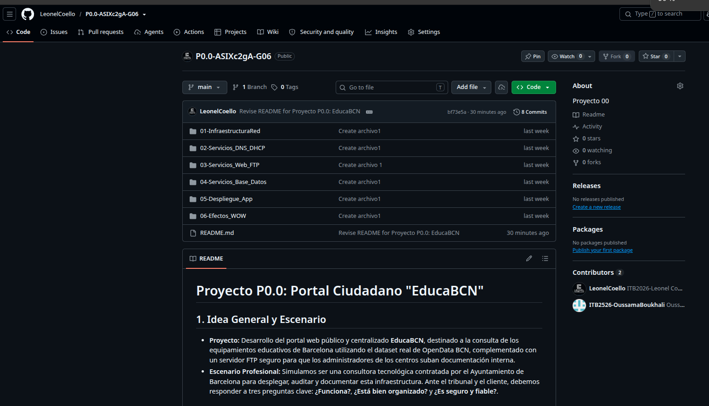

### 3.2 Backlog y tablero Kanban

El trabajo se gestiona en ProofHub con un tablero de seis columnas: *Pendiente (To Do)*, *Asignadas sprint*, *En curso (Doing)*, *Bloqueadas (Block)*, *Pendiente de revisión (Review)* y *Finalizadas (Done)*. Las tareas del sprint se asignan a los miembros del equipo y avanzan de columna según su estado.

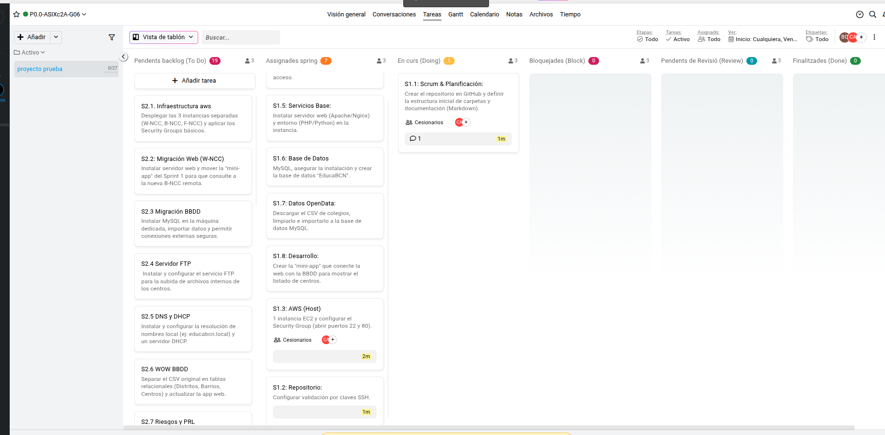

Estado del tablero durante el sprint, con las primeras tareas ya finalizadas:

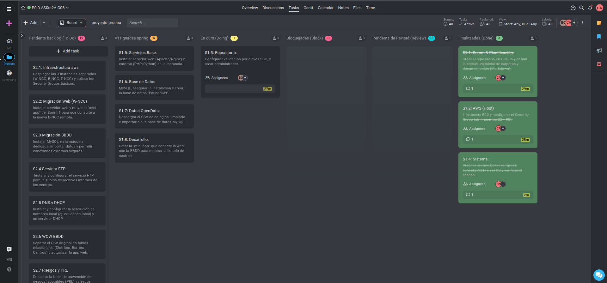

### 3.3 Fases del sprint

| Fase | Contenido | Estado |
|---|---|---|
| Scrum y planificación | Estructura del repositorio y backlog inicial | Finalizado |
| Repositorio | Conexión con GitHub mediante clave SSH | Finalizado |
| Servidor en AWS | Creación de la instancia y reglas de red | Finalizado |
| Sistema | Usuarios administradores y acceso remoto | Finalizado |

El backlog del siguiente sprint ya está definido: despliegue en tres instancias separadas (red de aplicación, base de datos y FTP), DNS y DHCP internos, servidor FTP y análisis de riesgos.

## 4. Servidor en AWS

### 4.1 Creación de la instancia

Se lanza una instancia EC2 con las siguientes características:

| Elemento | Valor |
|---|---|
| Nombre | B-NCC-App |
| Imagen (AMI) | Ubuntu Server 24.04 LTS (HVM), SSD, Free tier |
| Usuario inicial | `ubuntu` |
| Red | VPC por defecto de la cuenta, subred por defecto |
| IP pública | Asignación automática habilitada |
| Par de claves | `claves-educabcn` (formato PEM) |
| Security Group | `launch-wizard-1` (grupo nuevo) |

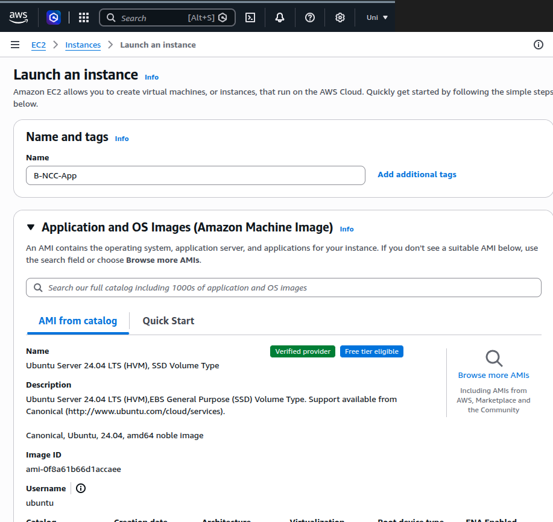

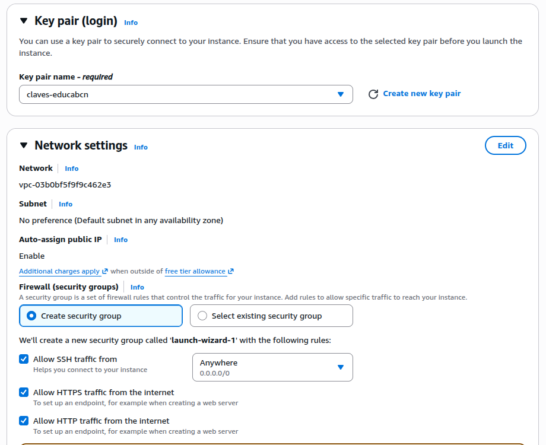

### 4.2 Reglas de red (Security Group)

El Security Group actúa como cortafuegos de la instancia. Solo se permite el tráfico imprescindible:

| Puerto | Protocolo | Origen | Uso |
|---|---|---|---|
| 22 | TCP (SSH) | 0.0.0.0/0 | Administración remota |
| 80 | TCP (HTTP) | 0.0.0.0/0 | Acceso web |
| 443 | TCP (HTTPS) | 0.0.0.0/0 | Reservado para el acceso cifrado |

Cualquier otro puerto, incluido el de la base de datos, permanece cerrado hacia Internet.

## 5. Acceso remoto y usuarios

### 5.1 Acceso por SSH con clave

El acceso inicial se hace con el usuario `ubuntu` y el fichero de clave privada. La clave debe tener permisos restringidos, o SSH la rechaza:

```bash
chmod 400 claves-educabcn.pem
ssh -i claves-educabcn.pem ubuntu@<IP_PUBLICA>
```

> El fichero `.pem` es privado. **No se sube al repositorio** y se entrega al cliente solo por un canal seguro.

### 5.2 Usuario administrador del proyecto

Se crea un usuario propio para la administración, de modo que no se trabaje de forma habitual con el usuario genérico de la imagen:

```bash
sudo useradd -m -s /bin/bash edbcn_admin
sudo passwd edbcn_admin
sudo usermod -aG sudo edbcn_admin
```

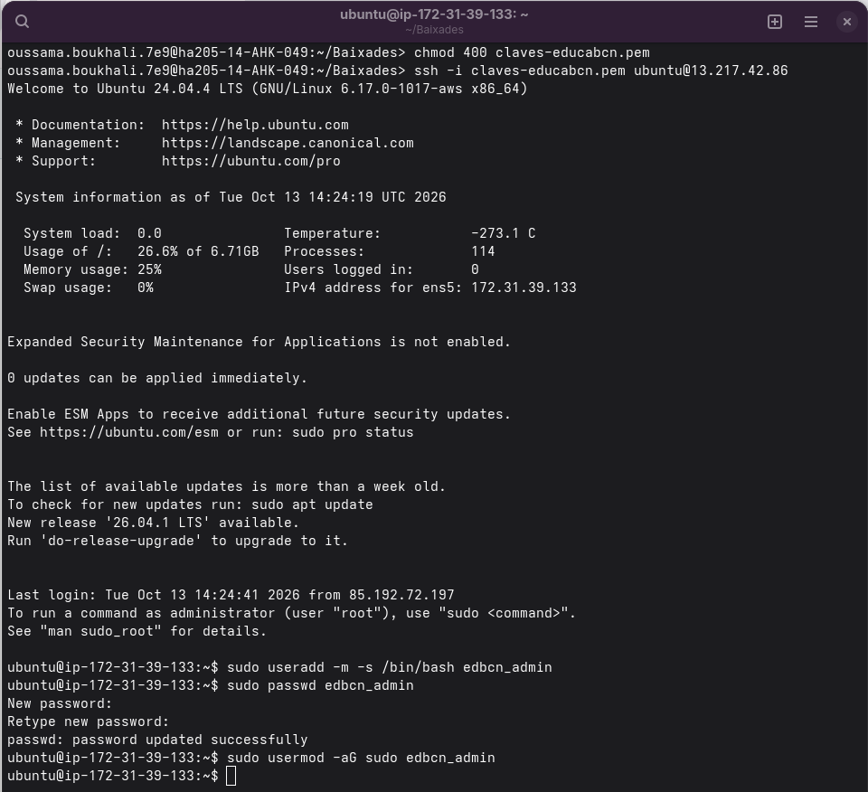

### 5.3 Usuario de verificación `bchecker`

Se crea un segundo usuario con permisos de administrador para que el servidor pueda ser comprobado externamente:

```bash
sudo adduser bchecker
sudo usermod -aG sudo bchecker
```

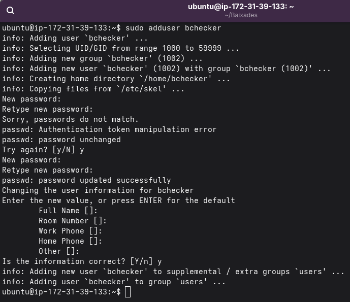

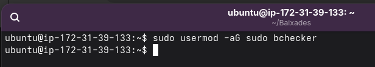

Para que este usuario pueda entrar con contraseña se activa `PasswordAuthentication yes` en `/etc/ssh/sshd_config` y se reinicia el servicio SSH:

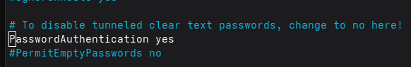

```bash
sudo systemctl restart ssh
```

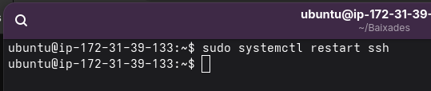

Verificación del acceso con el nuevo usuario:

```bash
ssh bchecker@<IP_PUBLICA>
whoami
```

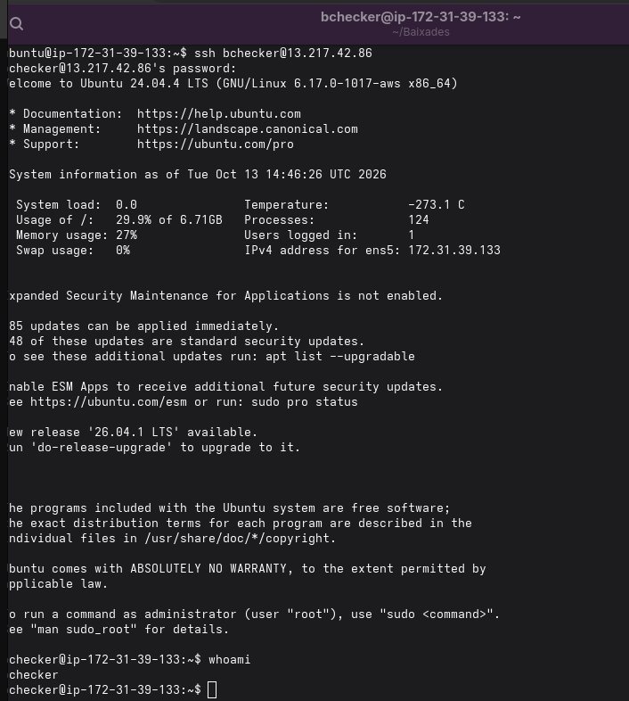

### 5.4 Resumen de usuarios

| Usuario | Función | Permisos | Método de acceso |
|---|---|---|---|
| `ubuntu` | Usuario inicial de la AMI | sudo | Clave PEM |
| `edbcn_admin` | Administración del proyecto | sudo | Clave / contraseña |
| `bchecker` | Verificación externa | sudo | Contraseña |

## 6. Conexión del servidor con GitHub

El servidor necesita descargar el código del repositorio. Para ello se genera una clave SSH propia y se registra en GitHub como **deploy key de solo lectura**, que da acceso a un único repositorio y no permite modificarlo.

```bash
sudo apt install git -y
ssh-keygen -t ed25519 -C "edbcn"
cat ~/.ssh/id_ed25519.pub
```

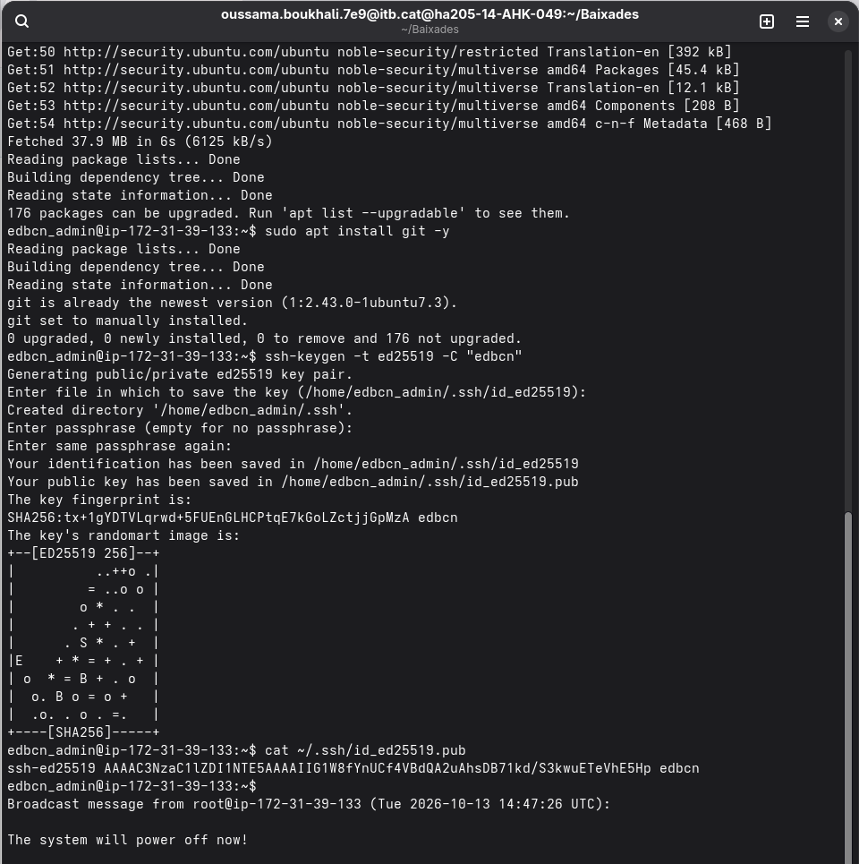

La clave pública se añade en *Settings → Deploy keys* del repositorio:

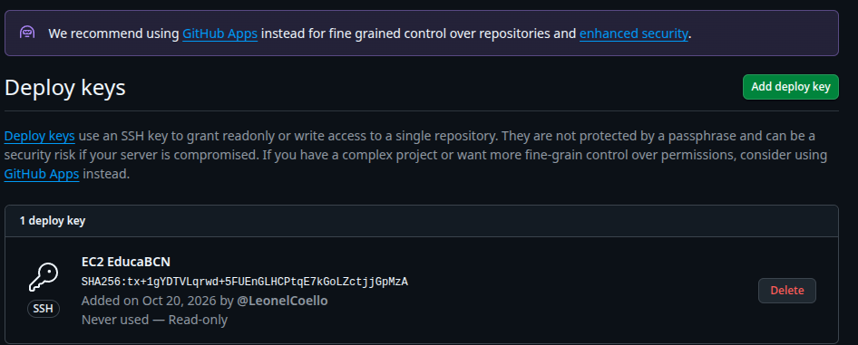

Se comprueba la autenticación y se clona el repositorio:

```bash
ssh -T git@github.com
git clone git@github.com:LeonelCoello/P0.0-ASIXc2gA-G06.git
```

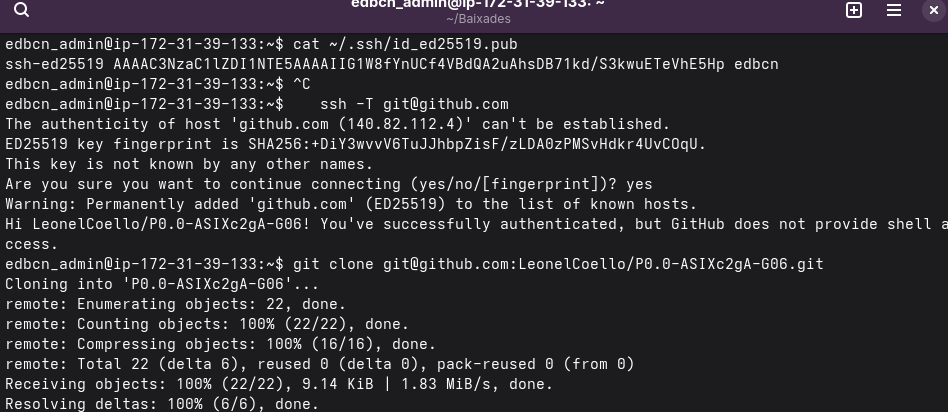

### Comprobación del flujo de trabajo

Para validar el ciclo completo se clona el repositorio en un equipo local, se realiza un cambio, se sube a GitHub y se comprueba que el commit aparece en el repositorio.

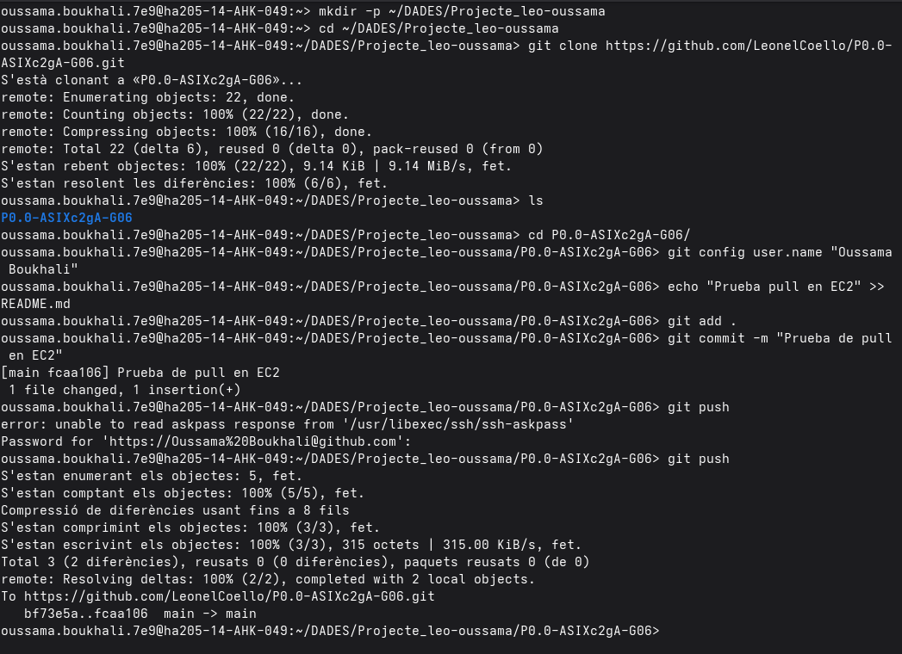

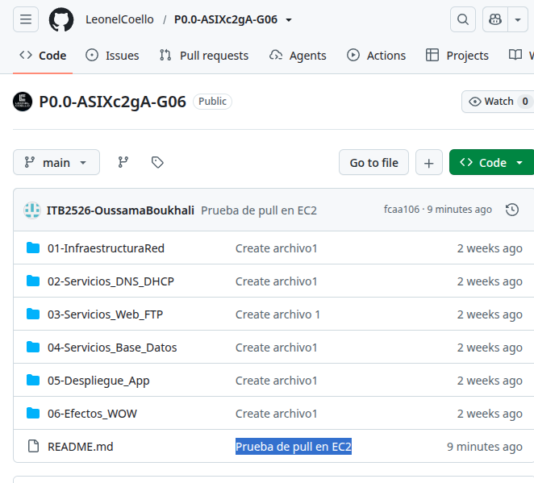

## 7. Criterios de rendimiento y disponibilidad

| Criterio | Objetivo | Cómo se comprueba |
|---|---|---|
| Disponibilidad del acceso remoto | Conexión SSH correcta en cualquier momento | `ssh -i claves-educabcn.pem ubuntu@<IP_PUBLICA>` |
| Carga del sistema | Por debajo de 1.0 en reposo | Resumen de bienvenida al iniciar sesión |
| Uso de memoria | Por debajo del 50 % | Resumen de bienvenida o `free -h` |
| Uso de disco | Por debajo del 70 % | Resumen de bienvenida o `df -h` |
| Sincronización con el repositorio | Clonado, commit y push sin errores | Flujo descrito en la sección 6 |

Valores observados en el sprint: carga del sistema 0.0, memoria entre el 25 % y el 27 %, disco entre el 26 % y el 30 % de 6,71 GB.

## 8. Plan de pruebas y validación

| Prueba | Procedimiento | Resultado |
|---|---|---|
| Acceso SSH con clave PEM | `ssh -i` con usuario `ubuntu` | Correcto |
| Creación de usuario administrador | Alta de `edbcn_admin` y pertenencia al grupo `sudo` | Correcto |
| Acceso con usuario `bchecker` | SSH por contraseña y `whoami` | Correcto |
| Autenticación con GitHub | `ssh -T git@github.com` | Correcto |
| Clonado desde la instancia | `git clone` por SSH | Correcto |
| Flujo commit y push | Cambio en local y comprobación en GitHub | Correcto |

Las pruebas de **automatización, contingencia y monitorización** se planifican para el siguiente sprint, cuando la arquitectura se separe en varias instancias.

## 9. Seguridad aplicada

- Autenticación inicial mediante par de claves con permisos `400`.
- Security Group limitado a los puertos 22, 80 y 443.
- Deploy key de GitHub en modo solo lectura.
- Usuario de administración propio, distinto del usuario genérico de la imagen.
- Clave privada excluida del repositorio.

## 10. Riesgos identificados y mejoras previstas

| Riesgo | Impacto | Mejora prevista |
|---|---|---|
| SSH abierto a todo Internet (0.0.0.0/0) | Alto: exposición a ataques de fuerza bruta | Restringir el origen a IPs concretas y separar Security Groups por rol |
| Acceso SSH por contraseña activo | Alto | Volver a autenticación solo por clave o añadir protección contra fuerza bruta (por ejemplo, fail2ban) |
| `bchecker` con permisos de administrador | Medio | Aplicar el principio de mínimo privilegio y retirar `sudo` tras la verificación |
| IP pública dinámica | Medio: cambia al reiniciar la instancia | Asignar una IP elástica y configurar DNS interno |
| Una sola instancia para todos los servicios | Medio: único punto de fallo | Separar en tres instancias con Security Groups propios |
| Instancia sin actualizar (kernel pendiente) | Medio | Actualizar paquetes y reiniciar de forma planificada |
| Repositorio público | Medio: riesgo de publicar credenciales | No subir claves ni contraseñas y revisar los ficheros antes de cada commit |
| Pérdida de la clave PEM | Alto: pérdida del acceso inicial | Guardar copia en un lugar seguro y limitar quién la posee |

## 11. Documentación para el cliente

**¿Qué se ha entregado en este bloque?** Un servidor Linux en la nube, accesible de forma remota y segura, sobre el que se instalarán los servicios del portal. El código del proyecto se gestiona en un repositorio con control de versiones.

**Mantenimiento recomendado:**
- Actualizar el sistema periódicamente (`sudo apt update && sudo apt upgrade`) y reiniciar cuando se actualice el kernel.
- Revisar los usuarios con permisos de administrador y eliminar los que ya no sean necesarios.
- Guardar la clave PEM en un lugar seguro y no compartirla por medios inseguros.

**Problemas frecuentes:**

| Síntoma | Causa probable | Solución |
|---|---|---|
| `Permissions are too open` al conectar | La clave PEM tiene permisos demasiado amplios | `chmod 400 claves-educabcn.pem` |
| `Connection timed out` | Instancia apagada, IP pública distinta o puerto 22 cerrado | Comprobar el estado y la IP actual en la consola de AWS y las reglas del Security Group |
| `Permission denied (publickey)` | Usuario o clave incorrectos | Usar el usuario `ubuntu` con la clave correcta |
| `Permission denied` al clonar | La deploy key no está registrada en el repositorio | Añadir la clave pública en *Settings → Deploy keys* |

## 12. Documentación para el administrador

**Conexión a la instancia**

```bash
chmod 400 claves-educabcn.pem
ssh -i claves-educabcn.pem ubuntu@<IP_PUBLICA>
```

**Gestión de usuarios**

```bash
sudo adduser <usuario>              # crear usuario
sudo usermod -aG sudo <usuario>     # dar permisos de administrador
sudo deluser <usuario> sudo         # retirar permisos de administrador
```

**Configuración de SSH**

- Fichero: `/etc/ssh/sshd_config`
- Para habilitar o deshabilitar la contraseña, modificar `PasswordAuthentication yes|no`.
- Aplicar los cambios con `sudo systemctl restart ssh`.

**Acceso al repositorio**

- Clave en la instancia: `~/.ssh/id_ed25519` (privada) y `~/.ssh/id_ed25519.pub` (pública).
- La clave pública está registrada como deploy key de solo lectura. Para rotarla, generar una nueva con `ssh-keygen`, añadirla en GitHub y eliminar la anterior.

**Dependencias de esta fase:** instancia EC2 con Ubuntu Server 24.04 LTS, Security Group con los puertos 22, 80 y 443, par de claves `claves-educabcn` y acceso a GitHub.

