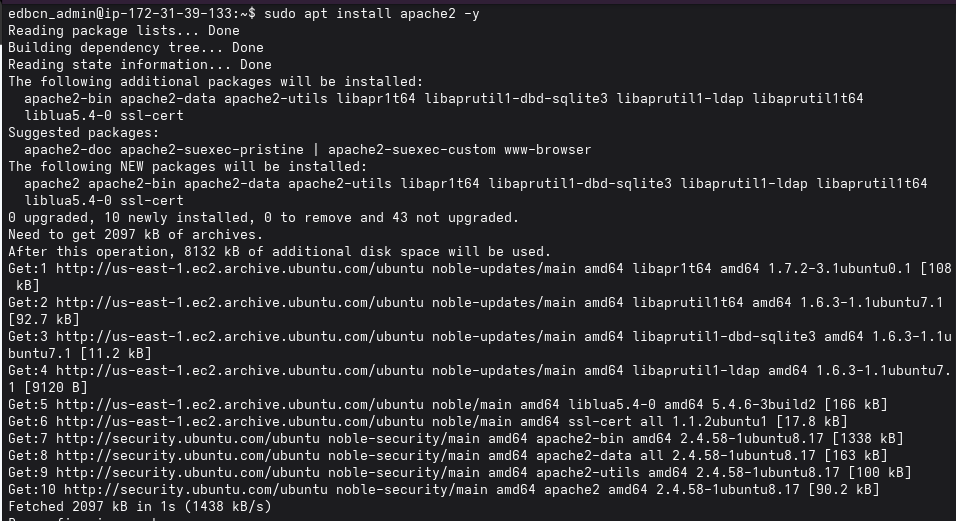

# 03 - Servicios Web · Proyecto P0.0 EducaBCN

**Grupo:** G06 · ASIXc 2A

**Equipo:** Leonel Coello · Oussama Boukhali

**Contenido:** Sprint 1 · Servidor web Apache y entorno PHP

\---

## 1\. Alcance de este documento

Este documento recoge la instalación y verificación del **servidor web** del proyecto durante el primer sprint: Apache como servidor HTTP y PHP como lenguaje de la aplicación, sobre la instancia de AWS descrita en `01-InfraestructuraRed`.

**Objetivos de este bloque:**

* Instalar un servidor web accesible desde Internet.
* Instalar el entorno PHP integrado con Apache y con soporte para MySQL.
* Verificar que el servidor procesa código PHP correctamente.

> La puesta en marcha del servidor FTP está planificada para el siguiente sprint y se documentará en esta misma carpeta.

## 2\. Tecnologías elegidas y justificación

|Componente|Tecnología|Justificación|
|-|-|-|
|Servidor web|Apache 2.4|Estable, muy extendido y con abundante documentación. Se integra con PHP mediante módulo|
|Lenguaje|PHP 8.3|Versión incluida en Ubuntu 24.04 LTS, con soporte oficial de la distribución y actualizaciones de seguridad|
|Integración con Apache|`libapache2-mod-php`|Apache procesa los ficheros `.php` directamente, sin servicios adicionales|
|Conexión con la base de datos|`php-mysql` (extensiones `mysqli` y `pdo\\\\\\\_mysql`)|Permite a la aplicación consultar MySQL|

## 3\. Instalación del servidor web

Se instala Apache desde los repositorios oficiales de Ubuntu:

```bash
sudo apt install apache2 -y
```



El puerto 80 ya está permitido en el Security Group de la instancia (ver `01-InfraestructuraRed`), por lo que el servidor es accesible desde `http://<IP\\\\\\\_PUBLICA>`.

## 4\. Instalación del entorno PHP

Se instala PHP junto con el módulo de Apache y la extensión para MySQL:

```bash
sudo apt install php libapache2-mod-php php-mysql -y
```

!\[Instalación de PHP](img/02-php-instalacion.png)

Para aplicar los cambios se reinicia Apache:

```bash
sudo systemctl restart apache2
```

!\[Reinicio de Apache](img/03-restart-apache.png)

## 5\. Verificación del funcionamiento de PHP

Se crea un fichero de prueba en el directorio raíz del servidor web:

```bash
sudo nano /var/www/html/info.php
```

```php
<?php
phpinfo();
?>
```

!\[Fichero de prueba info.php](img/04-info-php-nano.png)

Al abrir `http://<IP\\\\\\\_PUBLICA>/info.php` en el navegador se muestra la página de información de PHP, lo que confirma que Apache entrega el contenido ya procesado: PHP 8.3.6 con el manejador *Apache 2.0 Handler* y las extensiones de MySQL cargadas (`mysqli`, `mysqlnd`, `pdo\\\\\\\_mysql`).

!\[Página phpinfo en el navegador](img/05-info-php-navegador.png)

> El fichero `info.php` expone información interna del servidor. Es solo una prueba y \\\\\\\*\\\\\\\*debe eliminarse\\\\\\\*\\\\\\\* una vez verificado:
> ```bash
> sudo rm /var/www/html/info.php
> ```

## 6\. Criterios de rendimiento y disponibilidad

|Criterio|Objetivo|Cómo se comprueba|
|-|-|-|
|Servicio web activo|Apache en estado `active (running)` y habilitado al arranque|`systemctl status apache2`|
|Disponibilidad HTTP|El servidor responde en el puerto 80|Acceso desde navegador a `http://<IP\\\\\\\_PUBLICA>`|
|Procesamiento de PHP|Los ficheros `.php` se ejecutan en el servidor|Prueba con `phpinfo()`|
|Uso de recursos|Memoria por debajo del 50 % y carga del sistema por debajo de 1.0|Resumen de recursos al iniciar sesión por SSH|

## 7\. Plan de pruebas y validación

|Prueba|Procedimiento|Resultado|
|-|-|-|
|Instalación de Apache|`apt install apache2` sin errores|Correcto|
|Instalación de PHP|`apt install php libapache2-mod-php php-mysql` sin errores|Correcto|
|Aplicación de cambios|`systemctl restart apache2` sin errores|Correcto|
|Procesamiento de PHP|`info.php` desde el navegador|Correcto (PHP 8.3.6)|
|Extensiones de MySQL|Comprobación en la salida de `phpinfo()`|Correcto|

## 8\. Riesgos identificados y mejoras previstas

|Riesgo|Impacto|Mejora prevista|
|-|-|-|
|Tráfico solo en HTTP, sin cifrar|Medio|Activar HTTPS en el puerto 443 con certificado|
|Fichero `info.php` accesible públicamente|Medio: revela versiones y rutas|Eliminarlo tras la verificación|
|Cabeceras de Apache que revelan la versión|Bajo|Reducir la información con `ServerTokens Prod` y `ServerSignature Off`|
|Kernel pendiente de actualizar tras la instalación|Medio|Reiniciar la instancia de forma planificada|
|Un único servidor web, sin redundancia|Medio: único punto de fallo|Separar servicios en instancias distintas en el siguiente sprint|
|IP pública dinámica|Bajo: la URL cambia al reiniciar|Asignar una IP elástica y configurar DNS interno|

## 9\. Documentación para el cliente

**¿Qué se ha entregado en este bloque?** Un servidor web funcionando en la nube, preparado para publicar la aplicación del portal. En esta fase aún no muestra contenido propio: la aplicación se despliega en el bloque correspondiente.

**Mantenimiento recomendado:**

* Mantener el sistema actualizado con `sudo apt update \\\\\\\&\\\\\\\& sudo apt upgrade`.
* Comprobar de forma periódica que el servicio está activo con `systemctl status apache2`.
* No dejar ficheros de prueba en el directorio web.

**Problemas frecuentes:**

|Síntoma|Causa probable|Solución|
|-|-|-|
|La página no carga|Instancia apagada, IP pública cambiada o puerto 80 cerrado|Comprobar el estado y la IP en AWS y las reglas del Security Group|
|El navegador descarga el `.php` en lugar de mostrarlo|PHP no cargado en Apache|Reiniciar con `sudo systemctl restart apache2`|
|Aviso «No seguro» en el navegador|El sitio funciona por HTTP|Activar HTTPS (mejora prevista)|

## 10\. Documentación para el administrador

**Gestión del servicio**

```bash
sudo systemctl status apache2     # estado
sudo systemctl restart apache2    # reiniciar (tras cambios)
sudo systemctl enable apache2     # arranque automático
```

**Rutas principales**

|Elemento|Ruta|
|-|-|
|Directorio web|`/var/www/html/`|
|Configuración de PHP para Apache|`/etc/php/8.3/apache2/php.ini`|
|Módulos de PHP activos|`/etc/php/8.3/apache2/conf.d/`|
|Configuración de Apache|`/etc/apache2/`|
|Registros de Apache|`/var/log/apache2/`|

**Dependencias de esta fase:** instancia EC2 con Ubuntu Server 24.04 LTS, puerto 80 abierto en el Security Group y paquetes `apache2`, `php`, `libapache2-mod-php` y `php-mysql`.

