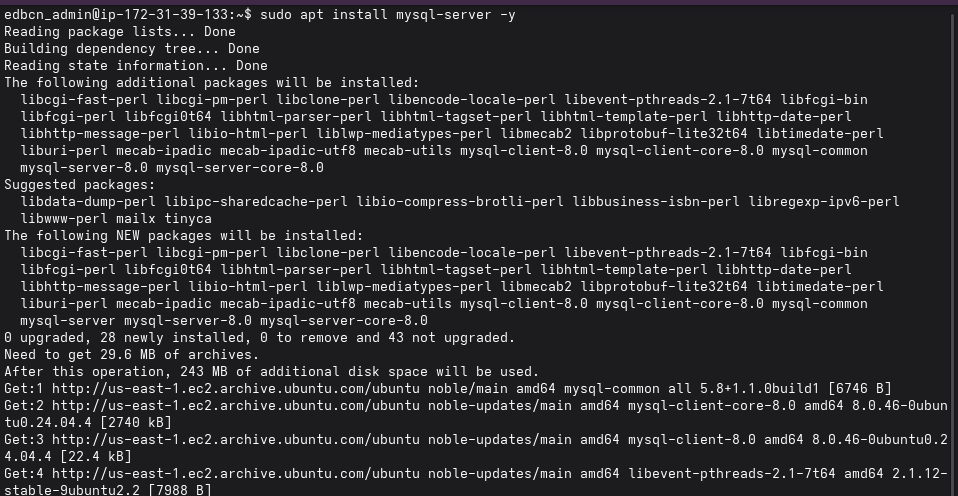
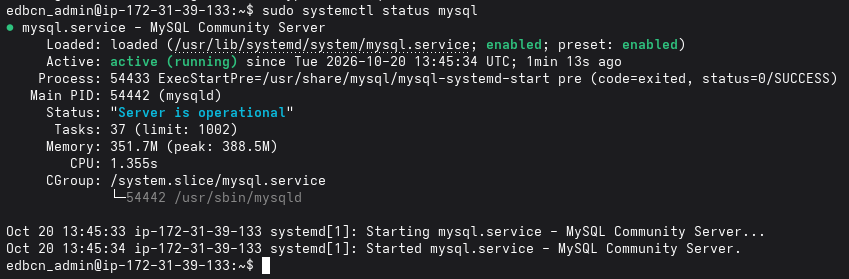
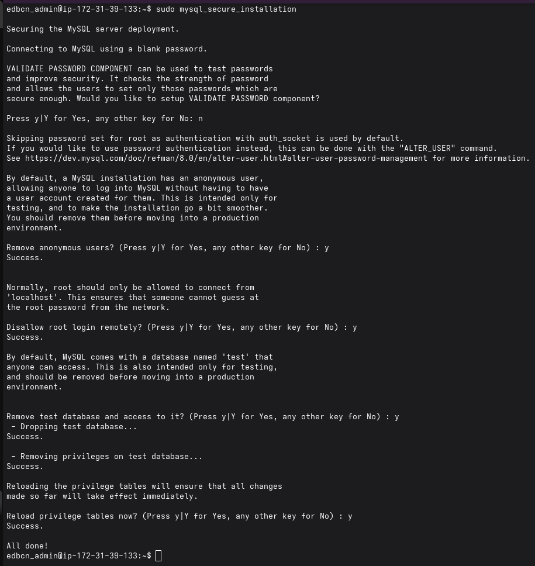
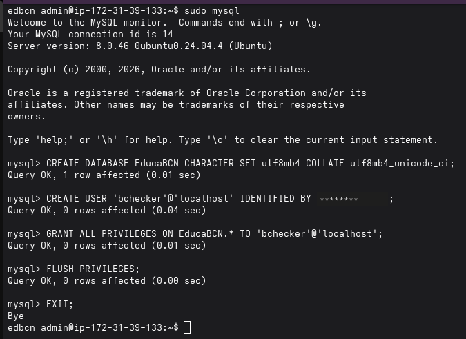
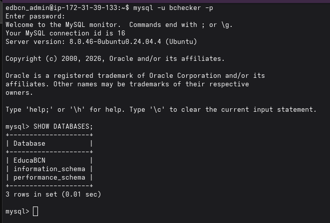
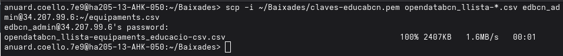
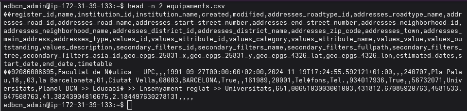
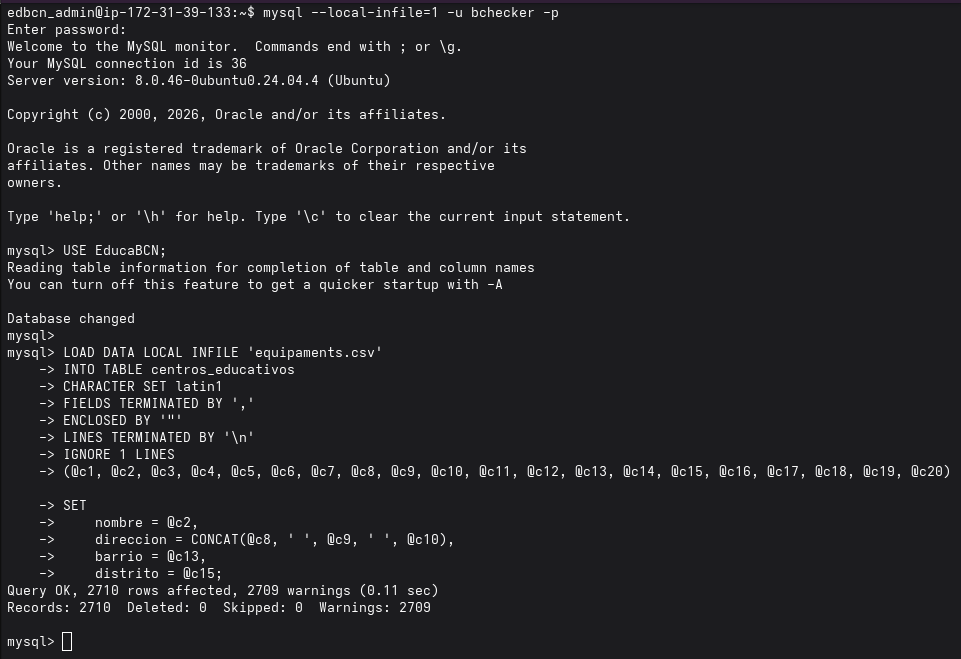
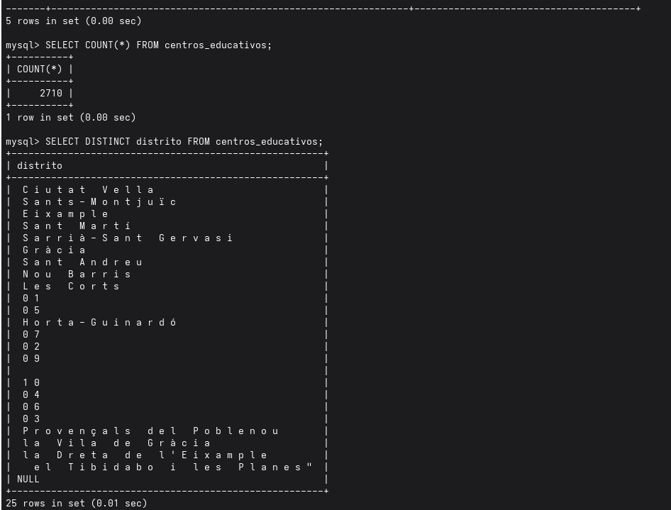
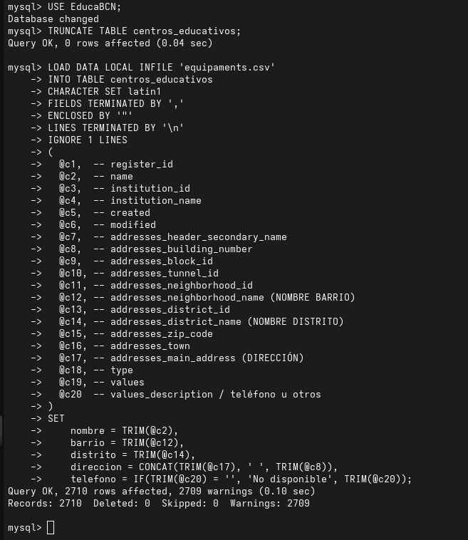

# 04 - Servicios de Base de Datos · Proyecto P0.0 EducaBCN

**Grupo:** G06 · ASIXc 2A

**Equipo:** Leonel Coello · Oussama Boukhali

**Contenido:** Sprint 1 · MySQL, base de datos `EducaBCN` y carga del dataset de OpenData BCN

---

## 1. Alcance de este documento

Este documento recoge la instalación y el aseguramiento del **servidor de base de datos**, la creación de la base de datos y del usuario de aplicación, y la **carga del dataset oficial de equipamientos educativos** de OpenData BCN durante el primer sprint. Todo ello sobre la instancia de AWS descrita en `01-InfraestructuraRed`.

**Objetivos de este bloque:**
- Instalar MySQL y comprobar que el servicio funciona.
- Asegurar la instalación inicial.
- Crear la base de datos del proyecto y un usuario con permisos limitados.
- Cargar el dataset de centros educativos y validar los datos.

## 2. Tecnologías elegidas y justificación

| Componente | Tecnología | Justificación |
|---|---|---|
| Motor de base de datos | MySQL 8.0 | Motor relacional muy extendido, adecuado para datos tabulares como el CSV de OpenData, y disponible en los repositorios de Ubuntu 24.04 |
| Codificación | `utf8mb4` | Admite todos los caracteres, necesarios para nombres con acentos y apóstrofos en catalán |
| Origen de los datos | OpenData BCN (CSV) | Fuente oficial y pública del Ayuntamiento |
| Transferencia de ficheros | `scp` | Copia cifrada sobre SSH, sin servicios adicionales |
| Carga masiva | `LOAD DATA LOCAL INFILE` | Importa miles de filas en una sola operación y permite transformar columnas durante la carga |

## 3. Instalación de MySQL

```bash
sudo apt install mysql-server -y
```



Se comprueba que el servicio está activo y habilitado al arranque:

```bash
sudo systemctl status mysql
```



## 4. Aseguramiento de la instalación

Se ejecuta el asistente de seguridad de MySQL:

```bash
sudo mysql_secure_installation
```

Opciones aplicadas:

| Opción | Decisión |
|---|---|
| Componente de validación de contraseñas | No |
| Eliminar usuarios anónimos | Sí |
| Deshabilitar el acceso remoto de `root` | Sí |
| Eliminar la base de datos `test` | Sí |
| Recargar las tablas de privilegios | Sí |

La cuenta `root` de MySQL se mantiene con autenticación por socket (`auth_socket`): solo se accede a ella desde el propio servidor con `sudo mysql`.



## 5. Creación de la base de datos y del usuario de aplicación

```sql
CREATE DATABASE EducaBCN CHARACTER SET utf8mb4 COLLATE utf8mb4_unicode_ci;
CREATE USER 'bchecker'@'localhost' IDENTIFIED BY '<CONTRASEÑA>';
GRANT ALL PRIVILEGES ON EducaBCN.* TO 'bchecker'@'localhost';
FLUSH PRIVILEGES;
```



El usuario solo puede conectarse desde `localhost` y tiene privilegios únicamente sobre la base de datos `EducaBCN`.

Comprobación de la conexión con ese usuario:

```bash
mysql -u bchecker -p
```
```sql
SHOW DATABASES;
```



## 6. Carga del dataset de OpenData BCN

### 6.1 Transferencia del fichero

El CSV de equipamientos educativos se descarga desde OpenData BCN en el equipo local y se copia a la instancia con `scp`:

```bash
scp -i claves-educabcn.pem opendatabcn_llista-*.csv edbcn_admin@<IP_PUBLICA>:~/equipaments.csv
```



### 6.2 Revisión del fichero

Antes de cargarlo se inspecciona la cabecera y la primera fila para identificar las columnas útiles:

```bash
head -n 2 equipaments.csv
```



### 6.3 Primera carga

Se carga el fichero con el usuario de aplicación, habilitando la carga local de ficheros:

```bash
mysql --local-infile=1 -u bchecker -p
```
```sql
USE EducaBCN;
LOAD DATA LOCAL INFILE 'equipaments.csv'
INTO TABLE centros_educativos
CHARACTER SET latin1
FIELDS TERMINATED BY ',' ENCLOSED BY '"'
LINES TERMINATED BY '\n'
IGNORE 1 LINES
(@c1, @c2, ..., @c20)
SET nombre = @c2, direccion = CONCAT(@c8,' ',@c9,' ',@c10), barrio = @c13, distrito = @c15;
```



El resultado fue de 2.710 filas cargadas.

### 6.4 Validación de los datos

Tras la carga se revisaron los datos con consultas de control:

```sql
SELECT COUNT(*) FROM centros_educativos;
SELECT DISTINCT distrito FROM centros_educativos;
```



El recuento confirmó los 2.710 registros, pero la consulta de distritos mostró **valores incorrectos**: códigos numéricos (`01`, `02`, ...), valores vacíos y fragmentos de nombres de barrio. Esto indicaba que las columnas del CSV se estaban asignando a campos equivocados.

### 6.5 Recarga con el mapeo corregido

Se vació la tabla y se repitió la carga indicando explícitamente qué columna del CSV corresponde a cada campo (nombre, barrio, distrito, dirección y teléfono). Los espacios sobrantes se eliminan con `TRIM` y, si un centro no tiene teléfono, se guarda el valor «No disponible».

```sql
USE EducaBCN;
TRUNCATE TABLE centros_educativos;

LOAD DATA LOCAL INFILE 'equipaments.csv'
INTO TABLE centros_educativos
CHARACTER SET latin1
FIELDS TERMINATED BY ',' ENCLOSED BY '"'
LINES TERMINATED BY '\n'
IGNORE 1 LINES
(
  @c1, @c2, @c3, @c4, @c5, @c6, @c7, @c8, @c9, @c10,
  @c11, @c12, @c13, @c14, @c15, @c16, @c17, @c18, @c19, @c20
)
SET
    nombre    = TRIM(@c2),
    barrio    = TRIM(@c12),
    distrito  = TRIM(@c14),
    direccion = CONCAT(TRIM(@c17), ' ', TRIM(@c8)),
    telefono  = IF(TRIM(@c20) = '', 'No disponible', TRIM(@c20));
```



### 6.6 Estructura de la tabla

La tabla `centros_educativos` contiene los campos que usa la aplicación:

| Campo | Contenido |
|---|---|
| `id` | Identificador del registro |
| `nombre` | Nombre del centro |
| `distrito` | Distrito de Barcelona |
| `barrio` | Barrio |
| `direccion` | Dirección postal |
| `telefono` | Teléfono o «No disponible» |

## 7. Criterios de rendimiento y disponibilidad

| Criterio | Objetivo | Cómo se comprueba |
|---|---|---|
| Servicio activo | MySQL en estado `active (running)` y habilitado al arranque | `systemctl status mysql` |
| Acceso restringido | Solo conexiones locales | Usuario creado para `localhost` y puerto 3306 cerrado en el Security Group |
| Integridad de la carga | Registros cargados igual a las filas del CSV | `SELECT COUNT(*)` frente a `wc -l equipaments.csv` |
| Consultas ágiles | Respuesta inmediata sobre 2.710 registros | Tiempos mostrados por el cliente de MySQL (centésimas de segundo) |
| Uso de recursos | Memoria por debajo del 50 % | `systemctl status mysql` y resumen de SSH |

## 8. Plan de pruebas y validación

| Prueba | Procedimiento | Resultado |
|---|---|---|
| Servicio MySQL | `systemctl status mysql` | `active (running)` |
| Aseguramiento | `mysql_secure_installation` completado | Correcto |
| Creación de la base de datos | `SHOW DATABASES` con `bchecker` | `EducaBCN` visible |
| Permisos del usuario | Conexión con `bchecker` | Correcto, con acceso solo a `EducaBCN` |
| Transferencia del CSV | `scp` al servidor | Correcto (100 %) |
| Carga de datos | `LOAD DATA LOCAL INFILE` | 2.710 filas |
| Calidad de los datos | `SELECT DISTINCT distrito` | Incidencia detectada y corregida con la recarga |

## 9. Seguridad aplicada

- Instalación asegurada: sin usuarios anónimos, sin base de datos `test` y sin acceso remoto de `root`.
- Usuario de aplicación limitado a `localhost` y a la base de datos `EducaBCN`.
- Puerto 3306 no expuesto en el Security Group.
- Contraseñas fuera de la documentación y del repositorio.

## 10. Riesgos identificados y mejoras previstas

| Riesgo | Impacto | Mejora prevista |
|---|---|---|
| Usuario de aplicación con `ALL PRIVILEGES` | Medio | Reducir a `SELECT` para la aplicación web y usar otro usuario para la carga |
| Contraseña débil del usuario de aplicación | Alto | Usar una contraseña robusta y guardarla fuera del código |
| Validación de contraseñas desactivada | Medio | Activar el componente `VALIDATE PASSWORD` |
| Calidad de datos del CSV (campos vacíos y códigos numéricos) | Medio | Normalizar en tablas relacionales (Distritos, Barrios, Centros) en el siguiente sprint |
| Carga con avisos (`Warnings`) | Bajo | Revisarlos con `SHOW WARNINGS` y ajustar tipos de columna |
| Codificación del CSV (`latin1`) | Medio: caracteres acentuados | Convertir el fichero a UTF-8 antes de cargar y comprobar acentos |
| Carga local de ficheros habilitada (`local-infile`) | Bajo | Habilitarla solo durante la carga |
| Base de datos y web en la misma instancia | Medio | Mover MySQL a una instancia propia en el siguiente sprint |
| Sin copias de seguridad | Alto | Programar copias con `mysqldump` |

## 11. Documentación para el cliente

**¿Qué se ha entregado en este bloque?** Una base de datos con los 2.710 equipamientos educativos de Barcelona publicados por el Ayuntamiento en OpenData BCN, listos para ser consultados desde el portal.

**Mantenimiento recomendado:**
- Actualizar el dataset cuando OpenData BCN publique una versión nueva (ver administración, sección 12).
- Realizar copias de seguridad periódicas de la base de datos.
- Mantener el sistema actualizado con `sudo apt update && sudo apt upgrade`.

**Problemas frecuentes:**

| Síntoma | Causa probable | Solución |
|---|---|---|
| `Can't connect to local MySQL server` | Servicio MySQL parado | `sudo systemctl start mysql` |
| `Access denied for user 'bchecker'` | Contraseña incorrecta | Revisar la contraseña o restablecerla con `ALTER USER` |
| `The used command is not allowed` al cargar | `local-infile` desactivado | Conectar con `mysql --local-infile=1 -u bchecker -p` |
| Caracteres extraños en nombres | Codificación del CSV | Recargar indicando la codificación correcta |

## 12. Documentación para el administrador

**Gestión del servicio**

```bash
sudo systemctl status mysql
sudo systemctl restart mysql
sudo mysql                          # acceso como root (auth_socket)
mysql -u bchecker -p                # acceso con el usuario de aplicación
```

**Rutas y datos principales**

| Elemento | Valor |
|---|---|
| Versión | MySQL 8.0 |
| Base de datos | `EducaBCN` (`utf8mb4`, `utf8mb4_unicode_ci`) |
| Tabla principal | `centros_educativos` |
| Usuario de aplicación | `bchecker`@`localhost` |
| Puerto | 3306, solo local |

**Actualización del dataset**

1. Descargar el nuevo CSV de OpenData BCN y copiarlo con `scp`.
2. Conectar con `mysql --local-infile=1 -u bchecker -p` y ejecutar `USE EducaBCN;`.
3. Vaciar la tabla con `TRUNCATE TABLE centros_educativos;`.
4. Repetir la carga de la sección 6.5.
5. Validar con `SELECT COUNT(*)` y `SELECT DISTINCT distrito`.

**Copia de seguridad y restauración**

```bash
mysqldump -u bchecker -p EducaBCN > educabcn_backup.sql
mysql -u bchecker -p EducaBCN < educabcn_backup.sql
```

**Dependencias de esta fase:** paquete `mysql-server`, acceso SSH a la instancia y fichero `equipaments.csv` descargado de OpenData BCN.

