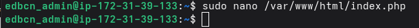
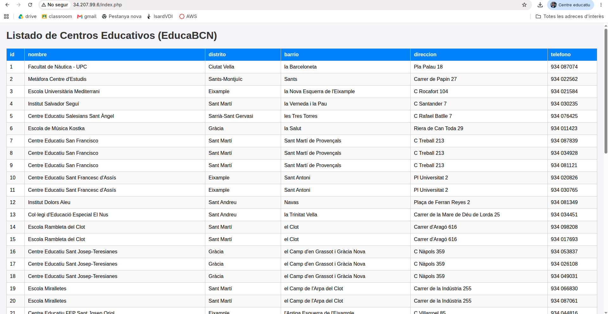

# 05 - Despliegue de la Aplicación · Proyecto P0.0 EducaBCN

**Grupo:** G06 · ASIX c2gA
**Equipo:** Leonel Coello · Oussama Boukhali
**Contenido:** Sprint 1 · Primera versión de la aplicación web que consulta los centros educativos

---

## 1. Alcance de este documento

Este documento recoge el despliegue de la **primera versión de la aplicación** del portal: una página PHP que se conecta a la base de datos `EducaBCN` y muestra el listado de centros educativos. Se apoya en el servidor web (`03-Servicios_Web_FTP`) y en la base de datos cargada (`04-Servicios_Base_Datos`).

**Objetivos de este bloque:**
- Publicar una página que consulte la base de datos de forma segura.
- Mostrar los datos de los centros educativos en una tabla clara.
- Verificar el funcionamiento completo del conjunto: web, PHP y base de datos.

## 2. Tecnologías elegidas y justificación

| Componente | Tecnología | Justificación |
|---|---|---|
| Lenguaje | PHP 8.3 | Ya integrado en Apache, sin servicios adicionales |
| Acceso a datos | PDO (driver MySQL) | Interfaz estándar, con gestión de errores por excepciones y soporte de consultas preparadas |
| Presentación | HTML5 y CSS embebido | Página ligera y sin dependencias externas |
| Escape de datos | `htmlspecialchars()` | Evita la inyección de código HTML o JavaScript a través de los datos (XSS) |

## 3. Funcionamiento de la aplicación

La página `index.php` realiza tres pasos:

1. **Conexión:** se conecta a MySQL en `localhost` con el usuario de aplicación, con codificación `utf8mb4` y errores por excepciones.
2. **Consulta:** obtiene los primeros 50 registros de la tabla `centros_educativos`.
3. **Presentación:** genera una tabla HTML cuyas columnas se construyen a partir de los campos devueltos (`id`, `nombre`, `distrito`, `barrio`, `direccion`, `telefono`). Si no hay registros, muestra un mensaje; si falla la conexión, muestra un error controlado.

## 4. Despliegue

El fichero se crea en el directorio raíz del servidor web:

```bash
sudo nano /var/www/html/index.php
```



Código de la aplicación (la contraseña real no se incluye en el repositorio):

```php
<?php
$host     = 'localhost';
$dbname   = 'EducaBCN';
$user     = 'bchecker';
$password = '<CONTRASEÑA>';

try {
    $pdo = new PDO("mysql:host=$host;dbname=$dbname;charset=utf8mb4", $user, $password);
    $pdo->setAttribute(PDO::ATTR_ERRMODE, PDO::ERRMODE_EXCEPTION);

    // Consulta directa a la tabla de centros
    $stmt = $pdo->query("SELECT * FROM centros_educativos LIMIT 50");
    $centros = $stmt->fetchAll(PDO::FETCH_ASSOC);
} catch (PDOException $e) {
    die("Error de conexión a la base de datos: " . $e->getMessage());
}
?>
<!DOCTYPE html>
<html lang="es">
<head>
    <meta charset="UTF-8">
    <title>Centros Educativos - EducaBCN</title>
    <style>
        body { font-family: Arial, sans-serif; margin: 20px; background-color: #f4f4f9; }
        h1 { color: #333; }
        table { width: 100%; border-collapse: collapse; background: #fff; margin-top: 15px; }
        th, td { padding: 10px; border: 1px solid #ccc; text-align: left; }
        th { background-color: #007bff; color: white; }
        tr:nth-child(even) { background-color: #f9f9f9; }
    </style>
</head>
<body>
    <h1>Listado de Centros Educativos (EducaBCN)</h1>

    <?php if (!empty($centros)): ?>
        <table>
            <thead>
                <tr>
                    <?php foreach (array_keys($centros[0]) as $columna): ?>
                        <th><?php echo htmlspecialchars($columna); ?></th>
                    <?php endforeach; ?>
                </tr>
            </thead>
            <tbody>
                <?php foreach ($centros as $centro): ?>
                    <tr>
                        <?php foreach ($centro as $valor): ?>
                            <td><?php echo htmlspecialchars($valor ?? ''); ?></td>
                        <?php endforeach; ?>
                    </tr>
                <?php endforeach; ?>
            </tbody>
        </table>
    <?php else: ?>
        <p>No se encontraron registros en la base de datos.</p>
    <?php endif; ?>
</body>
</html>
```

## 5. Verificación

La aplicación se abre desde el navegador en `http://<IP_PUBLICA>/index.php`. Muestra el listado de centros con sus campos, con cabecera azul y filas alternas, lo que confirma que Apache, PHP y MySQL funcionan juntos.



## 6. Criterios de rendimiento y disponibilidad

| Criterio | Objetivo | Cómo se comprueba |
|---|---|---|
| Disponibilidad | La página responde con HTTP 200 | Acceso desde el navegador a `http://<IP_PUBLICA>/index.php` |
| Tiempo de respuesta | Menos de 2 segundos para 50 registros | Carga de la página en el navegador |
| Datos correctos | Los campos coinciden con los de la base de datos | Comparar con `SELECT * FROM centros_educativos LIMIT 50;` |
| Robustez ante fallos | Mensaje de error controlado si la base de datos no responde | Parar MySQL y recargar la página |

## 7. Plan de pruebas y validación

| Prueba | Procedimiento | Resultado |
|---|---|---|
| Publicación de la página | Acceso a `index.php` por la IP pública | Correcto |
| Conexión a la base de datos | La página muestra datos reales | Correcto |
| Presentación de columnas | Cabecera generada a partir de los campos | Correcto |
| Caracteres especiales | Acentos y apóstrofos en nombres de centros | Correcto |
| Escape de datos | Uso de `htmlspecialchars()` en cabecera y celdas | Aplicado |

Las pruebas de **automatización, contingencia y monitorización** se planifican para el siguiente sprint, cuando la arquitectura se separe en varias instancias.

## 8. Seguridad aplicada

- Datos escapados antes de mostrarse, para evitar XSS.
- Errores de PDO gestionados con excepciones.
- Base de datos accesible solo desde `localhost`, sin exponer el puerto 3306.
- Contraseña excluida de la documentación y del repositorio.

## 9. Riesgos identificados y mejoras previstas

| Riesgo | Impacto | Mejora prevista |
|---|---|---|
| Credenciales de la base de datos escritas en `index.php` | Alto | Moverlas a un fichero de configuración fuera del directorio web |
| Usuario de aplicación con todos los privilegios | Medio | Usar un usuario con solo `SELECT` para la web |
| El mensaje de error muestra detalles internos | Medio | Mostrar un mensaje genérico y registrar el detalle en un log |
| Solo se muestran 50 registros, sin paginación ni búsqueda | Bajo | Añadir paginación y filtros por distrito y barrio |
| Tráfico en HTTP, sin cifrar | Medio | Activar HTTPS |
| Calidad de datos heredada del CSV | Medio | Normalizar las tablas y adaptar la consulta |
| Aplicación y base de datos en la misma instancia | Medio | Separarlas en instancias distintas |

## 10. Documentación para el cliente

**¿Qué ofrece el portal?** Una página que lista los centros educativos de Barcelona con su nombre, distrito, barrio, dirección y teléfono, a partir de los datos oficiales de OpenData BCN.

**¿Cómo se usa?** Abra en el navegador `http://<IP_PUBLICA>/index.php`. La versión actual muestra los primeros 50 centros.

**Problemas frecuentes:**

| Síntoma | Causa probable | Solución |
|---|---|---|
| La página no carga | Instancia apagada o IP pública distinta | Comprobar el estado y la IP en AWS |
| «Error de conexión a la base de datos» | MySQL parado o credenciales incorrectas | `sudo systemctl start mysql` y revisar las credenciales |
| «No se encontraron registros» | Tabla vacía | Repetir la carga de datos (ver `04-Servicios_Base_Datos`) |
| Caracteres extraños | Codificación de los datos | Recargar el CSV con la codificación correcta |

## 11. Documentación para el administrador

| Elemento | Valor |
|---|---|
| Fichero de la aplicación | `/var/www/html/index.php` |
| Base de datos | `EducaBCN`, tabla `centros_educativos` |
| Usuario de conexión | `bchecker`@`localhost` |
| Registros mostrados | 50 (`LIMIT 50`) |

**Cambios habituales**
- Para mostrar más registros, modificar el `LIMIT` de la consulta.
- Para cambiar la contraseña de la base de datos: `ALTER USER`, y actualizar `$password` en `index.php`.
- Tras editar el fichero no hace falta reiniciar Apache.

**Diagnóstico**

```bash
sudo tail -n 50 /var/log/apache2/error.log    # errores de PHP y Apache
sudo systemctl status apache2 mysql           # estado de los servicios
```

**Dependencias de esta fase:** Apache y PHP con `php-mysql` (`03-Servicios_Web_FTP`) y la base de datos cargada (`04-Servicios_Base_Datos`).

## 12. Siguientes pasos

- Mover las credenciales a un fichero de configuración y reducir privilegios.
- Añadir paginación y filtros por distrito y barrio.
- Separar la aplicación y la base de datos en instancias distintas.
