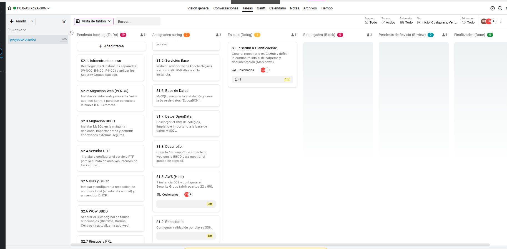

# EducaBCN

## Índice

- [Objetivos y alcance](#objetivos-y-alcance)
- [Tecnologías utilizadas](#tecnologias-utilizadas)
- [Arquitectura y evolución](#arquitectura-y-evolucion)
- [Árbol de la documentación](#arbol-de-la-documentacion)
- [Acceso directo a la documentación](#acceso-directo-a-la-documentacion)
- [Equipo y seguimiento](#equipo-y-seguimiento)
- [Datos de origen y requisitos](#datos-de-origen-y-requisitos)
- [Estado de las evidencias y trabajo pendiente](#estado-de-las-evidencias-y-trabajo-pendiente)


**Portal web de consulta de equipamientos educativos de Barcelona e infraestructura de servidores en AWS.**

EducaBCN es un proyecto del módulo de administración de sistemas informáticos en red. Se ha preparado una pequeña aplicación PHP que consulta los datos de centros educativos importados desde el conjunto oficial de OpenData BCN y los muestra en una tabla HTML. El trabajo incluye planificación con ProofHub, despliegue de servidores Ubuntu en AWS EC2, configuración de servicios de red y documentación técnica en GitHub.

> **Estado de esta documentación:** Sprints 1 y 2 realizados y documentados. La siguiente fase se menciona solamente como **planificación**, sin instrucciones de ejecución ni capturas de dicha fase.

## Objetivos y alcance

- Mostrar datos de equipamientos educativos de Barcelona en un portal accesible desde un navegador.
- Practicar la instalación, administración y comunicación de Apache/PHP, MySQL, SSH, FTP, DNS y DHCP.
- Separar los servicios por servidor, comprobar la conectividad y documentar el proceso con capturas originales.
- Gestionar tareas en ProofHub y mantener código, procedimientos y cambios mediante Git/GitHub.
- Preparar posteriormente un router con DMZ, intranet, NAT y dos clientes de prueba, conforme al enunciado.

La versión probada muestra hasta 50 registros por consulta. No está documentado un buscador interactivo completo ni una aplicación pública con actualización automática.

## Tecnologías utilizadas

| Área | Herramientas | Función |
|---|---|---|
| Infraestructura | AWS EC2, VPC, Security Groups, Ubuntu Server 24.04 LTS | Servidores, red y acceso |
| Aplicación web | Apache 2.4, PHP, PDO | Página `index.php` y consulta de datos |
| Datos | MySQL 8, CSV OpenData BCN | Almacenamiento e importación |
| Servicios | SSH, vsftpd, BIND9, ISC DHCP | Administración, FTP, DNS y DHCP |
| Organización | ProofHub, Git, GitHub, Markdown | Backlog, sprints y versiones |

La elección de herramientas se explica en el [estudio comparativo](docs/estudio-de-tecnologias.md) y la [justificación técnica](docs/justificacion-de-elecciones.md).

## Arquitectura y evolución

**Sprint 1 — Instancia única:** se preparó un servidor Ubuntu en EC2 con Apache, PHP y MySQL, se importó el CSV municipal y se comprobó el primer `index.php` desde el navegador.

**Sprint 2 — Distribución por funciones:** se utilizó **W-NCC** para Apache/PHP, **B-NCC** para MySQL y **F-NCC** para FTP, DNS y DHCP. La aplicación se transfirió mediante SCP y pasó a consultar MySQL de forma remota mediante la cuenta `webapp` de lectura.

```text
                        Navegador
                            |
                           HTTP
                            |
                     W-NCC (Apache/PHP)
                            |
                        TCP/3306
                            |
                       B-NCC (MySQL)

          F-NCC: FTP (vsftpd) · DNS (BIND9) · DHCP (ISC DHCP)

         EC2 / VPC AWS: conectividad y Security Groups
```

**Advertencia arquitectónica:** tres instancias y reglas de AWS no equivalen a una red real segmentada en DMZ, intranet y NAT. El router R-NCC y los dos equipos cliente se contemplan en la planificación posterior. [Ver arquitectura documentada](architecture/README.md).

## Árbol de la documentación

```text
EducaBCN/
├── README.md
├── MIGRACION_A_GITHUB.md
├── architecture/
│   └── README.md
├── docs/
│   ├── README.md
│   ├── objetivos-y-necesidades.md
│   ├── analisis-de-mercado.md
│   ├── estudio-de-tecnologias.md
│   ├── justificacion-de-elecciones.md
│   ├── planificacion.md
│   ├── recursos-y-presupuesto.md
│   ├── control-versiones.md
│   ├── riesgos-laborales.md
│   ├── contingencia.md
│   ├── manual-cliente.md
│   └── manual-administrador.md
├── infrastructure/
│   ├── red/               (Sprint 1 y 2)
│   ├── web/               (Sprint 1 y 2)
│   ├── base-datos/        (Sprint 1 y 2)
│   ├── ftp/               (Sprint 2)
│   ├── dns-dhcp/          (Sprint 2)
│   └── aplicacion/
│       ├── sprint-01.md
│       ├── sprint-02.md
│       └── codigo/
│           ├── sprint-01/index.php
│           └── sprint-02/index.php
├── security/
│   └── configuracion-accesos.md
├── tests/
│   ├── pruebas-sprint-01.md
│   ├── pruebas-sprint-02.md
│   └── criterios-rendimiento-disponibilidad.md
├── media/
│   ├── sprint-01/        (capturas originales y ProofHub)
│   └── sprint-02/        (capturas originales y ProofHub)
└── sprints/
    ├── registro-reuniones.md
    ├── sprint-01/       (planning, tasks, review, retrospective)
    └── sprint-02/       (planning, tasks, review, retrospective)
```

El árbol resume los elementos principales; los `README.md` de cada sección permiten seguir sus contenidos y las carpetas `media/` agrupan las pruebas visuales enlazadas entre los pasos técnicos.

## Acceso directo a la documentación

| Área | Enlace |
|---|---|
| Propósito y necesidades | [Objetivos](docs/objetivos-y-necesidades.md) |
| Entorno y alternativas | [Mercado y fuentes](docs/analisis-de-mercado.md) |
| Elección de infraestructura | [Tecnologías](docs/estudio-de-tecnologias.md) · [Justificación](docs/justificacion-de-elecciones.md) |
| Cronograma y recursos | [Planificación](docs/planificacion.md) · [Presupuesto](docs/recursos-y-presupuesto.md) |
| Procedimientos técnicos | [Infraestructura por servicio](infrastructure/README.md) |
| Seguridad y acceso docente | [Cuentas y reglas](security/configuracion-accesos.md) |
| Versiones y GitHub | [Control de versiones](docs/control-versiones.md) |
| Evidencias de tareas | [ProofHub y reuniones](sprints/README.md) |
| Pruebas técnicas | [Pruebas y rendimiento](tests/README.md) |
| Seguridad y recuperación | [PRL](docs/riesgos-laborales.md) · [Contingencia](docs/contingencia.md) |
| Uso de la web | [Manual de cliente](docs/manual-cliente.md) |
| Operación y mantenimiento | [Manual de administrador](docs/manual-administrador.md) |
| Código PHP de referencia | [Sprint 1 y Sprint 2 provisional](infrastructure/aplicacion/codigo/README.md) |

## Equipo y seguimiento

El registro de actas identifica a **Leonel Coello y Oussama Boukhali** como integrantes que participaron en las reuniones. El proyecto está organizado en un backlog y sprints de trabajo en ProofHub. Se conservan las **capturas reales de tareas asignadas del Sprint 1 y Sprint 2**; el histórico de finalización y comentarios debe consultarse en las fichas de ProofHub.



El avance se documenta en [actas](sprints/registro-reuniones.md), [Sprint 1](sprints/sprint-01/planning.md) y [Sprint 2](sprints/sprint-02/planning.md).

## Datos de origen y requisitos

El CSV procede del [conjunto oficial de equipamientos educativos de Barcelona](https://datos.gob.es/es/catalogo/l01080193-listado-de-equipamientos-de-educacion-de-la-ciudad-de-barcelona). Las decisiones y el alcance corresponden al enunciado *P0.0 — Desplegament d'infraestructura*. En el repositorio no se guardan contraseñas, claves privadas ni ficheros de acceso del profesorado.

## Estado de las evidencias y trabajo pendiente

Se incluyen capturas del despliegue de EC2, instalación de servicios, MySQL, consulta web, FTP, DNS/DHCP y tableros de ProofHub. Las pruebas de concesión DHCP a dos PCs, la segmentación final por router, la medición de disponibilidad y el reemplazo del `index.php` provisional del segundo sprint **no se declaran completados**. Se describen únicamente cuando exista evidencia real.
