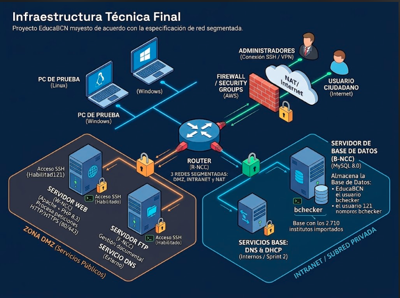

# Arquitectura del proyecto

La arquitectura inicial se implementó en una instancia EC2 con Apache, PHP, MySQL y la aplicación. En la segunda fase el equipo comenzó a separar los servicios en W-NCC (web), B-NCC (base de datos) y F-NCC (FTP).

## Diagrama de diseño

El siguiente diagrama procede del documento técnico original y representa un diseño de referencia, no la confirmación de que todas las funciones estén desplegadas:



La configuración realmente documentada se describe en [red del Sprint 1](../infrastructure/red/sprint-01.md) y [evolución del Sprint 2](../infrastructure/red/sprint-02.md).

## Arquitectura segmentada: segunda etapa del Sprint 2

El diagrama de diseño anterior se conserva como referencia histórica. La infraestructura evolucionó desde la distribución de servicios en EC2 hacia tres subredes en la misma VPC (`172.31.0.0/16`). Las IP de R-NCC se obtuvieron de las comprobaciones con `ip -br -4 a` y las de los servidores de las capturas de migración.

| Zona | Subred | Nodo / interfaz | IP privada observada |
|---|---|---|---|
| WAN | `172.31.100.0/24` | R-NCC, `ens5` | `172.31.100.10` |
| DMZ | `172.31.101.0/24` | R-NCC, `ens6` | `172.31.101.254` |
| DMZ | `172.31.101.0/24` | W-NCC | `172.31.101.10` |
| Intranet | `172.31.102.0/24` | R-NCC, `ens7` | `172.31.102.254` |
| Intranet | `172.31.102.0/24` | B-NCC | `172.31.102.10` |
| Intranet | `172.31.102.0/24` | F-NCC | `172.31.102.20` |

La puerta de enlace que comunica Linux por DHCP en B-NCC es `172.31.102.1` (router VPC de AWS). **No es la IP de R-NCC**: AWS utiliza su tabla de rutas para entregar el tráfico de salida hacia la interfaz de R-NCC correspondiente.

```text
                            Internet
                               |
                      AWS Internet Gateway
                               |
               WAN 172.31.100.0/24 (ens5)
                         R-NCC (router)
                  /                         \
       DMZ 172.31.101.0/24       Intranet 172.31.102.0/24
        ens6: 172.31.101.254      ens7: 172.31.102.254
            W-NCC                    B-NCC / F-NCC
        172.31.101.10        172.31.102.10 / 172.31.102.20
```

El alcance de las verificaciones de NAT y firewall, así como las funciones que todavía no están acreditadas, aparece en [pruebas de segmentación](../tests/pruebas-sprint-02-segmentacion.md). F-NCC permanece en la Intranet en las capturas aportadas; no se presenta como trasladado a la DMZ.
