# Manual de administración de EducaBCN

## Índice

- [1. Alcance del manual](#1-alcance-del-manual)
- [2. Inventario de infraestructura](#2-inventario-de-infraestructura)
- [3. Gestión de instancias AWS](#3-gestion-de-instancias-aws)
- [4. Acceso SSH y cuentas Linux](#4-acceso-ssh-y-cuentas-linux)
- [5. W-NCC: servicio web](#5-w-ncc-servicio-web)
- [6. B-NCC: administración de MySQL](#6-b-ncc-administracion-de-mysql)
- [7. F-NCC: administración de FTP](#7-f-ncc-administracion-de-ftp)
- [8. F-NCC: administración de DNS](#8-f-ncc-administracion-de-dns)
- [9. F-NCC: administración de DHCP](#9-f-ncc-administracion-de-dhcp)
- [10. Incidencias frecuentes](#10-incidencias-frecuentes)
- [11. Mantenimiento y registro](#11-mantenimiento-y-registro)
- [12. Recuperación](#12-recuperacion)
- [13. Procedimientos de instalación detallados](#13-procedimientos-de-instalacion-detallados)
- [14. Lista de comprobación antes de cerrar una sesión](#14-lista-de-comprobacion-antes-de-cerrar-una-sesion)
- [15. Administración de la cuenta de validación](#15-administracion-de-la-cuenta-de-validacion)
- [16. Control de cambios y verificación tras modificaciones](#16-control-de-cambios-y-verificacion-tras-modificaciones)
- [17. Documentación técnica detallada](#17-documentacion-tecnica-detallada)


## 1. Alcance del manual

Este manual describe la operación de la infraestructura distribuida observada tras el segundo sprint. Su finalidad es permitir a otra persona identificar los nodos, consultar servicios, comprobar la aplicación, diagnosticar problemas y realizar actuaciones controladas sin depender de quien instaló el sistema.

No sustituye los procedimientos de instalación detallados de `infrastructure/`, a los que remite desde cada sección. Se refiere únicamente a los servicios y actividades registrados en los dos primeros sprints.

## 2. Inventario de infraestructura

| Servidor | IP privada del documento | Servicios |
|---|---|---|
| W-NCC | `172.31.31.159` | Apache, PHP, aplicación EducaBCN |
| B-NCC | `172.31.39.133` | MySQL 8.0, tabla de centros |
| F-NCC | `172.31.16.170` | vsftpd, BIND9, ISC DHCP |

Los valores pertenecen al entorno mostrado. Antes de intervenir en una instancia recreada, confirmar la IP privada y el Security Group desde AWS EC2.

## 3. Gestión de instancias AWS

1. Acceder a la consola EC2 con una identidad autorizada.
2. Identificar la instancia por nombre y región y consultar sus estados y direcciones.
3. Revisar las interfaces, la VPC, las subredes y los Security Groups de cada instancia.
4. Evitar editar reglas públicas sin evaluar qué servicio quedará expuesto.
5. Antes de detener o sustituir una instancia, comprobar si hay datos o procesos sin persistir.

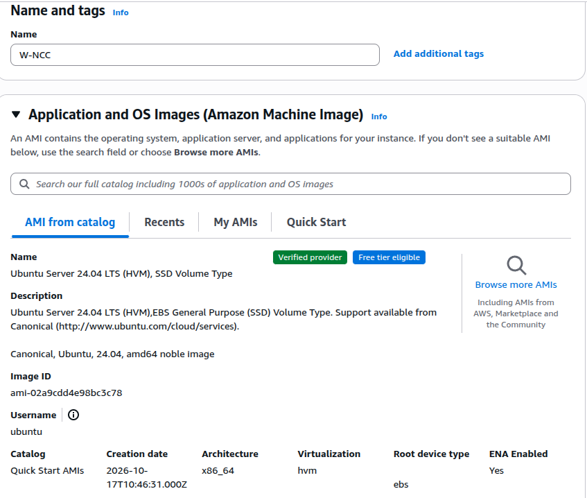

*Instancia W-NCC creada en la consola EC2.*

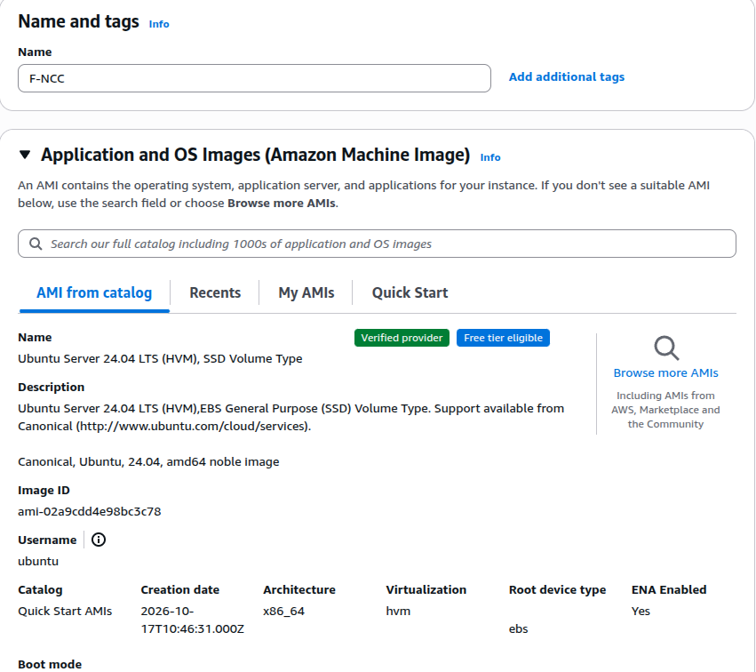

*Instancia F-NCC creada en AWS.*

El puerto 22 es para SSH administrativo, 80 para HTTP de prueba, 3306 para MySQL entre servidores y 21 para FTP de control. No deben abrirse estos puertos indiscriminadamente al público. Los puertos de FTP pasivo deben coincidir con el rango configurado en vsftpd y en el Security Group.

## 4. Acceso SSH y cuentas Linux

Las cuentas documentadas incluyen `web_admin`, `bdd_admin`, `ftp_admin` y, en distintas instancias, `bchecker`. El acceso inicial se realizó con las claves de EC2 y algunas sesiones posteriores por contraseña. Una cuenta Linux y una cuenta MySQL con el mismo nombre son identidades distintas.

Comandos útiles de diagnóstico de cuenta y de red:

```bash
whoami
hostnamectl
ip -br address
id web_admin
sudo systemctl status ssh
```

La consulta `id web_admin` debe ejecutarse en el nodo que tenga creada esa cuenta; en los demás fallará sin significar una avería. La administración debe limitarse a personal autorizado y no debe exigir compartir contraseñas con otros integrantes.

## 5. W-NCC: servicio web

### 5.1 Comprobar Apache y PHP

```bash
sudo systemctl status apache2
apache2ctl -t
php -v
php -m | grep -E '^pdo_mysql$|^mysqli$'
ls -la /var/www/html/
```

El directorio web contiene `index.php` y los archivos utilizados por la aplicación. Una comprobación de sintaxis permite detectar errores tras un cambio:

```bash
php -l /var/www/html/index.php
```

Si hay problemas, revisar:

```bash
sudo journalctl -u apache2 -n 50 --no-pager
sudo tail -n 50 /var/log/apache2/error.log
```

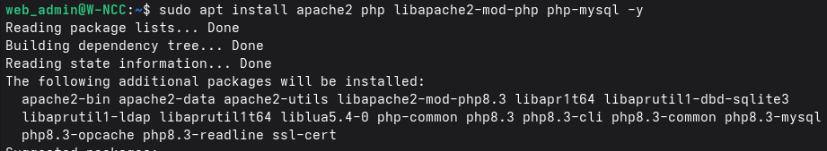

*Instalación de componentes Apache y PHP en W-NCC.*

### 5.2 Despliegue de la aplicación

En la migración documentada se copiaron archivos por SSH directamente desde B-NCC. Este procedimiento histórico sirve para entender el cambio, no debe repetirse indiscriminadamente sobre una versión más reciente.

```bash
mkdir -p /tmp/app
scp -r bdd_admin@172.31.39.133:/var/www/html/. /tmp/app/
sudo cp -a /tmp/app/. /var/www/html/
sudo rm -f /var/www/html/index.html
```

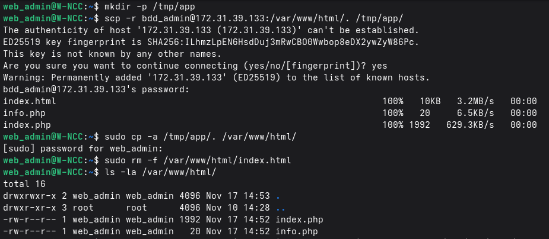

*Copia de archivos y despliegue en W-NCC.*

Para futuros despliegues conviene conservar una copia de los archivos existentes, comparar cambios y probar en un entorno no público antes de sustituir `index.php`.

### 5.3 Configuración de acceso MySQL desde PHP

El servidor de datos no se encuentra en `localhost`, sino en B-NCC. El código debe tomar el host y el usuario de la configuración vigente. El usuario remoto de la fase distribuida es `webapp`.

La documentación registra la separación de credenciales a `/etc/educabcn.conf`, fuera de la carpeta pública. Antes de asumir que se utiliza ese archivo, comprobar que `index.php` lo lee efectivamente.

```bash
sudo stat /etc/educabcn.conf
sudo grep -nE 'localhost|new PDO|mysqli_connect|educabcn.conf' /var/www/html/index.php
```

**No imprimir el contenido del archivo de credenciales en una captura pública.** Los permisos documentados son `root:www-data` y `640`.

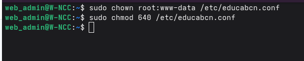

*Propiedad y permisos del archivo de configuración.*

### 5.4 Comprobar el portal

Realizar una petición local y otra desde el navegador usando la dirección publicada. Si se muestra el listado, confirmar que corresponde a B-NCC revisando también la conexión de red y el usuario MySQL empleado.

```bash
curl -I http://127.0.0.1/index.php
nc -zv 172.31.39.133 3306
```

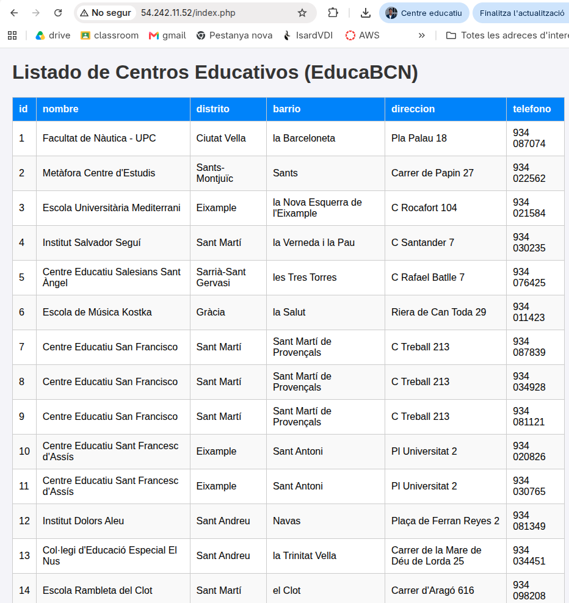

*Listado de centros educativos observado desde W-NCC.*

## 6. B-NCC: administración de MySQL

### 6.1 Estado del servidor

```bash
sudo systemctl status mysql
sudo journalctl -u mysql -n 50 --no-pager
```

En el segundo sprint se reutilizó la máquina de la primera fase y se detuvo Apache:

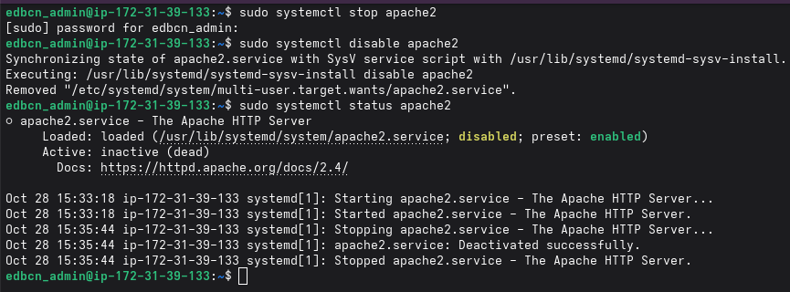

*Apache desactivado en B-NCC tras la separación de servicios.*

### 6.2 Comprobar los datos

Desde un usuario MySQL con permisos de lectura:

```sql
USE EducaBCN;
SELECT COUNT(*) FROM centros_educativos;
SELECT id, nombre, distrito, barrio, direccion, telefono
FROM centros_educativos LIMIT 5;
```

La importación inicial registró 2.710 filas, cifra que puede variar si el dataset se modifica después.

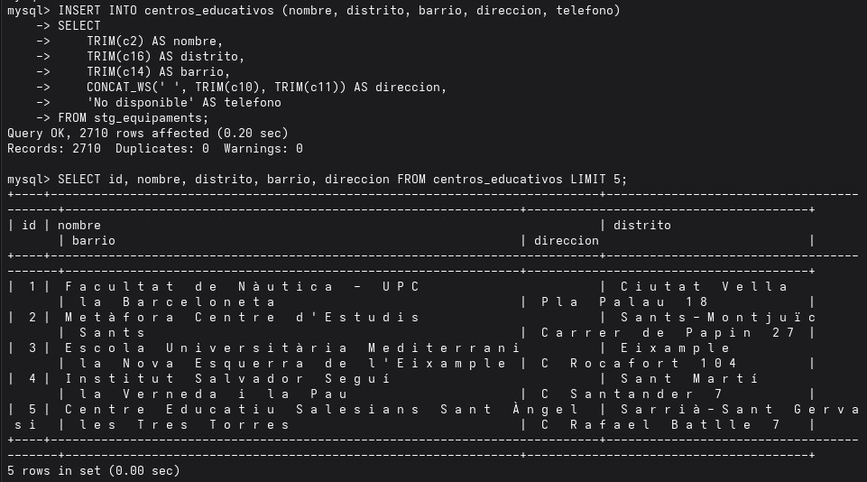

*Comprobaciones sobre la tabla de centros.*

### 6.3 Conexiones remotas y permisos

El archivo de configuración de MySQL documenta `bind-address=0.0.0.0`, lo que facilita conexiones remotas pero obliga a mantener restricciones de red. La aplicación utiliza el usuario de MySQL `webapp`, distinto de las cuentas Linux de administración. Sus permisos registrados permiten consultar datos, no modificarlos.

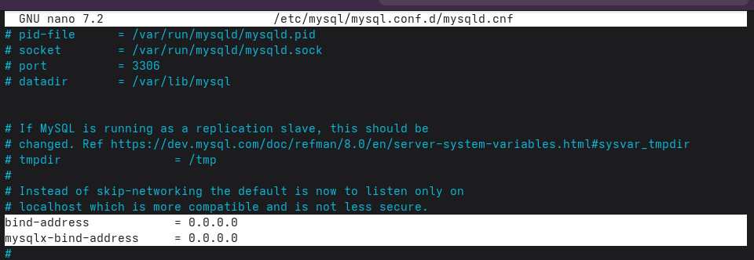

*Servidor MySQL configurado para escuchar fuera de localhost.*

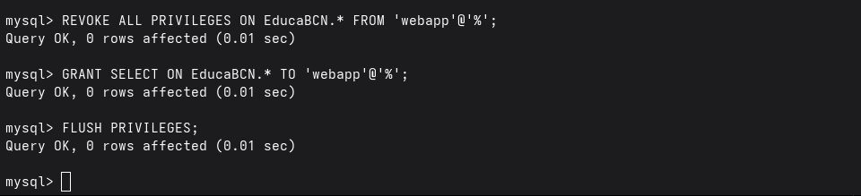

*Permisos de lectura de la cuenta webapp.*

Antes de cambiar permisos de usuarios hay que comprobar el origen, la función requerida y el conjunto de privilegios mínimo. Nunca almacenar contraseñas en el código publicado.

## 7. F-NCC: administración de FTP

### 7.1 Servicio y cuentas

```bash
sudo systemctl status vsftpd
sudo journalctl -u vsftpd -n 50 --no-pager
```

El equipo preparó un usuario de transferencia `ftpuser` y un directorio `ftp/subida`. La cuenta administrador del sistema es `ftp_admin`.

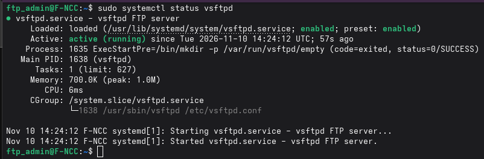

*Estado de vsftpd.*

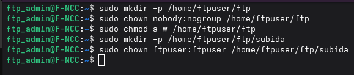

*Directorios y permisos del usuario de transferencia.*

### 7.2 Configuración

Los cambios se realizan sobre `/etc/vsftpd.conf`; antes de editar se debe conservar una copia. El documento original recoge acceso local, ausencia de usuarios anónimos, escritura y chroot.

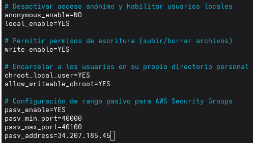

*Opciones de seguridad y modo pasivo de vsftpd.*

El protocolo FTP utilizado en la prueba no acredita cifrado. No usar transferencias sin protección para documentación privada o datos sensibles.

### 7.3 Diagnóstico

Si falla una transferencia, comprobar que el servicio está activo, que el usuario tiene permisos en su subdirectorio y que el rango pasivo coincide con las reglas del Security Group. Una conexión exitosa al puerto 21 por sí sola no demuestra que la subida funcione.

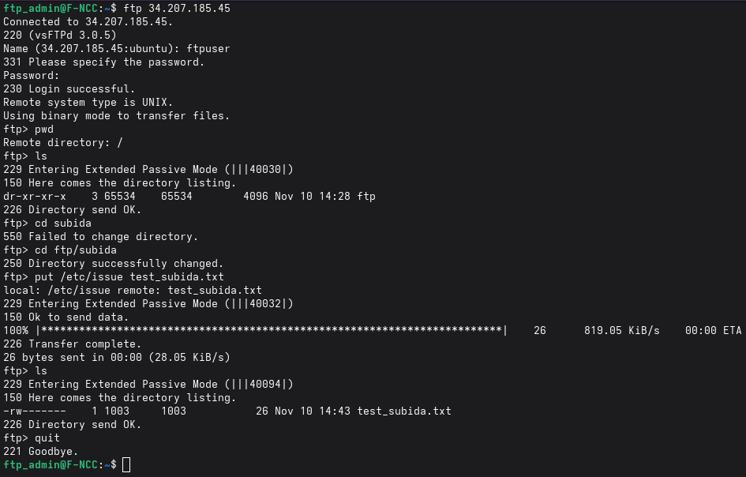

*Sesión de prueba del servicio FTP.*

## 8. F-NCC: administración de DNS

BIND9 ofrece la zona interna `educabcn.local`. Su archivo de zona contiene registros para `web`, `db` y `ftp` con las direcciones privadas de las instancias.

```bash
sudo named-checkconf
sudo named-checkzone educabcn.local /etc/bind/db.educabcn.local
sudo systemctl status bind9
```

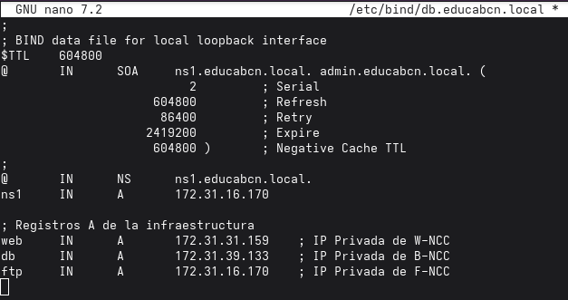

*Zona local con registros A de los nodos.*

Para validar desde F-NCC:

```bash
dig @127.0.0.1 db.educabcn.local
```

Para comprobar una resolución desde otra instancia usando el DNS de F-NCC:

```bash
nslookup db.educabcn.local 172.31.16.170
```

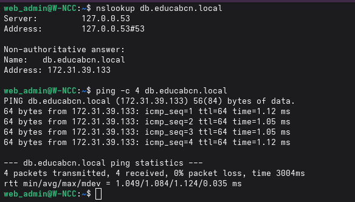

*Resolución y comprobación desde W-NCC.*

Si no responde, distinguir un error del demonio de un problema de resolución del sistema, firewall, Security Groups o dirección DNS configurada en el cliente.

## 9. F-NCC: administración de DHCP

El demonio ISC DHCP aparece instalado y con estado activo. La configuración reside en `/etc/dhcp/dhcpd.conf` y la interfaz en `/etc/default/isc-dhcp-server`.

```bash
sudo systemctl status isc-dhcp-server
sudo journalctl -u isc-dhcp-server -n 50 --no-pager
```

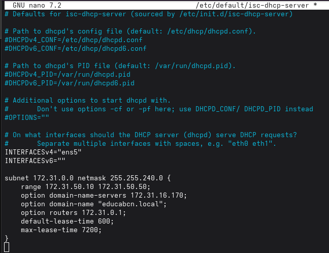

*Configuración visible de DHCP.*

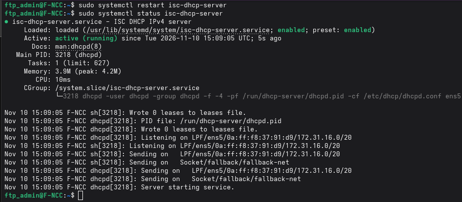

*Estado de ISC DHCP en F-NCC.*

**Alcance:** el estado activo del demonio no demuestra que las instancias EC2 reciban concesiones desde este servicio. AWS controla normalmente las opciones DHCP de su VPC. Para una prueba de concesiones se debe utilizar una topología de laboratorio compatible y registrar el cliente que recibe la IP.

## 10. Incidencias frecuentes

| Síntoma | Comprobaciones útiles | Posibles causas |
|---|---|---|
| La web no carga | `systemctl status apache2`, `curl`, Security Group | Apache parado, puerto HTTP bloqueado, URL incorrecta |
| Web sin datos / error PDO | Host de MySQL, `nc` a 3306, cuenta `webapp` | Host antiguo `localhost`, permisos o credenciales desactualizados |
| FTP conecta pero no transfiere | Usuario, chroot, rango pasivo, reglas | Permisos del subdirectorio o puertos pasivos filtrados |
| `nslookup` no encuentra nombre | `named-checkzone`, `dig @DNS` | Zona incorrecta o DNS no configurado en el cliente |
| DHCP no concede IP | Interfaz, red de clientes y origen del DHCP | El cliente utiliza DHCP de AWS o está en otro segmento |

## 11. Mantenimiento y registro

Después de modificar la configuración de un servicio, verificar la sintaxis cuando exista un comando de validación, aplicar el cambio de manera controlada y comprobar el resultado. Registrar fecha, responsable, archivo editado, motivo y prueba posterior. Antes de operaciones destructivas sobre MySQL, conservar y validar una copia.

## 12. Recuperación

Para incidencias consultar el [plan de contingencia](contingencia.md). Distinguir siempre una prueba ejecutada de un procedimiento preparado para una incidencia futura.

## 13. Procedimientos de instalación detallados

- [Creación y red de EC2](../infrastructure/red/sprint-02.md)
- [Web en W-NCC](../infrastructure/web/sprint-02.md)
- [MySQL remoto en B-NCC](../infrastructure/base-datos/sprint-02.md)
- [vsftpd en F-NCC](../infrastructure/ftp/sprint-02.md)
- [BIND9 e ISC DHCP](../infrastructure/dns-dhcp/sprint-02.md)

## 14. Lista de comprobación antes de cerrar una sesión

| Elemento | Comprobación | Respuesta ante fallo |
|---|---|---|
| Acceso | Hostnames y usuarios administrativos del nodo correcto | Revisar SSH, IP actual y grupos |
| Apache en W-NCC | Servicio activo y `php -l` sin errores | Revisar `journalctl -u apache2` y código actual |
| MySQL en B-NCC | Servicio activo, consulta local y acceso controlado desde W-NCC | Revisar SG, `bind-address`, cuenta `webapp` y DNS/IP |
| FTP en F-NCC | Servicio en ejecución y prueba con usuario autorizado | Revisar `vsftpd.conf`, directorios y puertos |
| BIND9 en F-NCC | Zona sintácticamente válida y resolución de registros | `named-checkconf`, `named-checkzone` y logs |
| ISC DHCP en F-NCC | Servicio sin errores | Distinguir estado del daemon de concesiones reales |
| Documentación | Cambios anotados y capturas sin secretos | Limpiar secretos antes de hacer commit |
| Costes AWS | Instancias y recursos que seguirán facturando | Revisar EC2, EBS y otras partidas desde Billing |

## 15. Administración de la cuenta de validación

El enunciado requiere que el profesorado pueda verificar el entorno con la cuenta `bchecker`. En cada servidor debe distinguirse su **identidad Linux** de la identidad MySQL `bchecker` de la primera fase y de la cuenta `webapp` utilizada por PHP en el segundo sprint. Las credenciales no se incluyen en este repositorio.

```bash
id bchecker
getent passwd bchecker
```

`id` permite revisar grupos y `getent passwd` comprueba la entrada NSS de la cuenta, sin revelar contraseñas. Si la cuenta existe pero el docente no puede acceder, revisar permisos de SSH, estado de la cuenta y las reglas de acceso con la supervisión del profesorado. No se debe copiar la contraseña en capturas o commits.

## 16. Control de cambios y verificación tras modificaciones

Antes de editar una configuración, identificar nodo, archivo, estado anterior y forma de recuperación. Mantener el cambio pequeño y comprobar sintaxis si existe un validador (`apache2ctl -t` para Apache, `named-checkconf` para BIND9, `php -l` para PHP). Registrar la actuación y consultar los logs del servicio. Después, comprobar tanto el proceso como el resultado desde otro nodo cuando corresponda.

El repositorio Git sirve para el código y Markdown versionados. **No** contiene automáticamente todos los archivos reales de `/etc` ni constituye por sí mismo una copia restaurable de toda la instancia. La migración observada en Sprint 2 copió la aplicación por SCP, no mediante `git pull`; un flujo Git de despliegue debe documentarse y verificarse antes de atribuirlo como realizado.

## 17. Documentación técnica detallada

- [Creación y red del primer servidor](../infrastructure/red/sprint-01.md)
- [Creación de W-NCC y F-NCC](../infrastructure/red/sprint-02.md)
- [Apache y PHP inicial](../infrastructure/web/sprint-01.md)
- [Migración web y cliente MySQL](../infrastructure/web/sprint-02.md)
- [MySQL y CSV inicial](../infrastructure/base-datos/sprint-01.md)
- [Usuario `webapp` y conexión remota](../infrastructure/base-datos/sprint-02.md)
- [FTP en F-NCC](../infrastructure/ftp/sprint-02.md)
- [DNS y DHCP en F-NCC](../infrastructure/dns-dhcp/sprint-02.md)
- [Código PHP de referencia para cada sprint](../infrastructure/aplicacion/codigo/README.md)
- [Criterios y pruebas pendientes](../tests/criterios-rendimiento-disponibilidad.md)
