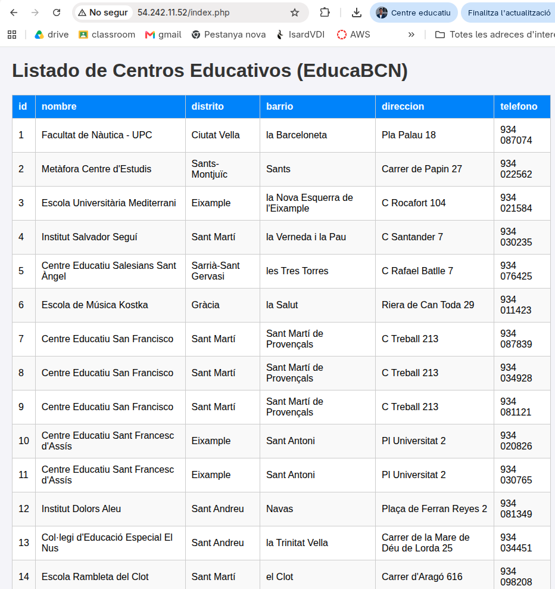

# Manual de usuario de EducaBCN

## Índice

- [1. Qué es y para quién sirve](#1-que-es-y-para-quien-sirve)
- [2. Requisitos e instalación](#2-requisitos-e-instalacion)
- [3. Acceder al portal paso a paso](#3-acceder-al-portal-paso-a-paso)
- [4. Comprender la tabla de resultados](#4-comprender-la-tabla-de-resultados)
- [5. Qué acciones NO permite esta versión](#5-que-acciones-no-permite-esta-version)
- [6. Problemas frecuentes y soluciones para el usuario](#6-problemas-frecuentes-y-soluciones-para-el-usuario)
- [7. Mantenimiento y actualización de la información](#7-mantenimiento-y-actualizacion-de-la-informacion)
- [8. Privacidad y uso responsable](#8-privacidad-y-uso-responsable)
- [9. Documentación relacionada](#9-documentacion-relacionada)

## 1. Qué es y para quién sirve

EducaBCN permite consultar una lista de equipamientos educativos de Barcelona mediante un navegador web. La información procede de un CSV público que fue importado a MySQL. El sitio documentado es un **prototipo académico** y no sustituye al buscador institucional de centros ni a la información oficial actualizada.

## 2. Requisitos e instalación

No es necesario instalar ningún programa específico, cuenta de AWS ni cliente SSH. Se requiere un ordenador o móvil con un navegador y acceso de red hacia el servidor web. En las pruebas del equipo se utilizó la IP pública de W-NCC y la ruta `/index.php`. Como la IP pública puede cambiar, la dirección vigente debe proporcionarla la persona administradora.

## 3. Acceder al portal paso a paso

1. Abrir un navegador actualizado, por ejemplo Firefox, Chrome o Edge.
2. Introducir la dirección que haya indicado el administrador para el portal EducaBCN.
3. Esperar a que aparezca el título «Listado de Centros Educativos (EducaBCN)».
4. Identificar la fila y la columna deseadas; si hay muchos resultados, desplazarse verticalmente.
5. Contrastar direcciones, teléfonos y centros con fuentes oficiales antes de utilizarlos para gestiones importantes.

La captura muestra el resultado comprobado durante el Sprint 2.

## 4. Comprender la tabla de resultados

El prototipo muestra campos de la base de datos como **identificador**, **nombre**, **distrito**, **barrio**, **dirección** y **teléfono**, según los datos presentes. Cada fila representa un registro de la tabla `centros_educativos`.

**Límite conocido:** el `index.php` documentado incluye `LIMIT 50`. Por ello, la página puede mostrar solo los primeros 50 registros, aunque la base de datos contenga más. No hay constancia de búsqueda, filtros, paginación ni función de edición de datos en las dos primeras etapas.

## 5. Qué acciones NO permite esta versión

El usuario no puede editar los centros, cargar CSV, modificar contraseñas, acceder a los servidores ni subir ficheros por FTP desde la interfaz pública. Esas acciones corresponden a servicios y cuentas administrativas diferentes. Tampoco existe constancia de una opción para crear cuentas de usuario o guardar favoritos.

## 6. Problemas frecuentes y soluciones para el usuario

| Problema | Comprobación inmediata | Cuándo contactar al administrador |
|---|---|---|
| La página no abre | Revisar Wi-Fi/red y dirección del enlace | Si otros sitios funcionan y EducaBCN no |
| Error de servidor | Actualizar una vez, sin repetir compulsivamente | Si el error persiste, indicando hora y mensaje |
| Tabla vacía | Confirmar que cargó el título y no hubo error | Si no aparecen registros donde antes los había |
| Información incompleta | Verificar si el registro está dentro de los 50 iniciales | Si se requiere el conjunto completo |
| Nombre o teléfono incorrecto | Comparar con la fuente oficial | Para reportar posible dato antiguo o error de importación |
| Contenido difícil de leer en el móvil | Usar orientación horizontal o zoom del navegador | Si el diseño no permite acceder a una columna |

Al reportar una incidencia es útil indicar el navegador, la hora, la URL (sin contraseñas) y lo que apareció en pantalla. No enviar claves privadas ni credenciales por correo o mensajería.

## 7. Mantenimiento y actualización de la información

El usuario final no tiene que realizar mantenimiento de la aplicación. Los centros y sus datos pueden cambiar con el tiempo; el conjunto consultado refleja la fecha en la que el administrador hizo la importación, no una sincronización automática demostrada. Si se necesita información actualizada, utilizar [el directorio oficial de centros](https://educacio.gencat.cat/ca/serveis-tramits/directoris-centres/index.html).

## 8. Privacidad y uso responsable

La web se diseñó para mostrar datos de equipamientos, no expedientes ni información académica individual. No se deben escribir datos personales sensibles en formularios no previstos ni subir documentos privados a la interfaz. Para consultar el funcionamiento interno o solicitar soporte, debe acudirse al equipo administrador.

## 9. Documentación relacionada

- [Estado y objetivo del proyecto](objetivos-y-necesidades.md)
- [Pruebas del portal en Sprint 2](../tests/pruebas-sprint-02.md)
- [Manual para administradores](manual-administrador.md)
