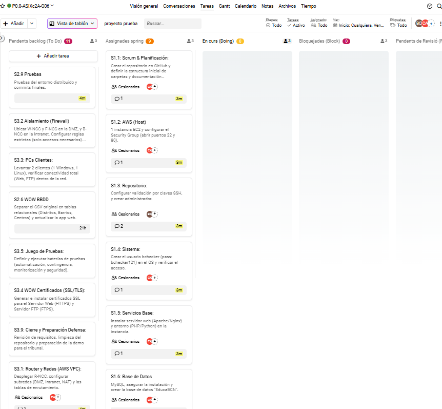
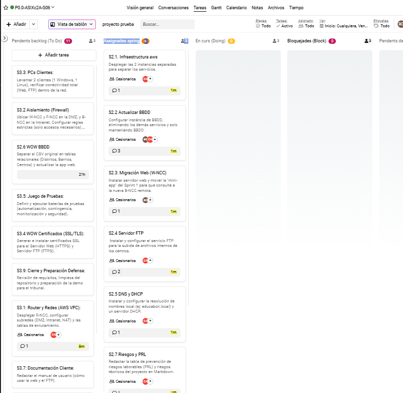

# Planificación y evolución de EducaBCN

## Índice

- [Marco del proyecto](#marco-del-proyecto)
- [Objetivo general y dependencias](#objetivo-general-y-dependencias)
- [Sprint 1 — Prototipo integrado](#sprint-1-prototipo-integrado)
- [Sprint 2 — Servidores diferenciados](#sprint-2-servidores-diferenciados)
- [Sprint 3 — Únicamente planificación](#sprint-3-unicamente-planificacion)
- [Calendario de reuniones conocido](#calendario-de-reuniones-conocido)
- [Organización, hitos y riesgo](#organizacion-hitos-y-riesgo)
- [Criterios de aceptación](#criterios-de-aceptacion)


## Marco del proyecto

El enunciado fija un proyecto de seis semanas con fecha prevista de finalización el **18/11/2026** y tres sprints quincenales de aproximadamente diez horas de trabajo por sprint. La planificación y el backlog se mantienen en ProofHub y el resultado técnico se documenta en GitHub mediante archivos Markdown.

La entrega documentada aquí contiene los dos primeros sprints realizados. El tercero aparece solo como **planificación de objetivos y dependencias**, sin incorporar acciones ya empezadas ni capturas de implementación de esa etapa.

## Objetivo general y dependencias

El objetivo es preparar infraestructura para una aplicación multicapa con web, SSH, base de datos, DNS, DHCP y FTP. La aplicación presenta un listado basado en el dataset municipal de equipamientos educativos. El proyecto debe evolucionar desde un prototipo integrado a un sistema con servidores diferenciados y, posteriormente, la red definida en el enunciado.

```text
Datos de OpenData BCN ──> Importación MySQL ──> PHP / PDO ──> Navegador
                               B-NCC          W-NCC

                          F-NCC: FTP + DNS + DHCP
```

El diagrama representa la distribución por **roles** tras Sprint 2. **No representa** una DMZ real ni un router R-NCC ya desplegado.

## Sprint 1 — Prototipo integrado

**Alcance:** instancia AWS EC2, acceso SSH, cuentas, Apache, PHP, MySQL, importación del CSV y `index.php` en la misma máquina. Resultado observado: el navegador muestra la tabla de centros, con hasta 50 filas por consulta. Se conserva [código de referencia de Sprint 1](../infrastructure/aplicacion/codigo/sprint-01/index.php).

**Pruebas y documentación:** [infraestructura](../infrastructure/red/sprint-01.md), [instalación web](../infrastructure/web/sprint-01.md), [base de datos](../infrastructure/base-datos/sprint-01.md), [aplicación](../infrastructure/aplicacion/sprint-01.md), [revisión](../sprints/sprint-01/review.md).



Las tarjetas de la vista muestran asignación. Para conocer cierre y cronología de cada tarea es necesario acceder a su ficha en ProofHub.

## Sprint 2 — Servidores diferenciados

**Alcance:** W-NCC para la web, B-NCC para MySQL (reutilizando la máquina previa), y F-NCC para FTP, DNS y DHCP. La web pasa a conectarse mediante la red privada de la VPC, utilizando una cuenta MySQL `webapp` de lectura. La aplicación se transfirió mediante SCP; esto es una evidencia de **copia efectiva**, no de un despliegue de código por `git pull`.

**Pruebas y documentación:** [AWS/VPC](../infrastructure/red/sprint-02.md), [servidor web](../infrastructure/web/sprint-02.md), [MySQL remoto](../infrastructure/base-datos/sprint-02.md), [FTP](../infrastructure/ftp/sprint-02.md), [DNS y DHCP](../infrastructure/dns-dhcp/sprint-02.md), [pruebas](../tests/pruebas-sprint-02.md).



Se cierra documentalmente el Sprint 2 con los servicios descritos; no se acreditan todavía normalización completa de la base de datos, concesión DHCP a un PC real, despliegue por Git en cada servidor ni pruebas sistemáticas de rendimiento. Estas limitaciones quedan registradas para no confundir objetivos con resultados.

## Sprint 3 — Únicamente planificación

El enunciado pide un router `R-NCC` con redes **DMZ**, **Intranet** y **NAT**, así como dos clientes de prueba (uno Windows y otro Linux) y resolución DNS de `R-NCC` y `R`. Para esa fase se contempla completar las reglas de filtrado, comprobar el enrutamiento y validar la red desde los clientes. Como posibles ampliaciones de calidad, se estudian TLS/FTPS, copias de seguridad, supervisión y ejecución de pruebas de contingencia.

**Estas son tareas previstas, no trabajo implementado en esta documentación.** No se muestran configuraciones ni imágenes de Sprint 3, aunque la memoria original contenga un apartado posterior con actividades comenzadas.

## Calendario de reuniones conocido

| Fecha | Situación registrada |
|---|---|
| 07/10 | Inicio del proyecto y backlog |
| 13/10 | EC2, Git y MySQL en planificación/ejecución |
| 20/10 | Apache, PHP, importación CSV y portal |
| 21/10 | Aplicación y servicios del primer prototipo validados |
| 27/10 | Revisión y cierre del primer sprint |
| 28/10 | Inicio del segundo sprint |
| 02/11 | Preparación de B-NCC, FTP, DNS y DHCP |
| 10/11 | B-NCC actualizado; W-NCC y F-NCC en curso |

Más detalle en [registro de reuniones](../sprints/registro-reuniones.md). Para fechas individuales de tareas, consultar ProofHub.

## Organización, hitos y riesgo

El backlog parte de tareas identificadas como S1.x, S2.x y S3.x. El equipo organiza las tarjetas en columnas como pendientes, asignadas, en curso, bloqueadas y finalizadas. Las capturas conservadas muestran la planificación; los estados y responsables completos se verificarán en el historial de ProofHub.

Hitos técnicos: portal integrado → consulta remota W-NCC/B-NCC → servicios auxiliares F-NCC → red segmentada planificada. Los riesgos principales son errores de permisos MySQL, bloqueo de TCP/3306, datos CSV inconsistentes, consumo del crédito AWS, exposición de contraseñas y retrasos por dependencias entre servicios. Las acciones de mitigación se detallan en [recursos y presupuesto](recursos-y-presupuesto.md) y [contingencia](contingencia.md).

## Criterios de aceptación

Para Sprint 1: servidor accesible, servicio HTTP/PHP funcional y listado de datos que provienen de MySQL. Para Sprint 2: servidor web separado, base de datos remota con cuenta de lectura, FTP/DNS/DHCP instalados y pruebas de los componentes que sí se documentaron. Los criterios cuantitativos aún pendientes se formulan en [rendimiento y disponibilidad](../tests/criterios-rendimiento-disponibilidad.md).

No se atribuyen resultados ni porcentajes de éxito a pruebas que no aparecen en la memoria o en las capturas entregadas.
