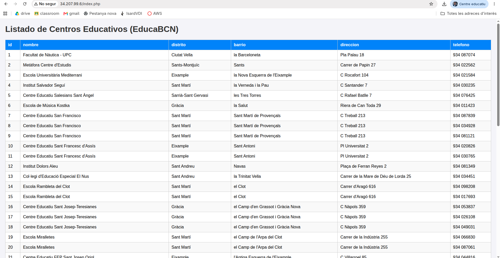

# Aplicación PHP inicial: Sprint 1

## Índice

- [Función](#funcion)
- [Código `index.php` del primer sprint](#codigo-indexphp-del-primer-sprint)
- [Consulta SQL](#consulta-sql)
- [Tratamiento de los datos](#tratamiento-de-los-datos)
- [Verificación del prototipo](#verificacion-del-prototipo)
- [Evolución](#evolucion)


## Función

La primera versión de EducaBCN consistía en un archivo `index.php` ejecutado por Apache en la misma instancia que MySQL. Utilizaba PDO para obtener registros de la tabla `centros_educativos` y generaba una tabla HTML con los campos de cada centro.

## Código `index.php` del primer sprint

El archivo [index.php de Sprint 1](codigo/sprint-01/index.php) reproduce la estructura PHP y HTML incluida en el documento original, con tres ajustes explicados: corrección de la llamada PDO que se deformó al exportar el PDF, eliminación del secreto incrustado y manejo genérico del error para no mostrar detalles internos al navegador. El código utiliza `localhost` y la cuenta MySQL `bchecker`, tal como se documentó en esta fase. Para ejecutar esta referencia es necesario proporcionar `EDUCABCN_DB_PASSWORD` al proceso PHP.

**Este código es una versión legible de referencia, no se ha vuelto a desplegar ni probado en AWS durante la preparación del ZIP.**

## Consulta SQL

El código del documento realiza una consulta equivalente a:

```sql
SELECT * FROM centros_educativos LIMIT 50;
```

Esto explica por qué el navegador muestra un subconjunto del dataset cargado y no necesariamente las 2.710 filas en una misma página.

## Tratamiento de los datos

El archivo PHP comprueba si se han obtenido registros, recorre la lista y utiliza `htmlspecialchars()` al imprimir las celdas HTML. Esto evita que los datos se interpreten directamente como etiquetas HTML, aunque no sustituye una revisión general de seguridad de la aplicación.

## Verificación del prototipo

Tras subir el archivo a `/var/www/html/`, se accedió desde el navegador a la dirección pública de la instancia y se mostró el listado de centros educativos.



*Primera versión del listado de EducaBCN en el navegador.*

## Evolución

En esta fase el host de la base de datos era `localhost`. Tras separar los servicios, ese valor dejó de ser válido para la aplicación alojada en W-NCC y se sustituyó por los datos de conexión remota de B-NCC.
