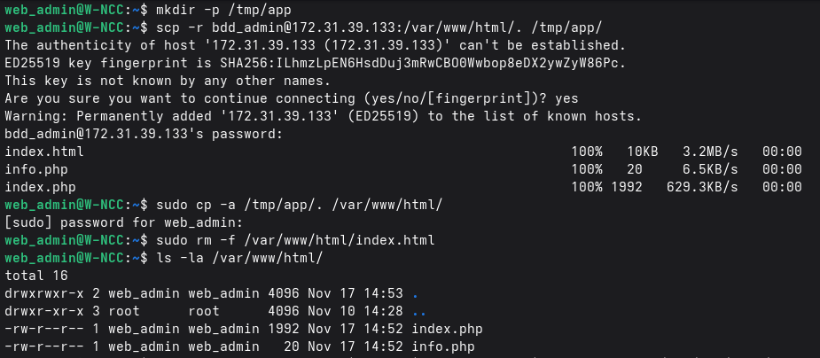
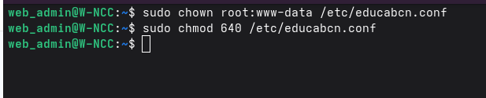
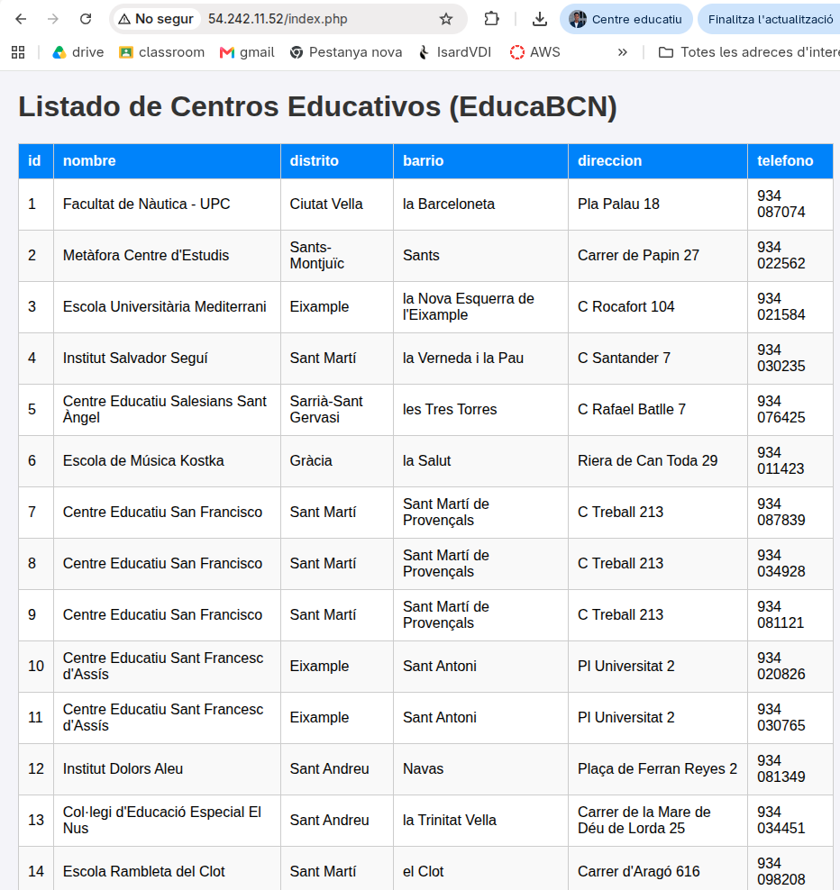

# Aplicación EducaBCN migrada: Sprint 2

## Índice

- [Objetivo](#objetivo)
- [Copia del código de la primera versión](#copia-del-codigo-de-la-primera-version)
- [Código `index.php` provisional del segundo sprint](#codigo-indexphp-provisional-del-segundo-sprint)
- [Adaptación de la conexión](#adaptacion-de-la-conexion)
- [Comprobación de funcionamiento](#comprobacion-de-funcionamiento)
- [Observaciones de implementación](#observaciones-de-implementacion)


## Objetivo

Mantener el portal PHP funcionando después de separar el servidor de aplicación del servidor de base de datos.

## Copia del código de la primera versión

Los archivos de la web se trasladaron desde B-NCC a W-NCC usando `scp`, mediante una cuenta autorizada de Linux y la IP privada de la instancia antigua. En W-NCC se copiaron desde `/tmp/app` a la raíz pública de Apache.

```bash
mkdir -p /tmp/app
scp -r bdd_admin@172.31.39.133:/var/www/html/. /tmp/app/
sudo cp -a /tmp/app/. /var/www/html/
sudo rm -f /var/www/html/index.html
```



*Migración de index.php y archivos PHP desde B-NCC a W-NCC.*

## Código `index.php` provisional del segundo sprint

Se incorpora el archivo [index.php provisional del Sprint 2](codigo/sprint-02/index.php), basado en la estructura del Sprint 1 pero apuntando a B-NCC y utilizando el usuario MySQL `webapp`. **No es el código verificado que está actualmente en W-NCC:** el equipo lo reemplazará por el archivo real obtenido en clase. No se ha probado este ejemplo en el servidor de producción.

El servidor documenta además un archivo externo `/etc/educabcn.conf` destinado a las credenciales. La plantilla evita incrustarlas, pero usa una variable de entorno para que no se presuponga un formato INI del fichero que todavía no se ha facilitado. Antes de subir el código real, se deberá documentar cómo carga efectivamente esa configuración.

## Adaptación de la conexión

En el primer prototipo PHP conectaba a `localhost`. En la versión distribuida, la IP de MySQL se refiere a B-NCC, `172.31.39.133`. El usuario de consulta remota es `webapp` y tiene permisos documentados de lectura sobre la base `EducaBCN`.

La documentación del equipo incluye el uso de `/etc/educabcn.conf` para guardar los datos de conexión fuera de `/var/www/html/`. La contraseña debe permanecer fuera de Git y de las capturas públicas. La sintaxis concreta de lectura depende de la implementación PHP que se despliegue: no basta con crear el archivo si `index.php` no lo lee.



*Protección del archivo de configuración del portal.*

## Comprobación de funcionamiento

La captura actualizada muestra el portal servido desde la nueva instancia y el listado de centros de Barcelona.



*Resultado visible del portal EducaBCN después de la migración.*

La captura se complementa con la prueba de conexión remota MySQL entre W-NCC y B-NCC descrita en `infrastructure/base-datos/sprint-02.md`.

## Observaciones de implementación

- No se requiere reinstalar MySQL en W-NCC.
- El motor de datos sigue residiendo en B-NCC.
- El dataset importado es estático hasta que exista un procedimiento de actualización.
- Si cambia la IP privada del servidor de datos, debe actualizarse la configuración o utilizarse un DNS interno resuelto correctamente.
