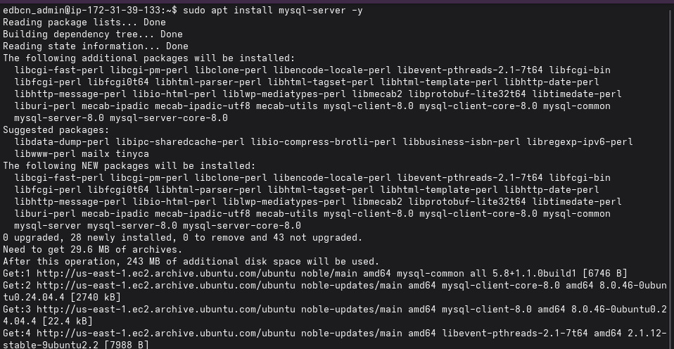
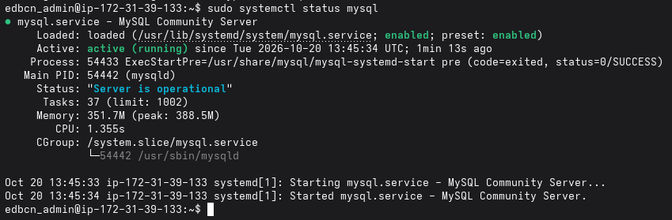
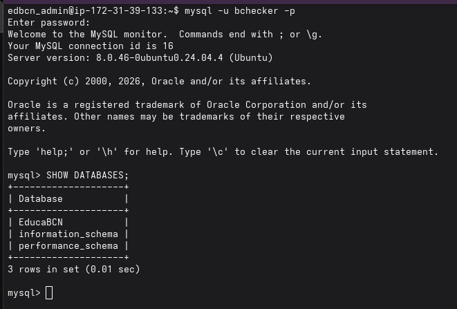
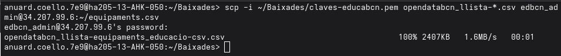
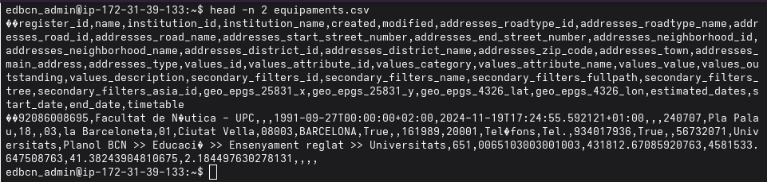
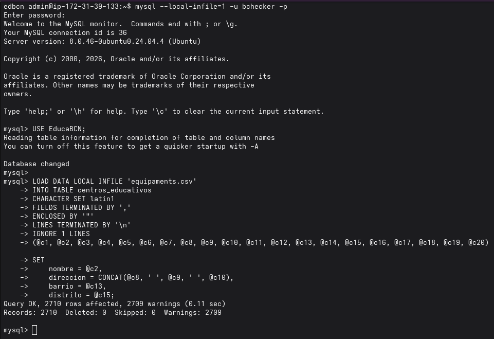
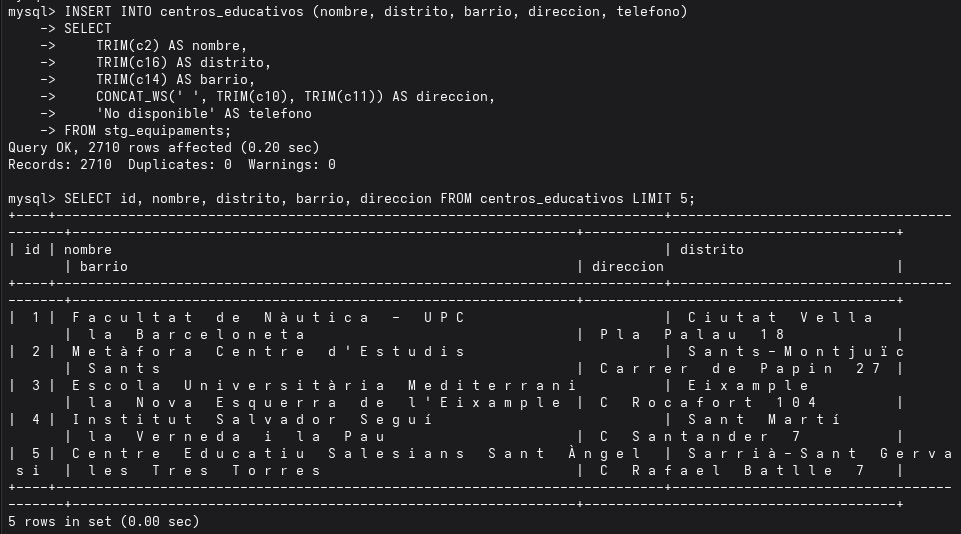
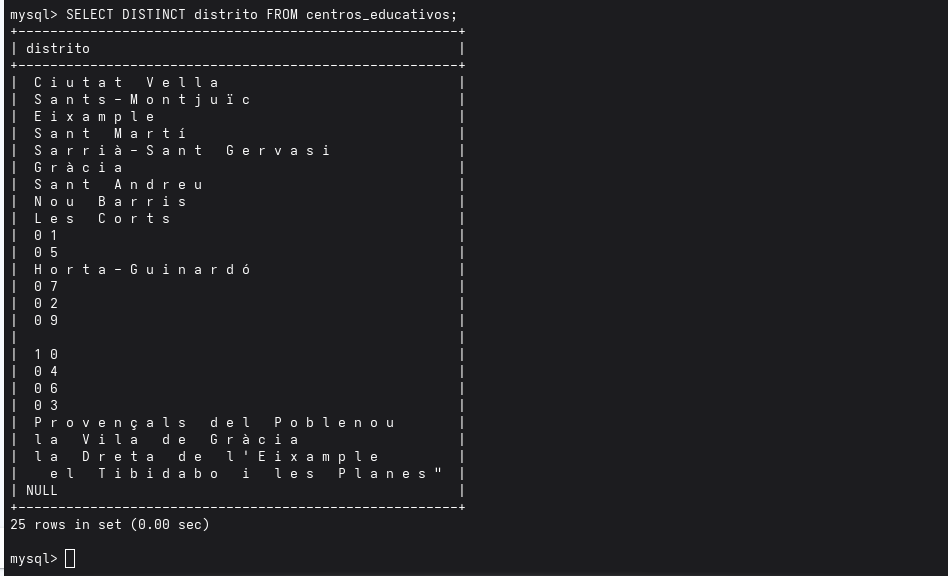

# Base de datos en el primer servidor: Sprint 1

## Índice

- [Objetivo](#objetivo)
- [1. Instalar y comprobar MySQL](#1-instalar-y-comprobar-mysql)
- [2. Inicialización y usuarios](#2-inicializacion-y-usuarios)
- [3. Importación del CSV](#3-importacion-del-csv)
- [4. Verificaciones](#4-verificaciones)
- [5. Consideraciones de calidad](#5-consideraciones-de-calidad)


## Objetivo

Instalar MySQL, crear la base de datos EducaBCN, importar el CSV de OpenData BCN y comprobar que la aplicación PHP puede leer sus registros.

## 1. Instalar y comprobar MySQL

Se instaló `mysql-server` en la instancia integrada y se comprobó el estado del servicio:

```bash
sudo apt install mysql-server -y
sudo systemctl status mysql
```



*Instalación de mysql-server en Ubuntu.*



*Comprobación de que el servicio MySQL se encuentra activo.*

## 2. Inicialización y usuarios

El equipo ejecutó las comprobaciones iniciales de endurecimiento y creó la base de datos. Para permitir la consulta local, utilizó un usuario MySQL de nombre `bchecker`. **No debe confundirse** con la cuenta Linux que también se llamó `bchecker`.

```sql
CREATE DATABASE EducaBCN
  CHARACTER SET utf8mb4 COLLATE utf8mb4_unicode_ci;
```

El documento original incluye capturas en las que aparece una contraseña durante la creación del usuario. Por seguridad no se reproducen. Se debe comprobar la existencia de la base desde un usuario autorizado sin publicar credenciales.



*Acceso del usuario de MySQL y comprobación de la base EducaBCN.*

## 3. Importación del CSV

Se descargó el dataset a un equipo local y se copió a la instancia mediante `scp`. A continuación se estudió su formato y se importó en la tabla `centros_educativos`, con campos como nombre, distrito, barrio, dirección y teléfono.



*Transferencia del archivo CSV desde el equipo local.*



*Inspección de cabeceras y campos del CSV de origen.*

En la documentación se reflejan problemas de codificación y de correspondencia de columnas, por los que se empleó una correspondencia explícita al importar. Antes de cargar de nuevo, es importante inspeccionar el separador, la codificación y la estructura del archivo en lugar de repetir sin cambios un comando diseñado para una versión concreta.



*Importación del conjunto de datos en MySQL.*

## 4. Verificaciones

Tras importar, se ejecutaron consultas de recuento y listados para comprobar el número y la estructura de los registros. La operación documentada devuelve **2.710 filas**.

```sql
USE EducaBCN;
SELECT COUNT(*) FROM centros_educativos;
SELECT id, nombre, distrito, barrio, direccion, telefono
FROM centros_educativos LIMIT 5;
SELECT DISTINCT distrito FROM centros_educativos;
```



*Consultas de datos y muestra inicial de centros educativos.*



*Consulta de los distritos presentes en el dataset.*

## 5. Consideraciones de calidad

El CSV puede contener nombres repetidos por diferencias entre registros o servicios, teléfonos que deben conservarse como texto y acentos de distintos idiomas. La captura no demuestra que exista una normalización completa a tablas de barrios, distritos y tipos de centro. En este archivo se documenta la tabla consultada y su importación real.
