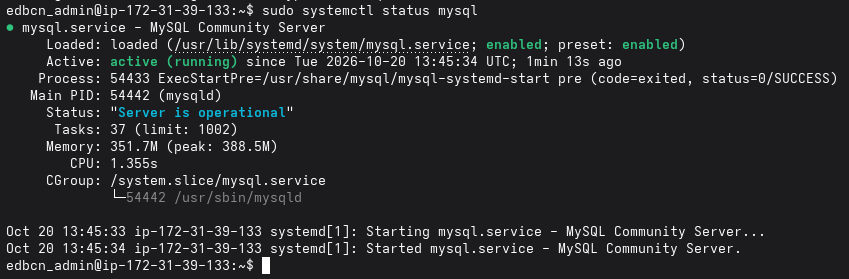
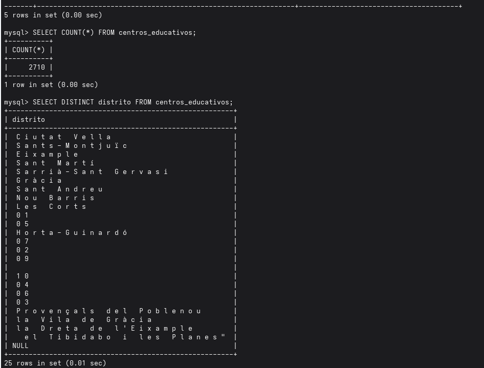

# Base de datos MySQL: Sprint 1

La primera instalación de MySQL se realizó dentro de la instancia monolítica del proyecto, junto con Apache y PHP. El objetivo fue cargar datos reales y mostrarlos en el portal.

## Instalación y arranque de MySQL

Tras actualizar los paquetes se instaló MySQL Server y se comprobó el servicio mediante systemd. Se realizó el procedimiento de endurecimiento inicial del motor SQL.

```bash
sudo apt update
sudo apt install mysql-server -y
sudo systemctl enable --now mysql
sudo systemctl status mysql
sudo mysql_secure_installation
```



## Creación de la base de datos EducaBCN

Se creó la base de datos de la aplicación con codificación UTF-8 compatible con caracteres especiales en catalán y castellano. En las primeras pruebas se utilizó un usuario MySQL llamado `bchecker` para acceder a los datos; en Linux también se había creado una cuenta `bchecker` con permisos de `sudo`. Son cuentas distintas, aunque compartan nombre. El acceso SQL se describe aquí como una decisión histórica del prototipo: no se debe interpretar que los privilegios finales de ambos usuarios fueran mínimos. Para el servidor web separado, el Sprint 2 registra otra cuenta SQL, `webapp`, destinada a las consultas remotas.

```sql
CREATE DATABASE IF NOT EXISTS EducaBCN
  CHARACTER SET utf8mb4 COLLATE utf8mb4_unicode_ci;
SHOW DATABASES;
```


## Obtención y transferencia del CSV

El conjunto de datos de centros educativos se descargó desde OpenData BCN. El documento registra su traslado desde el ordenador del equipo hacia la instancia por SCP, con posterior revisión del fichero en el servidor.

```bash
scp -i RUTA_CLAVE_PRIVADA archivo.csv USUARIO_SSH@HOST_EC2:/ruta/destino/
ls -lh /ruta/destino/archivo.csv
file -bi /ruta/destino/archivo.csv
```

Los nombres en mayúsculas representan valores del entorno que no deben publicarse como secretos.


## Importación y verificación de registros

El procedimiento original describe la creación de una tabla de datos y su carga desde el CSV. Durante la importación surgieron cuestiones de codificación y estructura de columnas que motivaron el uso de una tabla intermedia de staging para la revisión del origen. La documentación señala una carga inicial de 2.710 registros.

```sql
USE EducaBCN;
SELECT COUNT(*) AS numero_centros FROM centros_educativos;
SELECT * FROM centros_educativos LIMIT 10;
```

La verificación no consiste solo en recibir una respuesta SQL: también se comprueban nombres, acentos y columnas.




## Consulta desde el portal

El primer `index.php` leía desde `localhost` mediante PDO y mostraba hasta 50 registros en una tabla HTML. Los valores se escapaban con `htmlspecialchars` antes de mostrarse, evitando interpretar los textos procedentes de la base de datos como HTML.


