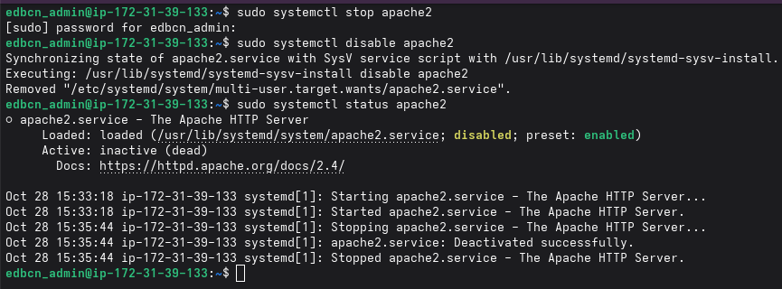
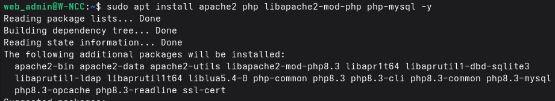

# Base de datos MySQL: evolución durante el Sprint 2

## Cambio de función del servidor original

La máquina monolítica del Sprint 1 pasó a ejercer el papel de **B-NCC**, centrada en MySQL. Para ello se deshabilitó Apache, de modo que la web se sirviera exclusivamente desde W-NCC.

## Retirada del servicio web de B-NCC

Mantener Apache activo en el servidor de datos después de la migración genera un servicio innecesario. La documentación original registra la desactivación del servidor web de la instancia original.

```bash
sudo systemctl stop apache2
sudo systemctl disable apache2
sudo systemctl status mysql
```



## Acceso SQL por la red privada

Se modificó MySQL para atender conexiones desde W-NCC. El documento original muestra `bind-address=0.0.0.0` (escucha en todas las interfaces IPv4) y la creación de `webapp` con host `%` (el usuario SQL puede autenticarse desde cualquier origen que alcance el servidor, según el resto de permisos). Más adelante se retiraron privilegios de escritura para dejar acceso de lectura. Estas medidas por sí solas **no demuestran** que únicamente W-NCC pueda acceder: para afirmarlo se necesitaría verificar las reglas de Security Groups y los permisos efectivos en MySQL. No se presenta como aplicada una restricción de origen que no esté acreditada.

```bash
sudo grep -R "bind-address" /etc/mysql/mysql.conf.d/
sudo systemctl restart mysql
sudo systemctl status mysql
```

El procedimiento original indica que a `webapp` se le retiraron los permisos y se le dejó acceso de lectura. Para determinar los privilegios vigentes hay que consultar `SHOW GRANTS` desde una sesión administrativa; no basta con inferirlos del nombre de usuario.


## Pruebas desde el servidor web

Desde W-NCC se comprobó la llegada al puerto 3306 y el acceso a MySQL. Una vez confirmada la conectividad, la aplicación debe utilizar el host de B-NCC definido fuera de `index.php`.

```bash
nc -vz HOST_B_NCC 3306
mysql -h HOST_B_NCC -u USUARIO_LECTURA -p -e "SHOW DATABASES;"
```

Las contraseñas se introducen interactivamente, no como argumentos ni dentro del repositorio.



## Mejora del modelo de datos

El plan del Sprint 2 propone descomponer los datos en tablas relacionadas de distritos, barrios, tipos de centro y centros educativos. Las consultas sobre los registros y los distritos evidencian exploración de datos, pero no constituyen prueba de creación de esas tablas y claves foráneas. Por ello, este apartado documenta la propuesta de normalización, **no una migración ya completada**. Solo se afirmará su ejecución cuando existan scripts DDL y consultas que acrediten las relaciones implementadas.

## Actualización de la dirección de B-NCC y del acceso de W-NCC

La IP `172.31.39.133` corresponde a la primera etapa del Sprint 2. Tras el despliegue de las subredes, B-NCC aparece en `172.31.102.10/24` y el nuevo grupo de seguridad de B-NCC permite TCP/3306 desde W-NCC (`172.31.101.10/32`). Se mantiene el historial de configuración original, incluidas las medidas aplicadas al usuario SQL, sin considerar esos datos como la política de red vigente.

Desde W-NCC se ejecutó:

```bash
nc -zv -w 5 172.31.102.10 3306
```

El resultado `succeeded` confirma que la ruta y las reglas permiten conectar al puerto MySQL. No demuestra por sí solo que la aplicación PHP haya ejecutado una consulta SQL con éxito después de cambiar de IP. La prueba de bloqueo de SSH directo y de ICMP, junto a la regla permitida para MySQL, aparece en [pruebas de aislamiento](../../tests/pruebas-sprint-02-segmentacion.md).
