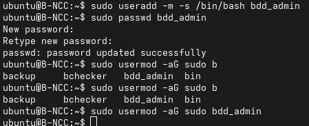
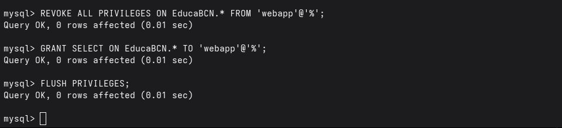

# Adaptación de MySQL al segundo servidor: Sprint 2

## Índice

- [1. Objetivo](#1-objetivo)
- [2. Preparación de B-NCC](#2-preparacion-de-b-ncc)
- [3. Desactivar Apache en el servidor de datos](#3-desactivar-apache-en-el-servidor-de-datos)
- [4. Acceso de red a MySQL](#4-acceso-de-red-a-mysql)
- [5. Usuario de aplicación webapp](#5-usuario-de-aplicacion-webapp)
- [6. Comprobación desde W-NCC](#6-comprobacion-desde-w-ncc)
- [7. Resultado](#7-resultado)


## 1. Objetivo

La máquina que contenía toda la aplicación se reutilizó como B-NCC, destinada a MySQL. Se dejó de servir la página desde la instancia antigua y se habilitó el acceso remoto a la base de datos desde W-NCC.

## 2. Preparación de B-NCC

Se configuró el nombre `B-NCC` y se creó la cuenta Linux `bdd_admin`, añadiéndola al grupo `sudo` para tareas administrativas. La cuenta de MySQL utilizada por PHP es independiente de esta cuenta Linux.


*Cambio del nombre de host de la instancia a B-NCC.*



*Creación de la cuenta Linux bdd_admin.*

## 3. Desactivar Apache en el servidor de datos

Tras trasladar la web a W-NCC se desactivó Apache en B-NCC para que el antiguo equipo quedara dedicado al servicio de base de datos.

```bash
sudo systemctl stop apache2
sudo systemctl disable apache2
sudo systemctl status apache2
```


*Apache detenido y deshabilitado en B-NCC.*

## 4. Acceso de red a MySQL

Para aceptar conexiones que no provienen de `localhost`, se configuró MySQL para escuchar también en la interfaz de red. En el documento aparece:

```ini
bind-address = 0.0.0.0
```


*Configuración del bind-address de MySQL para conexiones remotas.*

El valor `0.0.0.0` indica escucha en todas las interfaces IPv4. **No es una restricción de origen**: la protección depende de los Security Groups, de las rutas y de las cuentas autorizadas de MySQL. Para la solución distribuida se recomienda limitar TCP/3306 al servidor W-NCC.

## 5. Usuario de aplicación webapp

Se creó el usuario MySQL `webapp` para las conexiones remotas, distinto de `bchecker` y de `bdd_admin`. En las capturas se observa la asignación de permisos de lectura sobre `EducaBCN`, seguida de una prueba de consulta desde W-NCC. La creación inicial usó el host comodín `%`, por lo que el control de acceso no depende exclusivamente del usuario MySQL.



*Permisos de lectura configurados para webapp.*

## 6. Comprobación desde W-NCC

```bash
nc -zv 172.31.39.133 3306
mysql -h 172.31.39.133 -u webapp -p EducaBCN
```


*Comprobación del puerto MySQL desde W-NCC.*


*Consulta remota de MySQL desde W-NCC.*

La captura muestra que una operación de escritura no está autorizada para el usuario utilizado, lo que es coherente con una aplicación de consulta. La conexión real de PHP también depende de que las credenciales guardadas en W-NCC coincidan con las de MySQL.

## 7. Resultado

B-NCC quedó como servidor de datos independiente de la web. El navegador puede mostrar los registros a través de W-NCC, tal como se recoge en la documentación de migración de la aplicación.
