# DNS y DHCP en F-NCC: Sprint 2

## Índice

- [1. Distribución](#1-distribucion)
- [2. Instalación de BIND9](#2-instalacion-de-bind9)
- [3. Registros de la zona](#3-registros-de-la-zona)
- [4. Consultas y resolución desde otros equipos](#4-consultas-y-resolucion-desde-otros-equipos)
- [5. Instalación de ISC DHCP](#5-instalacion-de-isc-dhcp)
- [6. Diferencia entre servicio activo y concesiones verificadas](#6-diferencia-entre-servicio-activo-y-concesiones-verificadas)


## 1. Distribución

Las capturas del Sprint 2 muestran BIND9 e ISC DHCP instalados y configurados en la instancia F-NCC. El mismo servidor aloja vsftpd. El DNS de laboratorio usa `educabcn.local` y registros A que resuelven a las IP privadas de los servidores.

## 2. Instalación de BIND9

```bash
sudo apt update
sudo apt install bind9 bind9utils bind9-doc -y
```

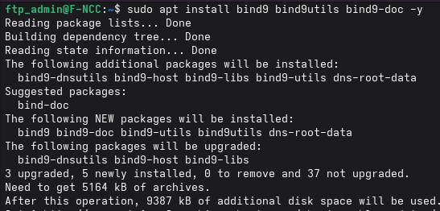

*Instalación de BIND9 y herramientas de administración DNS.*

Se declaró la zona local en `/etc/bind/named.conf.local` y se preparó el archivo `/etc/bind/db.educabcn.local` como base para los registros.

```text
zone "educabcn.local" {
    type master;
    file "/etc/bind/db.educabcn.local";
};
```

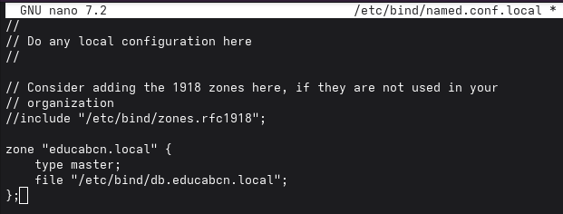

*Declaración de zona interna educabcn.local en BIND9.*

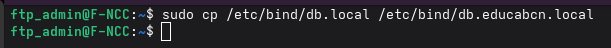

*Preparación del archivo de zona DNS local.*

## 3. Registros de la zona

La zona incluye los servidores con las direcciones privadas observadas:

| Registro | Tipo | Valor documentado |
|---|---|---|
| `web.educabcn.local` | A | `172.31.31.159` |
| `db.educabcn.local` | A | `172.31.39.133` |
| `ftp.educabcn.local` | A | `172.31.16.170` |

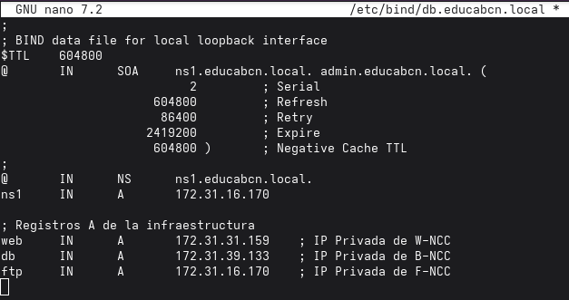

*Registros DNS de los tres servidores en el archivo de zona.*

Después se reinició el servicio y se validaron las consultas locales.

```bash
sudo named-checkconf
sudo named-checkzone educabcn.local /etc/bind/db.educabcn.local
sudo systemctl restart bind9
sudo systemctl status bind9
```

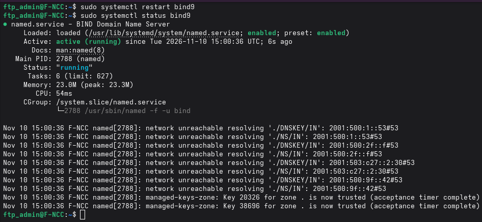

*Servicio BIND9 activo.*

## 4. Consultas y resolución desde otros equipos

Se comprobaron respuestas con `dig`, `nslookup` y `ping`, tanto en F-NCC como en las instancias W-NCC y B-NCC.

```bash
dig @127.0.0.1 web.educabcn.local
nslookup db.educabcn.local 172.31.16.170
ping -c 4 db.educabcn.local
```

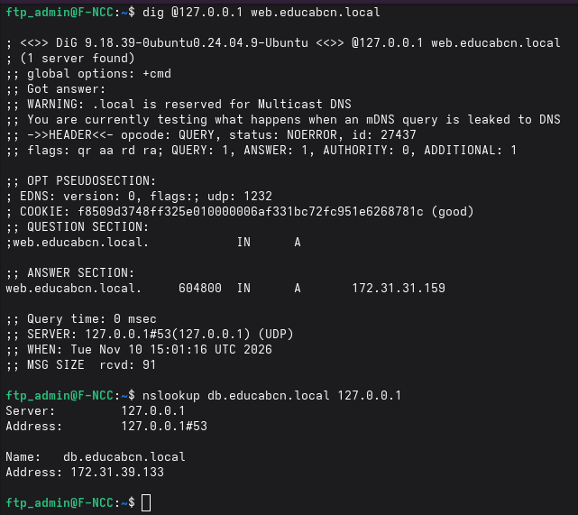

*Consultas DNS locales desde F-NCC.*

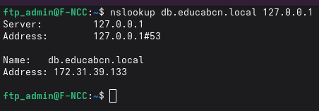

*Resolución del nombre db.educabcn.local en el servidor DNS.*

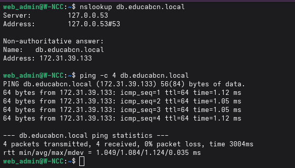

*Resolución y ping al servidor de datos desde W-NCC.*

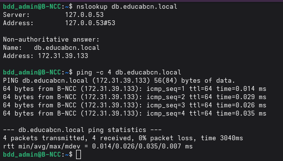

*Resolución y ping al servidor de datos desde B-NCC.*

## 5. Instalación de ISC DHCP

Se instaló el demonio `isc-dhcp-server`. El proyecto muestra el fichero de parámetros de DHCP y el servicio iniciado mediante `systemd`.

```bash
sudo apt install isc-dhcp-server -y
sudo systemctl status isc-dhcp-server
```

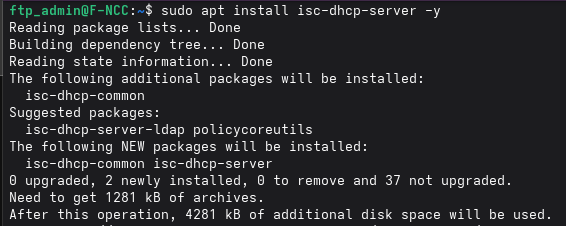

*Instalación del paquete isc-dhcp-server.*

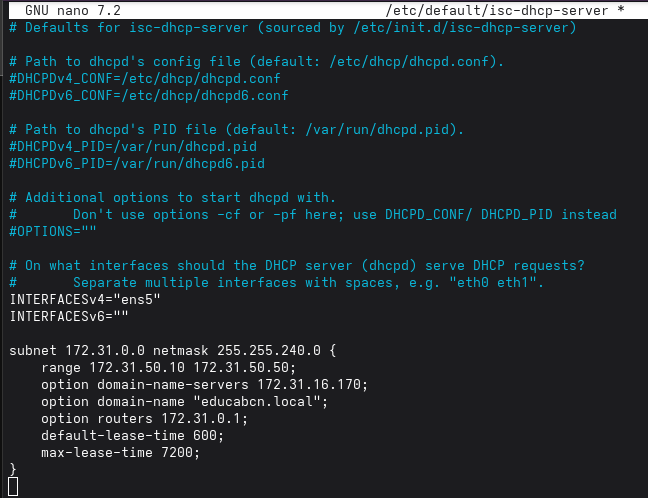

*Configuración de ISC DHCP e interfaz de servicio.*

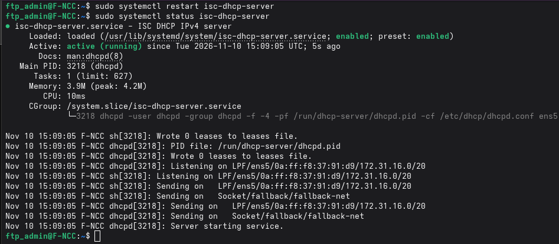

*ISC DHCP iniciado en la instancia F-NCC.*

## 6. Diferencia entre servicio activo y concesiones verificadas

La prueba disponible acredita la instalación, configuración y ejecución del demonio, pero no documenta una concesión DHCP obtenida por un cliente Windows o Linux. En una VPC de AWS las instancias EC2 suelen recibir parámetros del DHCP administrado por AWS; instalar otro servidor en EC2 no convierte automáticamente a ese servidor en proveedor de direcciones para la subred.

Esta distinción evita atribuir a ISC DHCP funciones que no están demostradas en las capturas del proyecto.
