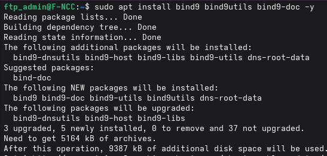
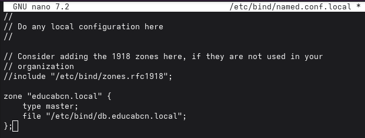
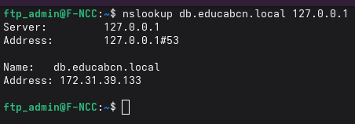
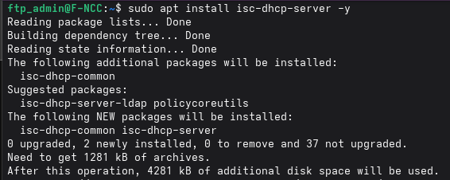
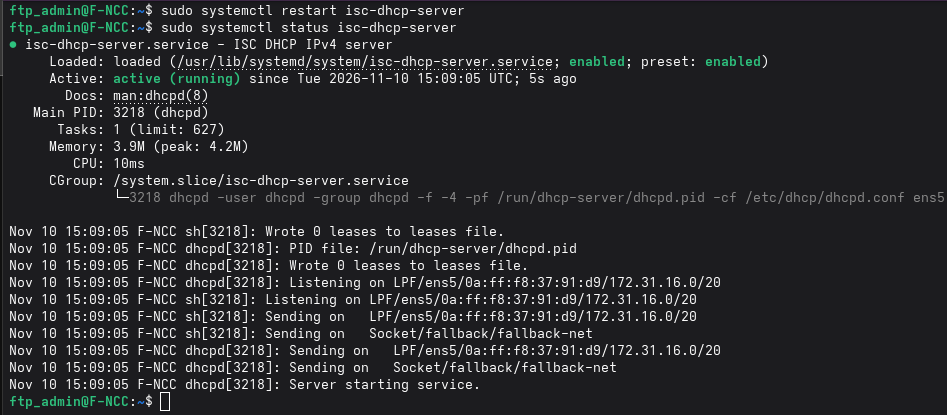
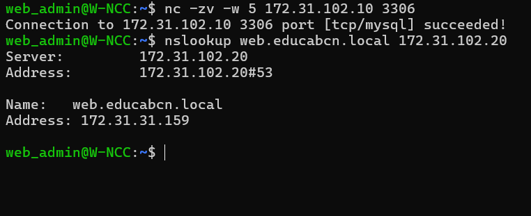
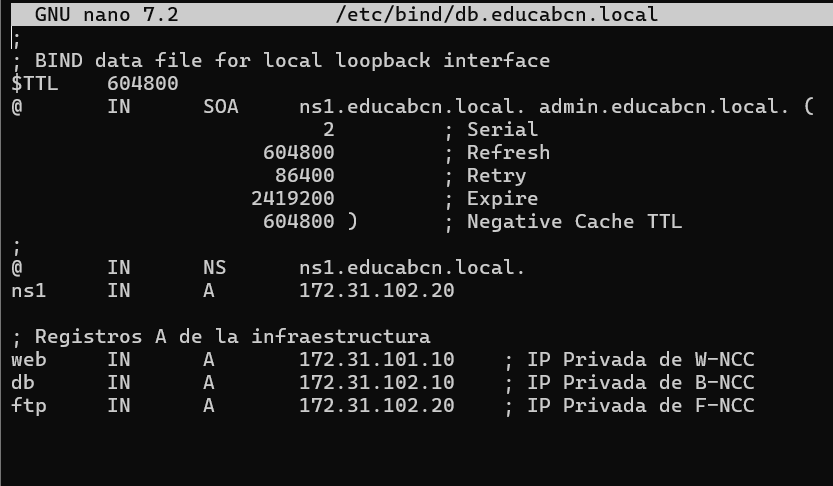

# DNS y DHCP: Sprint 2

El documento de trabajo incluye la instalación de BIND9 y del servicio ISC DHCP, la edición de la zona DNS interna y comprobaciones desde diferentes servidores. Los servicios se estudian por separado porque cumplen funciones distintas.

## Instalación del servicio BIND9

Se instaló el paquete del servidor DNS para resolver nombres internos asociados a EducaBCN. Se comprobó su presencia y se preparó el archivo de definición de zona.

```bash
sudo apt update
sudo apt install bind9 bind9-utils dnsutils -y
sudo systemctl status bind9
```



## Declaración de la zona DNS

La zona local se registró en `/etc/bind/named.conf.local`, apuntando a un fichero específico con los registros de la red interna. Se utilizaron nombres lógicos para evitar acoplar el código PHP a IP concretas.

```bash
sudo named-checkconf
sudo systemctl restart bind9
```

La sintaxis exacta de los registros debe mantenerse sincronizada con la zona y las direcciones privadas actuales.




## Comprobación del servicio DNS

Tras el reinicio se revisó el estado del demonio y se realizaron consultas desde el nodo DNS y desde otros servidores. De este modo se separa la validación del proceso (servicio iniciado) de la verificación funcional (respuesta DNS adecuada).

```bash
sudo systemctl status bind9
dig @HOST_DNS web.educabcn.local
getent hosts web.educabcn.local
```




## Instalación de ISC DHCP

Se instaló ISC DHCP Server, se configuró la interfaz indicada en `/etc/default/isc-dhcp-server` y se revisó el estado del demonio. Estas capturas acreditan instalación y comprobación del servicio, pero **no demuestran la asignación de una dirección IP por este servidor a un cliente**. En una subred VPC de AWS la asignación DHCP de EC2 está gestionada por AWS: la mera instalación de ISC DHCP en otra instancia no reemplaza ese mecanismo. Se documenta como trabajo de laboratorio, no como servicio efectivo de asignación de las IP de las instancias EC2.

```bash
sudo apt install isc-dhcp-server -y
sudo systemctl status isc-dhcp-server
cat /etc/default/isc-dhcp-server
```





## Actualización de DNS tras la migración de subredes (segunda etapa del Sprint 2)

Los registros anteriores se conservan porque pertenecen a la primera topología del Sprint 2. Al trasladar W-NCC, B-NCC y F-NCC a nuevas subredes, las consultas seguían devolviendo la IP antigua de W-NCC. La zona de BIND9 en F-NCC se revisó para adaptar los registros a los valores actuales.

| Registro A | IP inicial | IP tras la migración |
|---|---|---|
| `web.educabcn.local` | `172.31.31.159` | `172.31.101.10` |
| `db.educabcn.local` | `172.31.39.133` | `172.31.102.10` |
| `ftp.educabcn.local` | `172.31.16.170` | `172.31.102.20` |
| `ns1.educabcn.local` | `172.31.16.170` | `172.31.102.20` |

### Detección del registro desactualizado

```bash
nslookup web.educabcn.local 172.31.102.20
```

- `nslookup` pregunta por la IP asociada a un nombre.
- `172.31.102.20` es el DNS consultado explícitamente; no debe confundirse con el destino del registro web.



Aunque el servidor DNS respondía, `web.educabcn.local` devolvía `172.31.31.159`, dirección de la fase anterior. El estado «responde» no implicaba que la zona estuviera actualizada.

### Revisión de los registros A en BIND9

```bash
sudo nano /etc/bind/db.educabcn.local
```

En el fichero de zona se observaron los valores de la nueva red y un número de serie (`Serial`) pendiente de incrementar antes de recargar la zona. El operador recibió la indicación de pasar de `2` a `3`; esto se conserva como procedimiento, pero el PDF y las capturas recibidas no muestran una prueba final de recarga con número de serie incrementado.



La captura registra las IP actuales para `ns1`, `web`, `db` y `ftp`.

### Validación y recarga previstas tras la edición

```bash
sudo named-checkzone educabcn.local /etc/bind/db.educabcn.local
sudo rndc reload educabcn.local
nslookup web.educabcn.local 172.31.102.20
nslookup db.educabcn.local 172.31.102.20
```

- `named-checkzone` valida la sintaxis y coherencia de la zona.
- `rndc reload` solicita a BIND9 recargarla, tras incrementar su número de serie.
- Las consultas finales deben devolver `172.31.101.10` y `172.31.102.10` respectivamente.

La prueba posterior de firewall sí muestra que `db.educabcn.local` devuelve `172.31.102.10`; véase [pruebas de red](../../tests/pruebas-sprint-02-segmentacion.md). No se inventa una captura independiente de la resolución final de `web.educabcn.local`.

**La configuración de ISC DHCP documentada en la etapa anterior permanece sin cambios**; no se atribuye a ese servicio la asignación de IP de las instancias EC2, gestionada por AWS.
