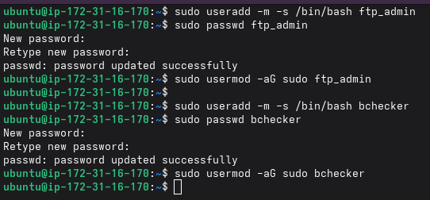
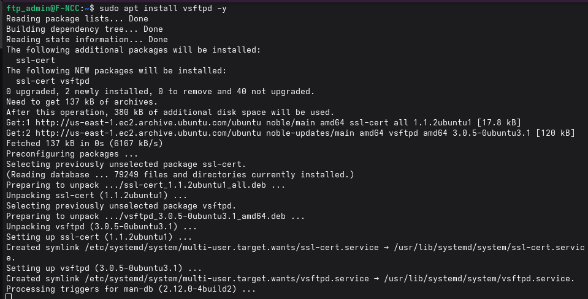
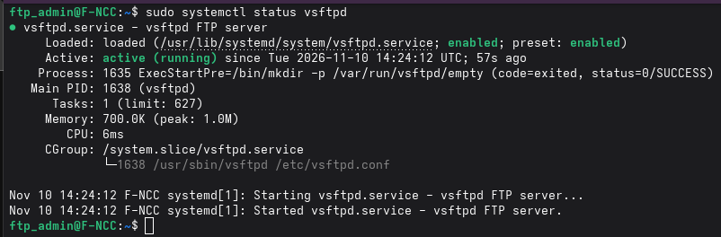
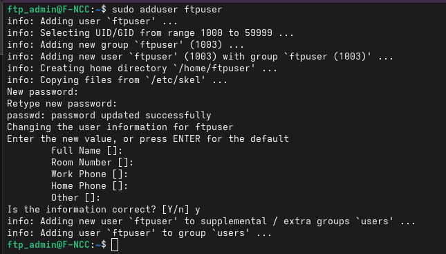
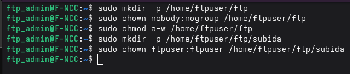
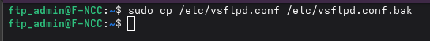
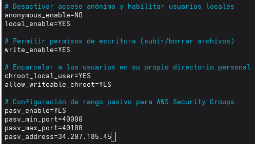
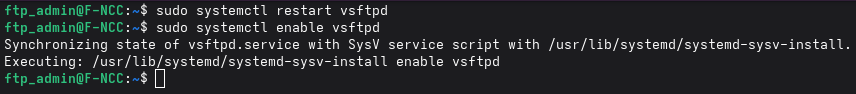
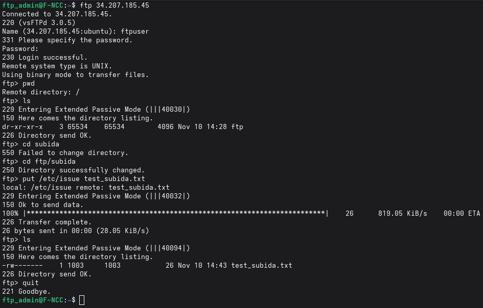

# Servidor de transferencia F-NCC: Sprint 2

## Índice

- [Objetivo](#objetivo)
- [1. Preparación del servidor](#1-preparacion-del-servidor)
- [2. Instalación y estado del servicio](#2-instalacion-y-estado-del-servicio)
- [3. Cuenta de transferencia y estructura de directorios](#3-cuenta-de-transferencia-y-estructura-de-directorios)
- [4. Archivo de configuración](#4-archivo-de-configuracion)
- [5. Reinicio y prueba](#5-reinicio-y-prueba)
- [Resultado](#resultado)


## Objetivo

Configurar en una instancia EC2 separada un servicio de transferencia de archivos y un usuario autorizado. El componente elegido es vsftpd sobre Ubuntu Server.

## 1. Preparación del servidor

El equipo asignó el nombre F-NCC y creó la cuenta administradora `ftp_admin`. La captura también registra la creación de otra cuenta Linux con permisos de administración.


*Nombre de host configurado como F-NCC.*



*Creación de cuentas Linux para administrar F-NCC.*

## 2. Instalación y estado del servicio

```bash
sudo apt update
sudo apt install vsftpd -y
sudo systemctl status vsftpd
```



*Instalación del servicio vsftpd en F-NCC.*



*Servicio vsftpd activo en systemd.*

## 3. Cuenta de transferencia y estructura de directorios

Se creó una cuenta `ftpuser` para las transferencias y se preparó un directorio al que se limita su sesión mediante `chroot`. El directorio raíz del chroot debe pertenecer a root o a una cuenta que impida su modificación; los datos que puede escribir el usuario deben estar en un subdirectorio específico.

```bash
sudo adduser ftpuser
sudo mkdir -p /home/ftpuser/ftp/subida
sudo chown root:root /home/ftpuser/ftp
sudo chmod 755 /home/ftpuser/ftp
sudo chown ftpuser:ftpuser /home/ftpuser/ftp/subida
```



*Creación de la cuenta destinada a las transferencias.*



*Preparación de carpetas y permisos para el usuario FTP.*

## 4. Archivo de configuración

El equipo guardó una copia del archivo original `/etc/vsftpd.conf` antes de modificarlo. Las capturas muestran acceso anónimo deshabilitado, usuarios locales habilitados, escritura permitida y `chroot_local_user=YES`, junto con un rango de puertos de modo pasivo.

```bash
sudo cp /etc/vsftpd.conf /etc/vsftpd.conf.bak
sudo nano /etc/vsftpd.conf
```



*Copia de seguridad del archivo de configuración de vsftpd.*



*Opciones configuradas de usuarios locales, chroot y modo pasivo.*

**Diferencia importante:** vsftpd puede configurarse con TLS, pero la configuración y la prueba visibles no acreditan que el canal FTP esté cifrado. No se denomina FTPS a este despliegue sin evidencia de certificados y negociación TLS.

## 5. Reinicio y prueba

```bash
sudo systemctl restart vsftpd
sudo systemctl enable vsftpd
sudo systemctl status vsftpd
```



*Reinicio y verificación del servicio FTP.*

La captura del cliente demuestra autenticación y transferencia en el servicio configurado. Para conexiones pasivas deben contemplarse las reglas de entrada del rango de puertos configurado y los límites de los Security Groups.



*Prueba de conexión y operaciones de transferencia FTP.*

## Resultado

El servicio FTP está instalado y se documenta una prueba operativa. El acceso a expedientes o ficheros personales reales no forma parte de las evidencias aportadas; para datos sensibles debe exigirse cifrado y una política de permisos adaptada.
