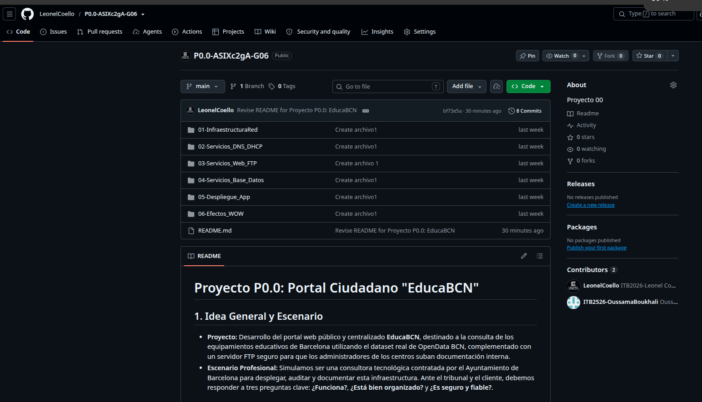
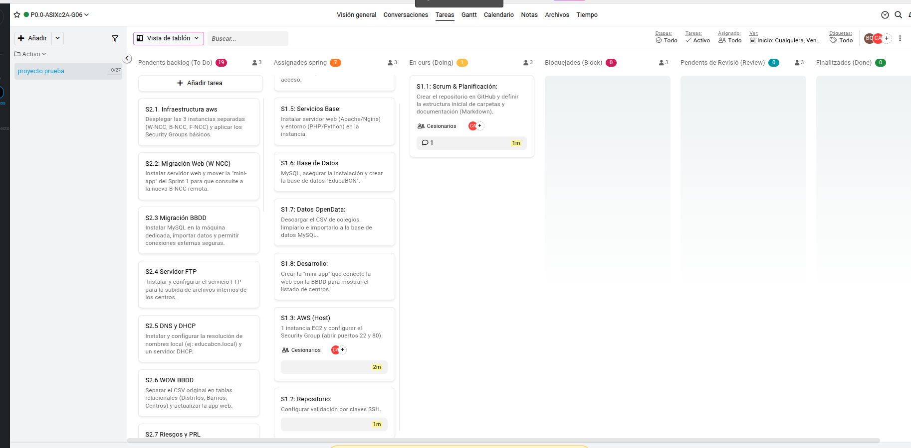
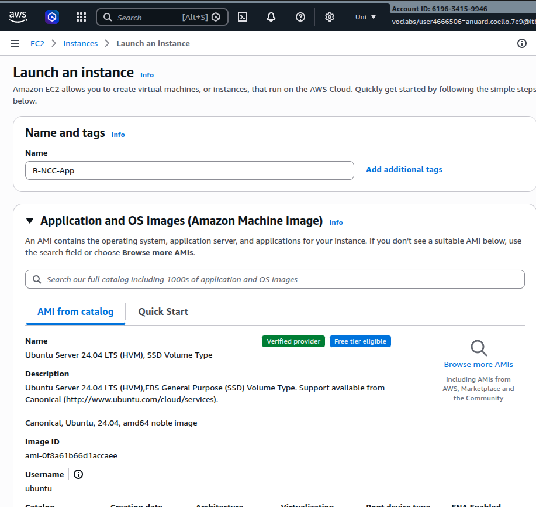
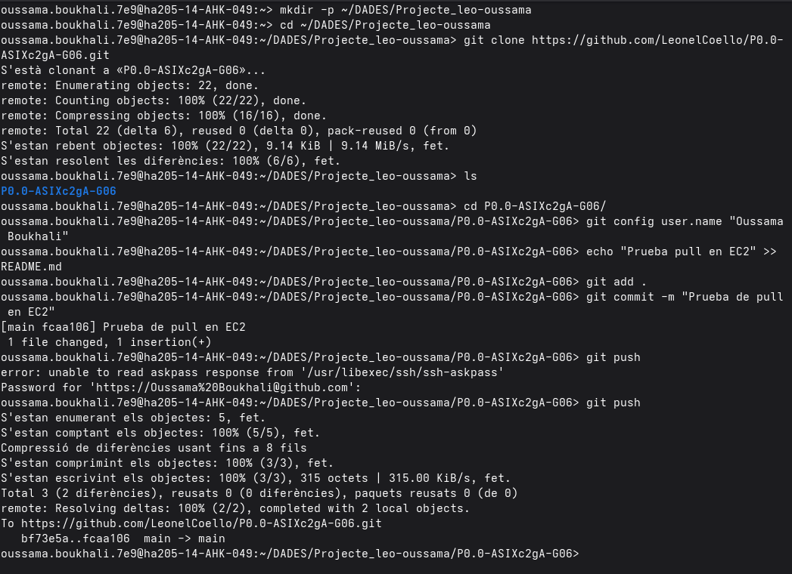
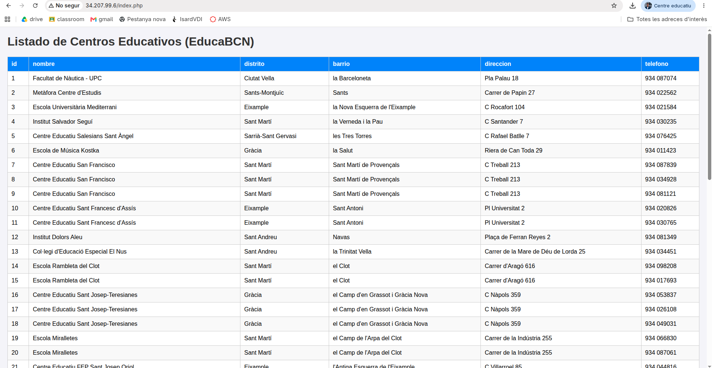

# Infraestructura y red: Sprint 1

La primera versión de EducaBCN se implantó sobre una única instancia de Amazon EC2 con Ubuntu Server 24.04 LTS. Se centralizaron Apache, PHP, MySQL y el portal para demostrar el flujo completo antes de distribuir los servicios. El procedimiento se describe cronológicamente; las imágenes son capturas reales de la documentación del equipo.

## Organización del repositorio y del trabajo

El equipo utilizó ProofHub para asignar actividades y GitHub como repositorio de código y documentación. La estructura inicial distribuía las evidencias por redes, servicios, bases de datos y aplicación. La planificación empezó con la definición del backlog y la asignación de responsabilidades.





## Creación de la instancia AWS EC2

Se inició una instancia virtual con Ubuntu Server 24.04 LTS. Se configuró su grupo de seguridad para habilitar los accesos necesarios durante el laboratorio y se vinculó un par de claves para el primer acceso administrativo. Es necesario conservar el identificador de la instancia y del grupo de seguridad en un inventario privado, sin publicar claves privadas ni contraseñas.

Comprobaciones útiles tras el arranque:

```bash
hostnamectl
lsb_release -a
ip -brief address
ip route
sudo systemctl status ssh
```

Estas comprobaciones permiten distinguir errores del sistema operativo, de la interfaz de red y del acceso remoto.



## Acceso SSH y cuentas de administración

En el Sprint 1 se accedió inicialmente a la instancia con una clave PEM y después se habilitó también la autenticación SSH por contraseña para las comprobaciones del laboratorio. Se creó la cuenta de Linux `bchecker` y se le concedieron privilegios administrativos mediante `sudo`. Esto describe la configuración efectivamente documentada, no una práctica recomendada para un entorno expuesto a Internet. La cuenta Linux `bchecker` no debe confundirse con el usuario SQL del mismo nombre. En el diseño de seguridad se recomienda usar claves personales y separar cuentas administrativas de cuentas de servicio; no hay constancia de que la autenticación por contraseña ya se haya deshabilitado.

```bash
whoami
id
sudo systemctl status ssh
sudo getent group sudo
```

Para documentar el acceso basta con registrar el procedimiento y una captura sin revelar nombres de claves privadas ni material secreto.


## Validación de la infraestructura monolítica

Con la instancia preparada se instalaron los servicios del prototipo. La validación del Sprint 1 consistió en consultar los centros educativos desde el navegador y confirmar que el portal obtenía los datos del MySQL local. El resultado obtenido confirma la viabilidad del prototipo; no equivale a pruebas de alta disponibilidad.




