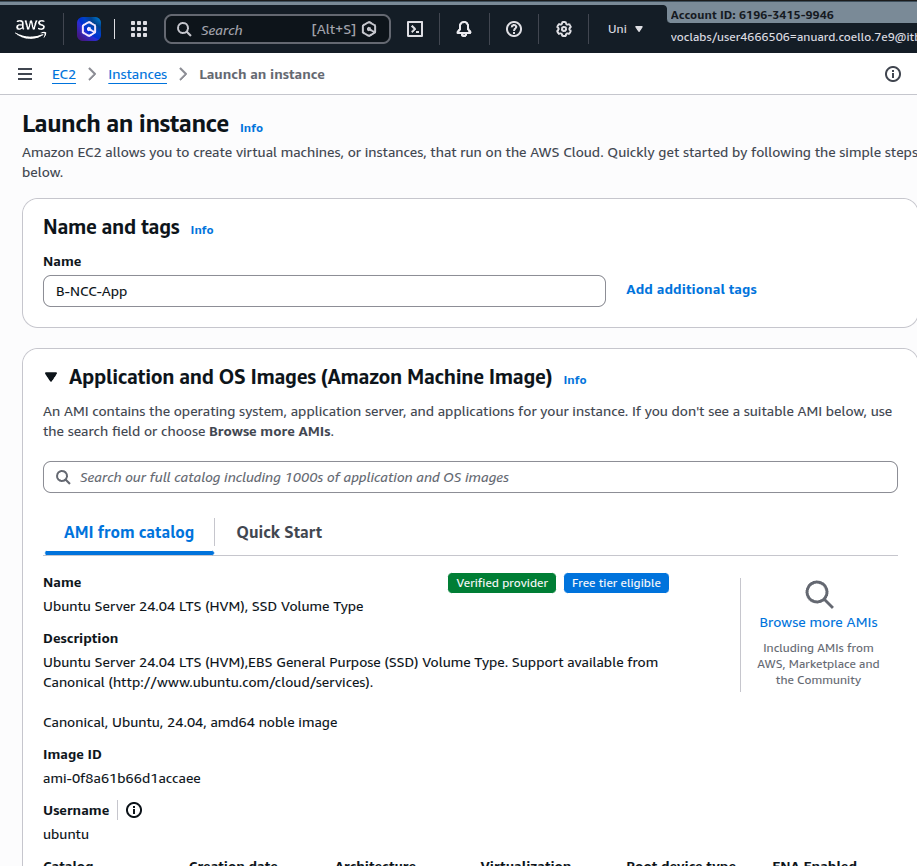
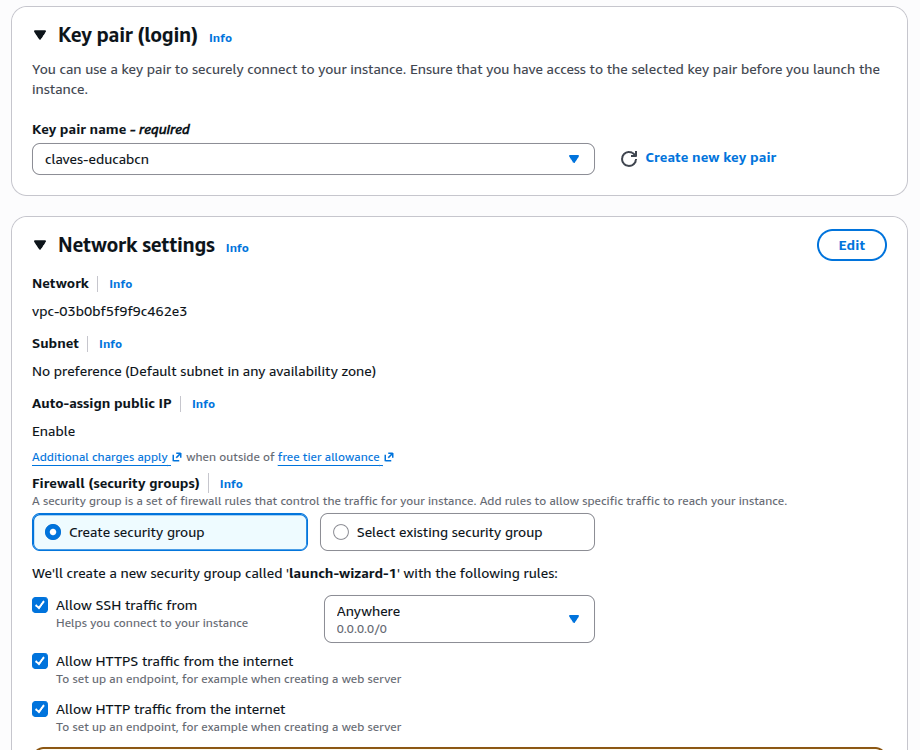
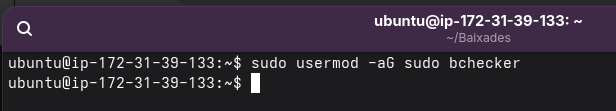
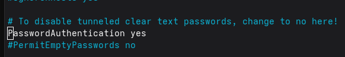
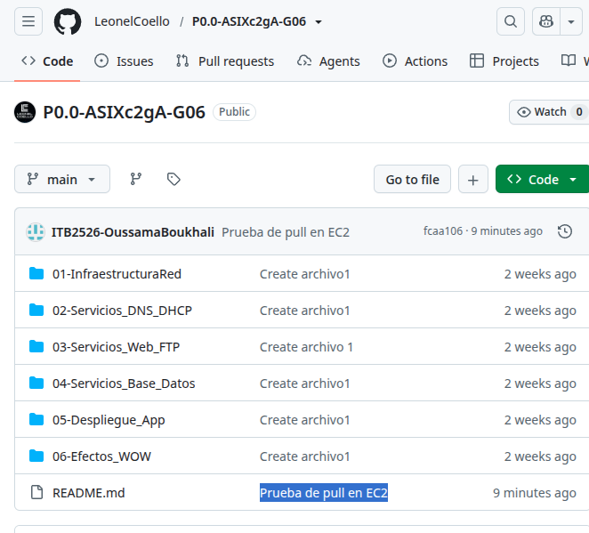
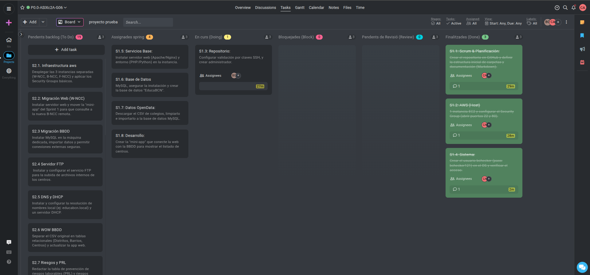

# Infraestructura de red: Sprint 1

## Índice

- [Contexto](#contexto)
- [1. Crear la instancia](#1-crear-la-instancia)
- [2. Reglas de acceso](#2-reglas-de-acceso)
- [3. Acceso SSH y cuentas](#3-acceso-ssh-y-cuentas)
- [4. Organización del trabajo](#4-organizacion-del-trabajo)
- [5. Resultado](#5-resultado)


## Contexto

La primera versión de EducaBCN se construyó en una sola instancia EC2 con Ubuntu Server 24.04 LTS. El servidor alojaba Apache, PHP, MySQL y los archivos de la aplicación. Esta configuración permitió validar el conjunto de datos y el portal antes de separar responsabilidades.

## 1. Crear la instancia

En la consola de EC2 se seleccionó una AMI Ubuntu Server, se asignó un nombre de instancia y se definió el par de claves. La elección de una instancia Linux permitió administrar el sistema con comandos y `systemd`.



*Selección de Ubuntu Server y nombre de instancia EC2.*

## 2. Reglas de acceso

Se prepararon las opciones de conectividad y los Security Groups de AWS. Para el despliegue se requirió SSH administrativo y acceso HTTP de prueba al portal. Las reglas concretas deben revisarse en la consola antes de exponer un puerto; permitir SSH desde cualquier origen no es una configuración recomendable para un uso permanente.



*Configuración inicial de acceso a la instancia AWS.*

## 3. Acceso SSH y cuentas

Se utilizó un par de claves de AWS para establecer una sesión SSH con la instancia. Posteriormente se creó una cuenta Linux `bchecker`, a la que se dieron permisos de `sudo` y se habilitó la autenticación mediante contraseña para realizar pruebas. Este usuario Linux no debe confundirse con la cuenta MySQL que aparece con el mismo nombre.

```bash
sudo adduser bchecker
sudo usermod -aG sudo bchecker
sudo systemctl restart ssh
```



*Alta del usuario en el grupo sudo.*



*Configuración histórica de autenticación SSH por contraseña.*

La imagen acredita la configuración realizada, no que el acceso por contraseña sea la opción más segura. Se recomienda limitar SSH a administradores y direcciones autorizadas, preferentemente con claves.

## 4. Organización del trabajo

El equipo creó su repositorio en GitHub y utilizó ProofHub para registrar los hitos del despliegue. Esta estructura permitió relacionar la instalación con los cambios publicados.



*Estructura inicial del repositorio GitHub.*



*Tablero de tareas de ProofHub durante el despliegue.*

## 5. Resultado

La instancia de la primera fase sirvió de entorno integrado. En la fase posterior se reutilizó como servidor de base de datos B-NCC, desactivando Apache para que dejara de servir la web.
