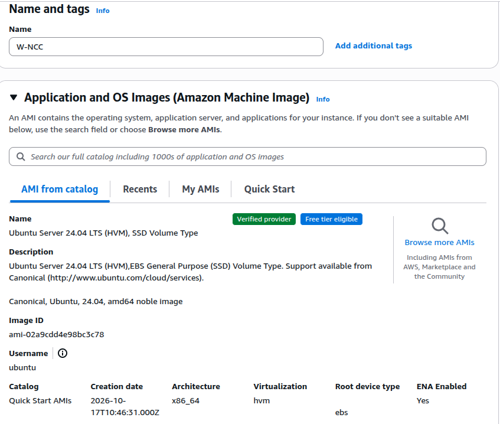
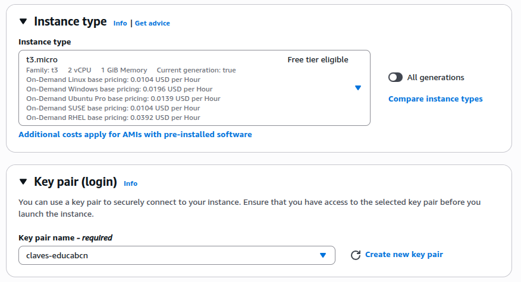
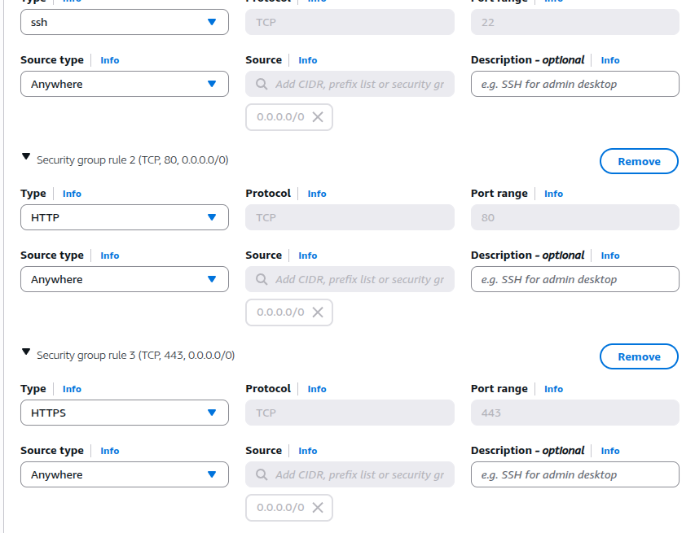
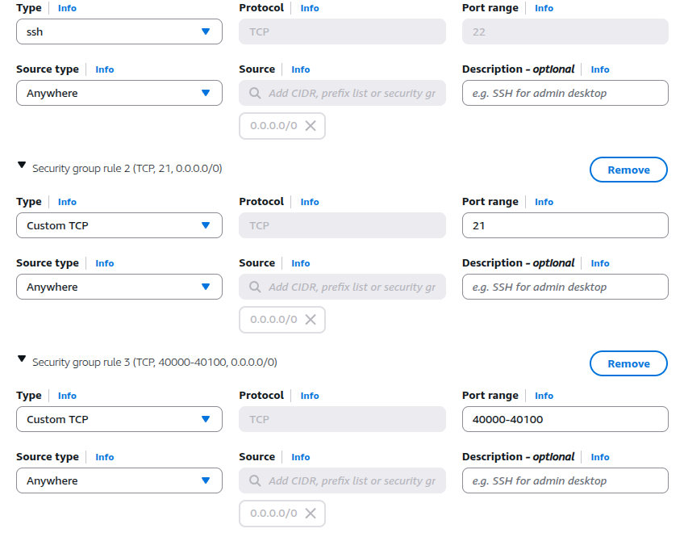
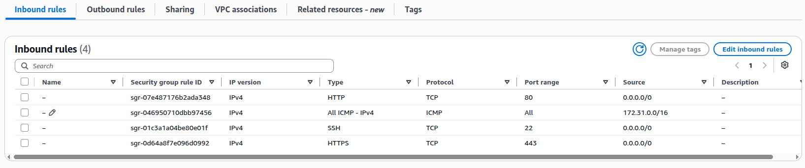

# Infraestructura de red: Sprint 2

## Índice

- [Objetivo](#objetivo)
- [1. Despliegue de W-NCC](#1-despliegue-de-w-ncc)
- [2. Despliegue de F-NCC](#2-despliegue-de-f-ncc)
- [3. Comunicación dentro de la VPC](#3-comunicacion-dentro-de-la-vpc)
- [4. Comprobación del puerto de MySQL](#4-comprobacion-del-puerto-de-mysql)
- [5. Estado de la arquitectura](#5-estado-de-la-arquitectura)


## Objetivo

Distribuir las responsabilidades entre tres instancias EC2 del mismo proyecto, manteniendo la posibilidad de comunicación interna para consultar MySQL. Se emplean los nombres W-NCC (web), B-NCC (datos) y F-NCC (servicios auxiliares).

## 1. Despliegue de W-NCC

Desde EC2 se creó una nueva instancia Ubuntu Server para Apache y PHP, con el nombre W-NCC. Se seleccionaron las opciones de máquina, claves y Security Groups correspondientes al acceso web y administrativo.



*Creación de la instancia EC2 W-NCC.*



*Selección de tipo de instancia y clave SSH para W-NCC.*



*Configuración inicial de reglas para HTTP, HTTPS y SSH.*

## 2. Despliegue de F-NCC

Se creó una instancia separada para vsftpd y los servicios de nombres y DHCP que aparecen configurados en la documentación. Las capturas muestran su creación y acceso por SSH.


*Creación de la instancia F-NCC en AWS.*

## 3. Comunicación dentro de la VPC

Los equipos del documento emplean IP privadas en el rango `172.31.x.x`. No debe inferirse que eso suponga varias subredes de seguridad. Las comunicaciones se autorizan mediante las reglas de las interfaces y los Security Groups aplicados a las instancias.

| Equipo | IP privada observada | Función |
|---|---|---|
| W-NCC | `172.31.31.159` | Web / PHP |
| B-NCC | `172.31.39.133` | MySQL |
| F-NCC | `172.31.16.170` | FTP / DNS / DHCP |

La documentación registra reglas ICMP añadidas para poder probar conectividad entre instancias. Una respuesta de `ping` demuestra llegada ICMP, no que todos los servicios sean accesibles ni que el aislamiento entre zonas sea correcto.



*Reglas de conectividad entre instancias para pruebas.*



*Security Groups asociados al entorno AWS.*

## 4. Comprobación del puerto de MySQL

En W-NCC se utilizó el puerto TCP 3306 para verificar que B-NCC estaba accesible por red antes de configurar PHP:

```bash
nc -zv 172.31.39.133 3306
```


*Prueba de conexión TCP al puerto MySQL de B-NCC desde W-NCC.*

## 5. Estado de la arquitectura

El resultado de esta fase es una infraestructura distribuida a nivel de instancias y servicios. El esquema de un router dedicado, DMZ, Intranet y NAT pertenece al diseño posterior y no se describe como parte de esta instalación.
