# Infraestructura y red: evolución durante el Sprint 2

## Motivo de la separación

En la primera fase la caída de una sola instancia dejaba inaccesibles simultáneamente la aplicación y la base de datos. Para reducir este acoplamiento se utilizaron tres nodos EC2: W-NCC para la web, B-NCC para los datos y F-NCC para el servicio de transferencia. El servidor original se conservó como B-NCC, deshabilitando Apache.

## Creación del servidor W-NCC

Se aprovisionó la instancia del servidor web y se revisaron sus parámetros de red, acceso SSH y grupo de seguridad. Se dejó Apache y PHP sobre W-NCC, trasladando allí la aplicación que antes residía junto a la base de datos.

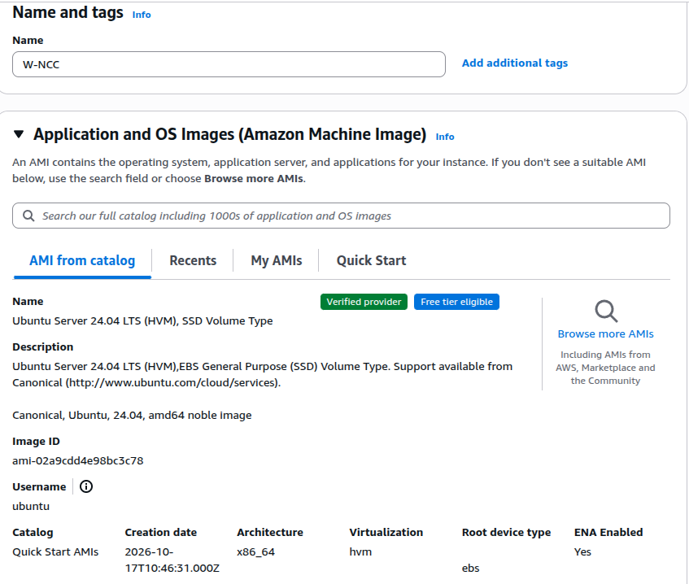

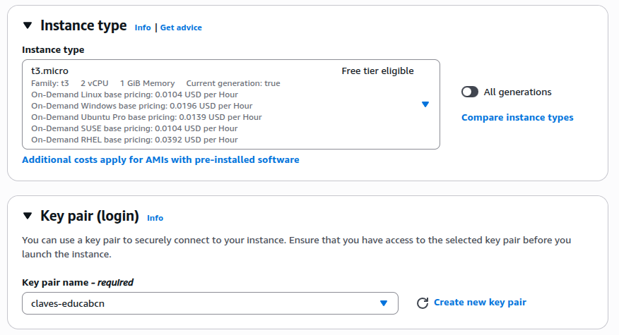

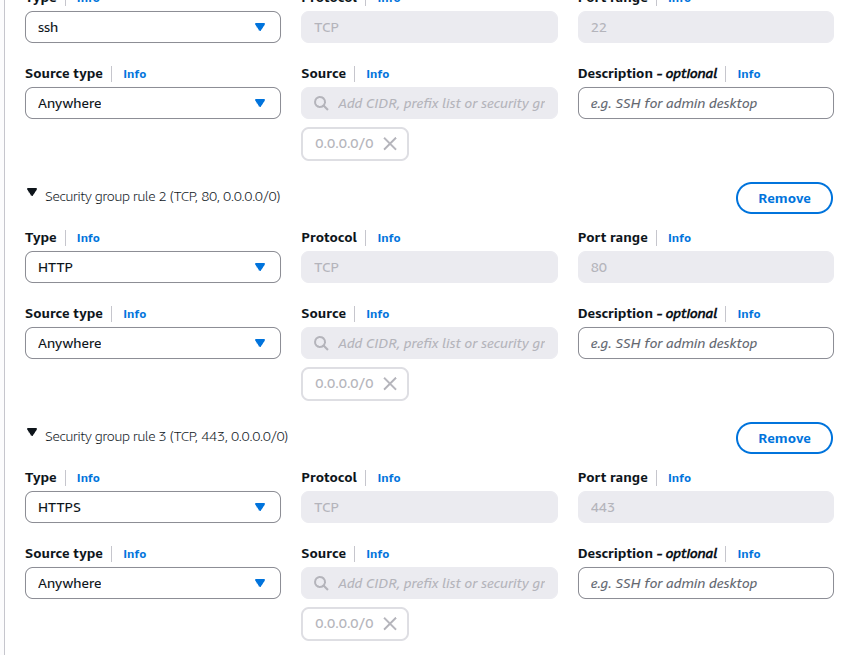

## Creación del servidor F-NCC

Se creó una instancia distinta para las transferencias. El servicio de archivos se administra de forma independiente del portal web y utiliza vsftpd. Esto permite controlar usuarios y superficie de exposición por servidor.

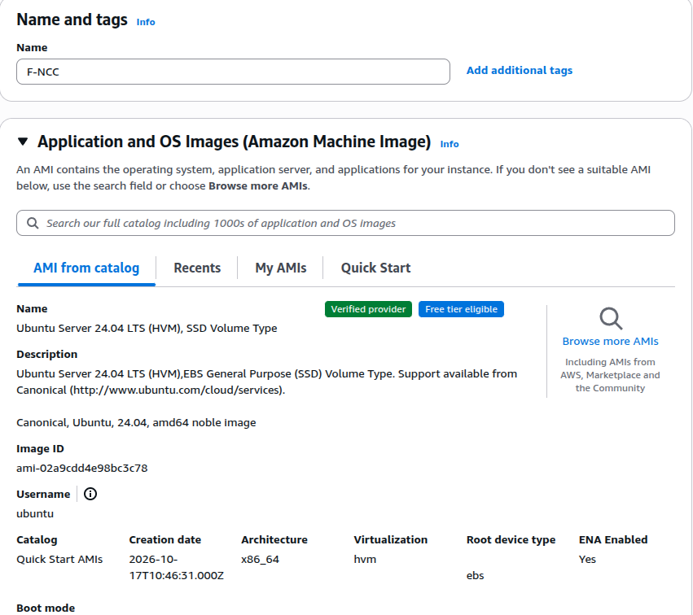

## Grupos de seguridad y tráfico entre nodos

Se añadieron reglas de conectividad y se verificó el intercambio ICMP durante el laboratorio. El documento original registra reglas temporales amplias; deben interpretarse como configuraciones de prueba y no como recomendación para producción. Para una política restrictiva, la conectividad MySQL debería admitirse únicamente desde W-NCC, y SSH desde ubicaciones administrativas autorizadas. Las reglas temporales amplias de laboratorio no acreditan que estas restricciones estén ya activas.

```bash
ip -brief address
ip route
getent hosts db.educabcn.local
nc -vz HOST_B_NCC 3306
```

`HOST_B_NCC` representa la IP privada o el nombre resuelto del nodo de base de datos. Una prueba TCP correcta no acredita que el usuario SQL tenga los permisos apropiados; esa prueba se registra separadamente.

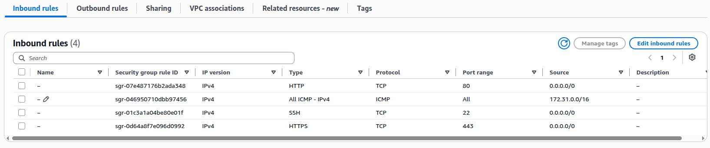

## Cambios de nombres de host y roles

La asignación de nombres W-NCC, B-NCC y F-NCC permite reconocer el rol de cada máquina en capturas, terminales y monitorización. Antes de trasladar un servicio se comprueba la configuración del hostname y el acceso administrativo.

```bash
hostnamectl
cat /etc/hostname
```

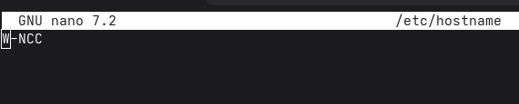

## Separación efectiva del servidor de datos

En la instancia reutilizada se desactivó Apache para evitar que continuase prestando el servicio web. Se mantuvo MySQL y se revisó el acceso remoto desde W-NCC. El diseño de seguridad recomienda no publicar el puerto 3306 en Internet y restringir su origen a W-NCC mediante reglas de red y permisos SQL. La prueba de conectividad desde W-NCC no verifica, por sí sola, que otros orígenes estén bloqueados.

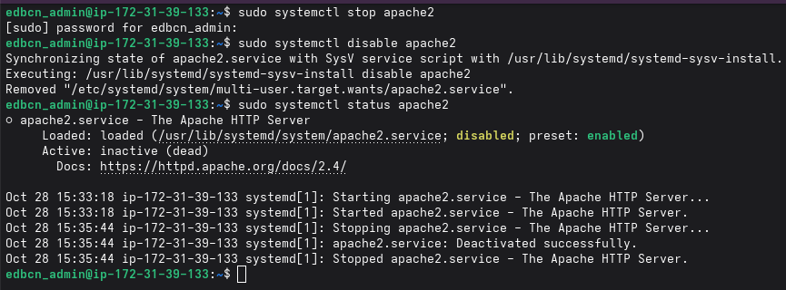

## Resolución de nombres interna

Las capturas posteriores recogen consultas DNS realizadas desde los servidores de web y de datos. Esto facilita comprobar que los nombres internos resuelven a las direcciones de red configuradas sin depender de valores incrustados en el código.

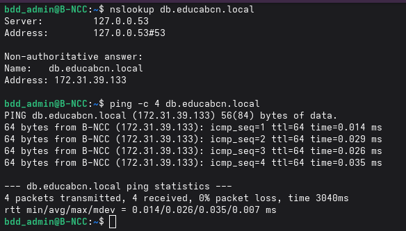

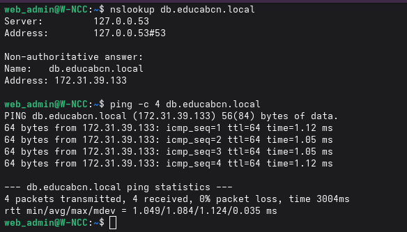

## S2.6. Router, redes y NAT: segunda etapa del Sprint 2

### Razón del cambio

Tras desplegar W-NCC, B-NCC y F-NCC con sus direcciones privadas originales, el equipo añadió una topología segmentada. Se decidió **incorporar al Sprint 2** la actividad denominada inicialmente S3.1 para que la infraestructura de red quedara implementada antes de dedicar la siguiente fase a mejoras avanzadas de EducaBCN. No se sustituyen las capturas de los primeros despliegues: representan el estado previo a la migración.

### Evolución del direccionamiento

| Máquina | IP privada de la primera etapa del Sprint 2 | IP privada tras migrar las subredes |
|---|---|---|
| W-NCC (web) | `172.31.31.159` | `172.31.101.10` (DMZ) |
| B-NCC (base de datos) | `172.31.39.133` | `172.31.102.10` (Intranet) |
| F-NCC (FTP/DNS/DHCP) | `172.31.16.170` | `172.31.102.20` (Intranet) |
| R-NCC | No existía | `ens5` `172.31.100.10`; `ens6` `172.31.101.254`; `ens7` `172.31.102.254` |

Las IP de la primera columna son históricas, necesarias para comprender los comandos y capturas anteriores. Las de la segunda se muestran en la documentación de la migración y en las capturas de verificación. Los valores `.1` que aparecen en algunos borradores de la tabla de R-NCC corresponden a las puertas de enlace que reserva AWS, no a las IP actuales del router Linux.

### Creación de la VPC segmentada y el servidor R-NCC

Se organizaron tres subredes de la VPC: `172.31.100.0/24` (WAN), `172.31.101.0/24` (DMZ) y `172.31.102.0/24` (Intranet). Se crearon las asociaciones de tablas de rutas y la instancia EC2 R-NCC, y se prepararon interfaces de red adicionales para conectar las zonas. La distinción entre la subred y la interfaz evita confundir una dirección de gateway de AWS con una dirección propia de R-NCC.

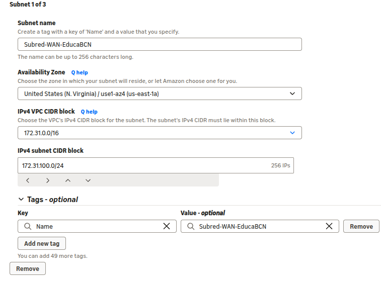

La subred WAN alberga la interfaz exterior de R-NCC.

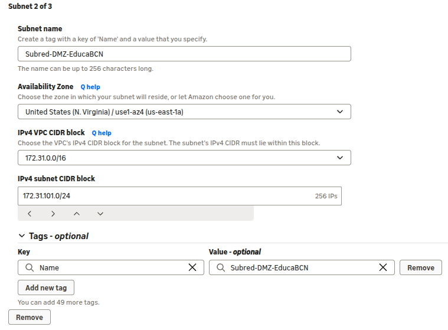

La DMZ aloja W-NCC y la interfaz de R-NCC orientada al servidor web.

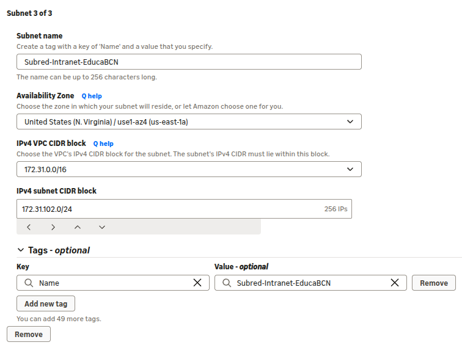

En la Intranet se ubican B-NCC y F-NCC en la topología observada. La intención de trasladar F-NCC a la DMZ aparece en una tarea anterior, pero no hay evidencia de que se haya ejecutado.

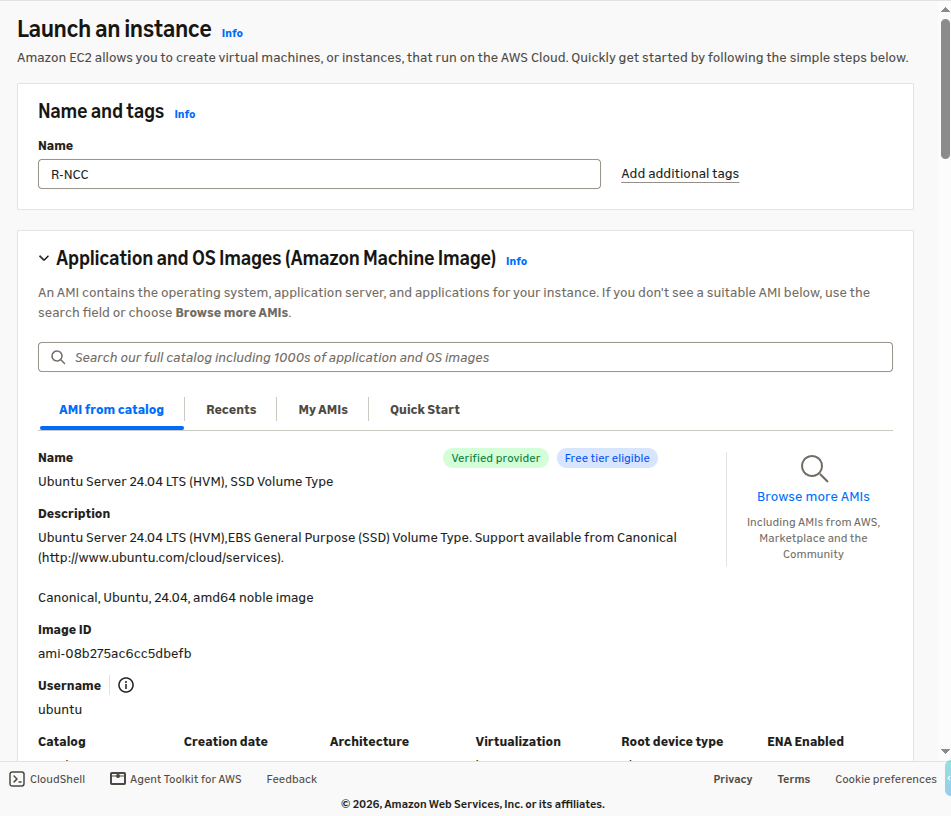

Se desplegó R-NCC en AWS y se configuraron las interfaces de red para las tres zonas.

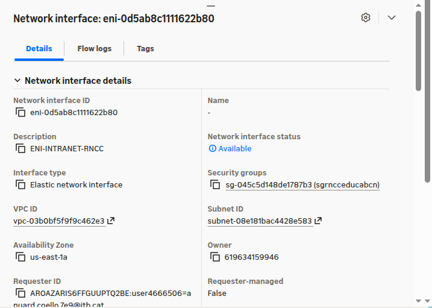

La captura acredita la preparación de interfaces de red elásticas para los segmentos adicionales.

### Habilitación de la función de router

Para que una instancia EC2 reenvíe tráfico ajeno debe desactivarse la comprobación **Source/Destination Check** en AWS y habilitarse el reenvío IPv4 dentro de Linux. La primera medida permite que R-NCC actúe como dispositivo intermedio; la segunda activa el encaminamiento por el kernel.

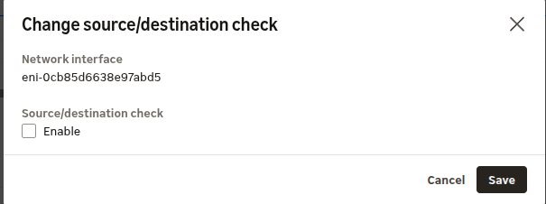

Se desactiva la comprobación de origen/destino, necesaria para el rol de router de la instancia.

La configuración de interfaces se documentó con Netplan; se comprueban las direcciones reales tras aplicarlo:

```bash
ip -br -4 a
ip route
sudo sysctl net.ipv4.ip_forward
```

- `ip -br -4 a`: muestra interfaces IPv4, IP y estado de forma abreviada.
- `ip route`: muestra la tabla de rutas dentro de R-NCC.
- `sudo sysctl net.ipv4.ip_forward`: consulta si el kernel reenvía paquetes (`1` habilitado, `0` deshabilitado).

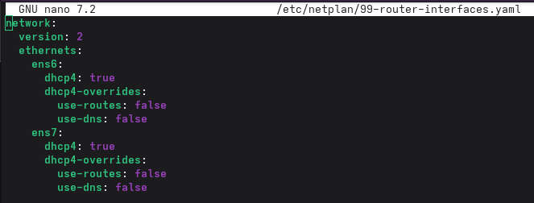

La captura muestra la preparación de interfaces de R-NCC en el documento de trabajo.

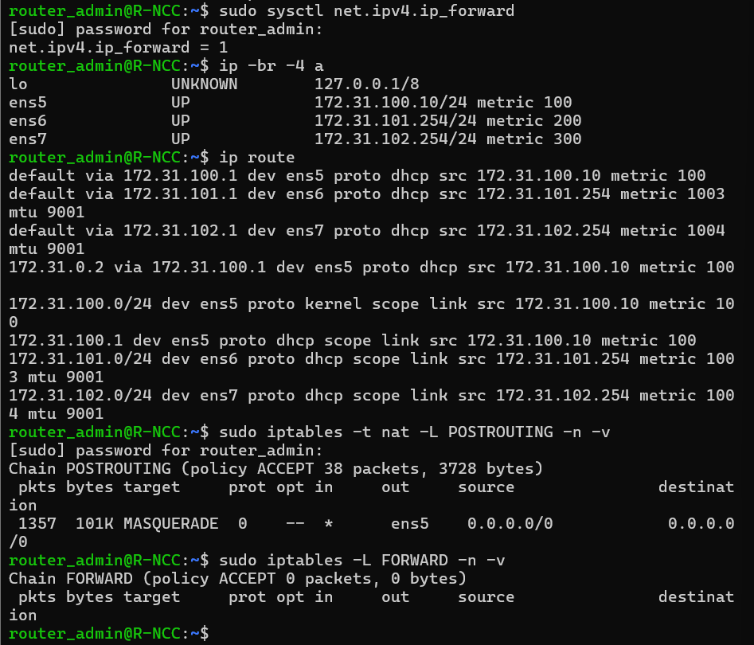

La prueba posterior registró `ens5=172.31.100.10`, `ens6=172.31.101.254`, `ens7=172.31.102.254`, las tres activas y `net.ipv4.ip_forward = 1`.

### Tablas de enrutamiento de AWS

Las capturas de AWS muestran rutas locales para la VPC y una salida `0.0.0.0/0` por el Internet Gateway en RT-WAN. La tabla RT-INTRANET está asociada a la subred de B-NCC/F-NCC y dirige su salida predeterminada a la interfaz de R-NCC. **La ruta `local` sigue existiendo**; un ping entre subredes no basta para probar que todo el tráfico interzona atraviesa el firewall del router.

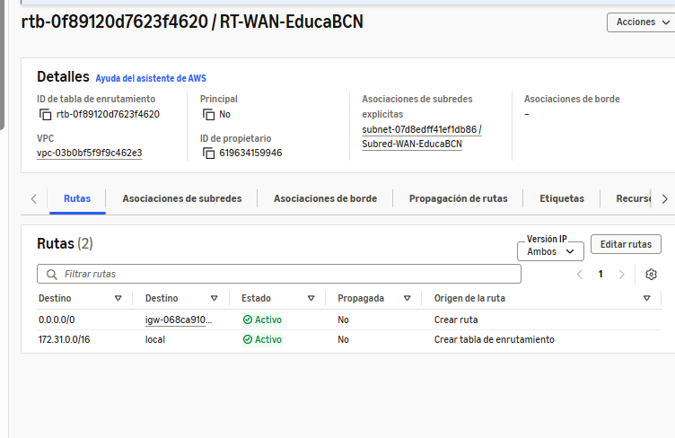

La WAN dispone de ruta predeterminada hacia el Internet Gateway.

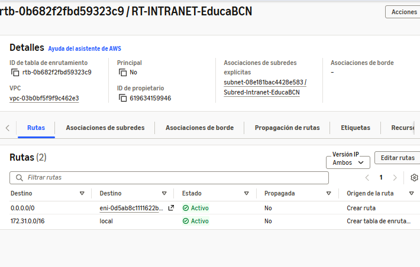

La Intranet dirige la salida predeterminada hacia una ENI de R-NCC.

En B-NCC se observó lo siguiente:

```bash
ip -br -4 a
ip route
```

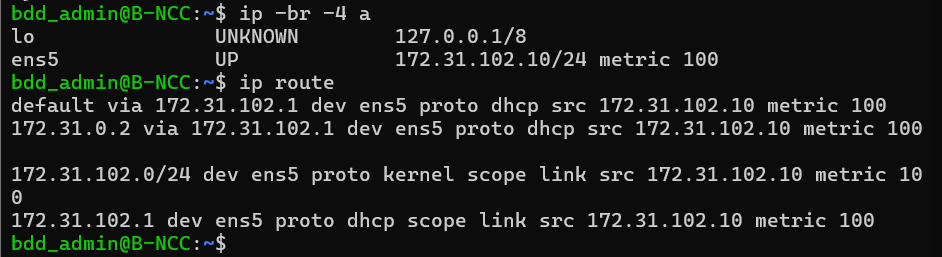

B-NCC tiene `172.31.102.10/24` y muestra como puerta de enlace de su sistema `172.31.102.1`, la del servicio de red de AWS. No es contradictorio con dirigir la salida de la subred a R-NCC mediante la tabla de rutas VPC.

### NAT mediante MASQUERADE

En R-NCC se configuró una regla `MASQUERADE` para la salida WAN por `ens5`. Esta traducción permite que las máquinas privadas utilicen la dirección WAN de R-NCC al salir a Internet, junto con las rutas y permisos adecuados.

```bash
sudo iptables -t nat -L POSTROUTING -n -v
sudo iptables -L FORWARD -n -v
```

- `-t nat` consulta la tabla de traducción de direcciones.
- `POSTROUTING` muestra reglas aplicadas a los paquetes a la salida.
- `-n -v` evita resolver nombres y muestra contadores.
- `FORWARD` lista el filtrado de paquetes que atraviesan el router.

La comprobación documentó `MASQUERADE` por `ens5`. En cambio, la cadena `FORWARD` mostró política predeterminada `ACCEPT`, sin reglas de aislamiento específicas; **el NAT no debe presentarse como un firewall entre zonas**. Las reglas de acceso por instancia están descritas en [seguridad del Sprint 2](../../security/configuracion-accesos.md).

### Verificación práctica de salida desde la Intranet

En B-NCC se ejecutó:

```bash
curl -4 -I --max-time 10 https://example.com
```

El comando solicita cabeceras HTTPS usando IPv4, con un límite de 10 segundos.

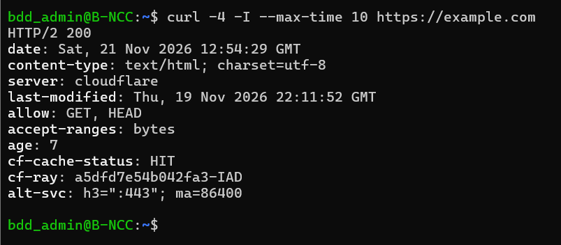

La respuesta `HTTP/2 200` acredita que el servidor B-NCC podía alcanzar un recurso externo.

Para identificar el recorrido, se observó el tráfico en las interfaces de R-NCC mientras B-NCC originaba una petición HTTPS:

```bash
sudo tcpdump -ni ens7 'src host 172.31.102.10 and tcp port 443'
sudo tcpdump -ni ens5 'tcp port 443'
```

- `-n`: evita consultas de nombres durante la captura.
- `-i`: selecciona la interfaz.
- El primer filtro muestra solicitudes HTTPS de B-NCC que llegan por `ens7`.

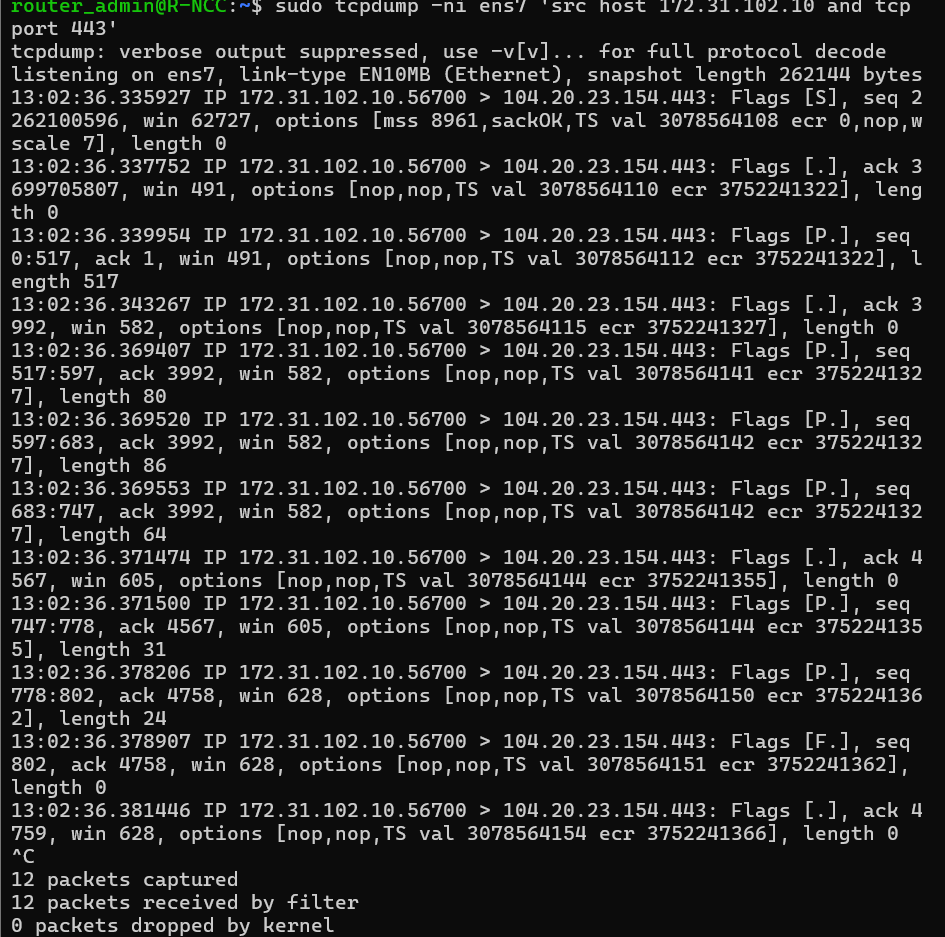

Se observa tráfico originado en `172.31.102.10` hacia un destino externo TCP/443.

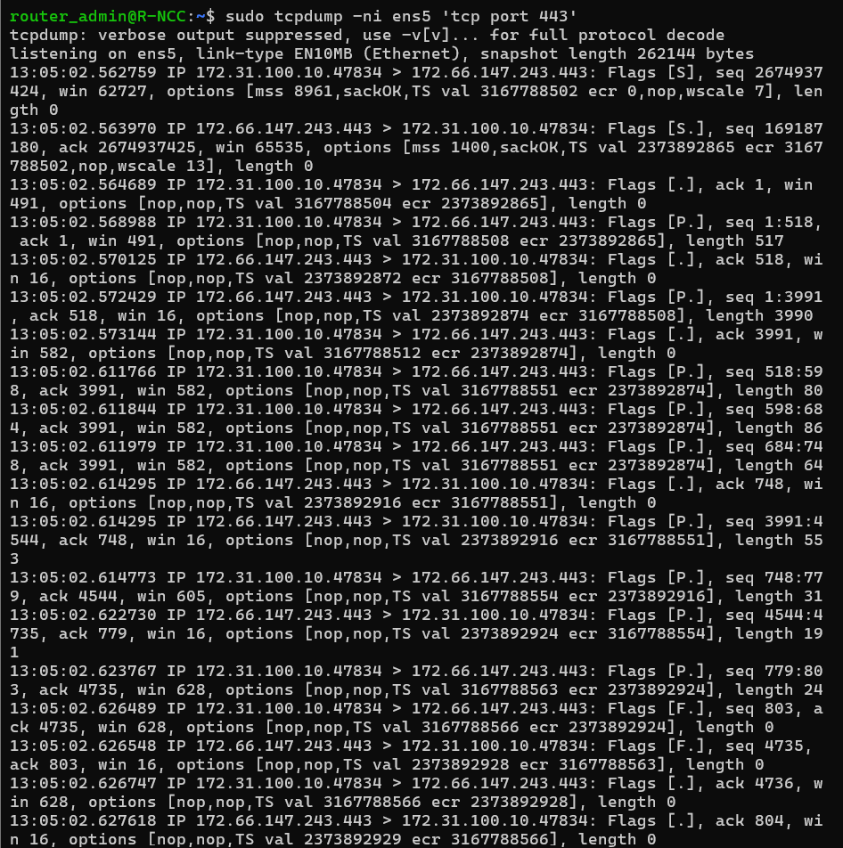

Se observa tráfico TCP/443 con origen `172.31.100.10` por `ens5`, en la fase posterior al NAT. **Los destinos externos visibles en ambas capturas son distintos**; estas imágenes acreditan tráfico en ambas interfaces, pero no demuestran por sí solas que se trate del mismo flujo. El equipo comunicó también una prueba con destino externo fijado; no se adjunta aquí una captura equivalente, por lo que no se sustituye la evidencia fotográfica por una afirmación más fuerte.

### Administración de instancias privadas

Se configuró acceso SSH mediante R-NCC como punto de salto (`ProxyJump`). Desde el equipo de administración se probó acceso a W-NCC, B-NCC y F-NCC por sus IP privadas. Las claves privadas permanecen en el equipo del administrador, no en R-NCC. Los permisos del puerto 22 y el estado de la autenticación se desarrollan en [SSH](../../security/ssh.md).

### Resultado de la etapa

Se documentaron subredes y ENI, activación de IPv4 Forwarding, NAT, acceso SSH administrativo y pruebas de salida HTTPS. A su vez se identificaron controles que corresponden al aislamiento: reglas entrantes por instancia mediante Security Groups y el alcance limitado de la política `FORWARD` de R-NCC. **No se confunde el funcionamiento del router con un aislamiento interzona exhaustivo.** Véase el [registro de pruebas](../../tests/pruebas-sprint-02-segmentacion.md).
