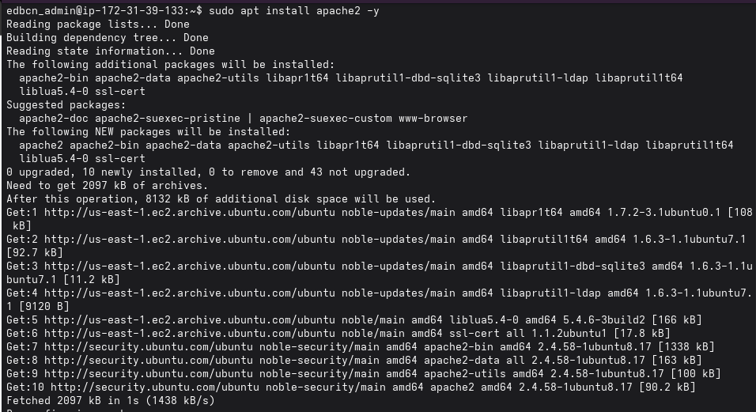
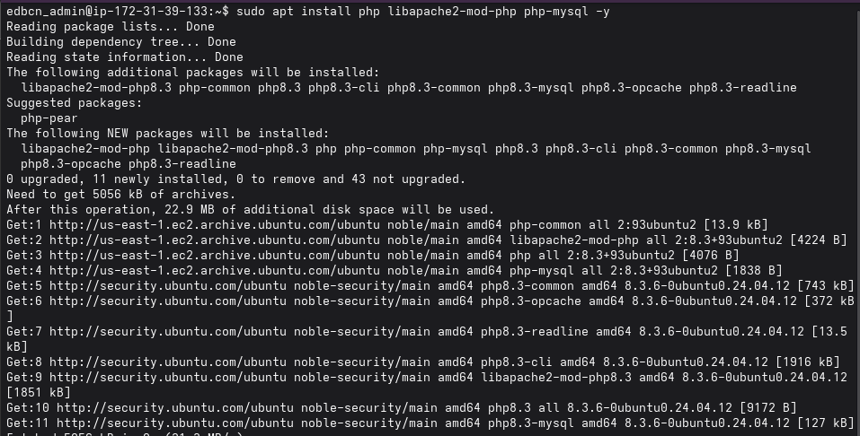
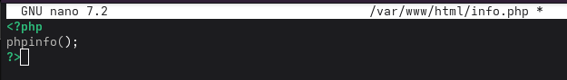
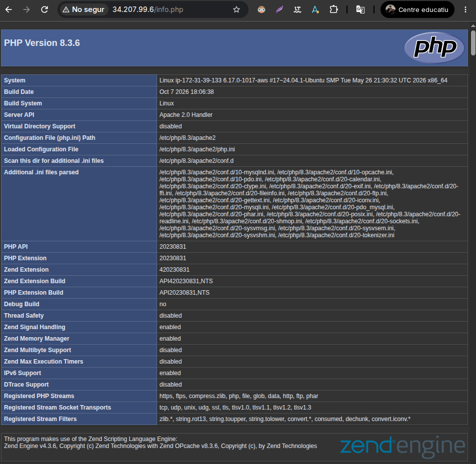
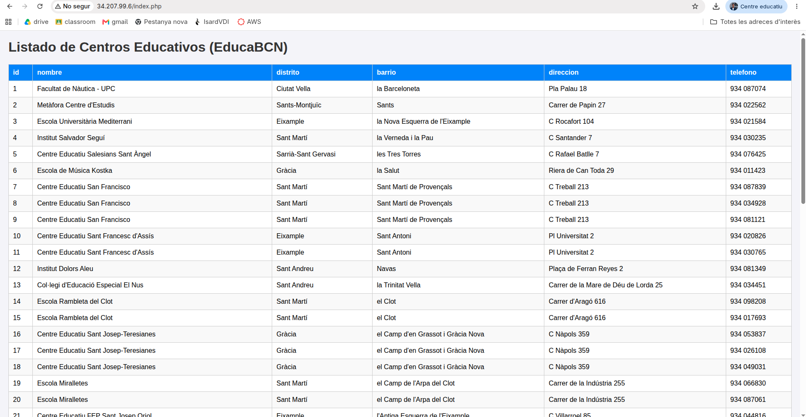

# Servicios web: Sprint 1

El primer servidor Apache se instaló en la misma máquina que MySQL y la aplicación EducaBCN.

## Instalación de Apache

Se actualizaron los repositorios e instaló el servidor web desde los paquetes de Ubuntu. A continuación se comprobó que el servicio había iniciado correctamente.

```bash
sudo apt update
sudo apt install apache2 -y
sudo systemctl enable --now apache2
sudo systemctl status apache2
```

La instalación proporciona el servicio HTTP al que se accede desde el navegador en la dirección de la instancia.



## Instalación e integración de PHP

La aplicación necesita ejecutar código PHP en el servidor y consultar MySQL mediante su extensión correspondiente. Tras instalar los paquetes se reinició Apache para cargar los módulos.

```bash
sudo apt install php libapache2-mod-php php-mysql -y
sudo systemctl restart apache2
php -v
```



## Prueba de ejecución PHP

El equipo creó una página de prueba de PHP y abrió su dirección en el navegador. Esta verificación permite diferenciar una respuesta HTML estática del procesamiento de scripts PHP. Las páginas `phpinfo()` se utilizan únicamente de forma temporal y deben retirarse para no exponer detalles del entorno.

```bash
sudo rm -f /var/www/html/info.php
```





## Publicación de la aplicación

Una vez verificado Apache y PHP se colocó `index.php` en el directorio público. El script abre una conexión PDO a MySQL, ejecuta una consulta de lectura y representa los valores en una tabla HTML. En la primera versión el host SQL era `localhost`. El código original contiene credenciales incrustadas: en la documentación se omiten y se recomienda externalizarlas.


