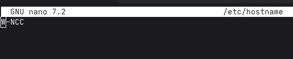
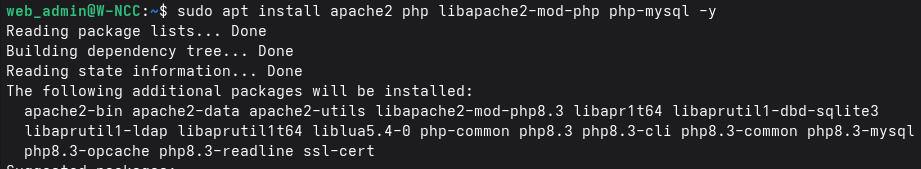
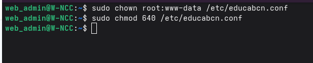
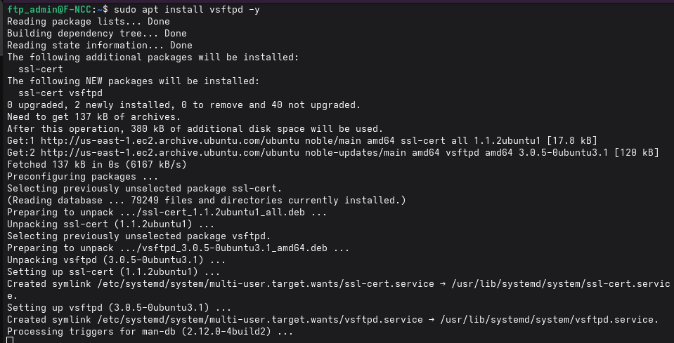
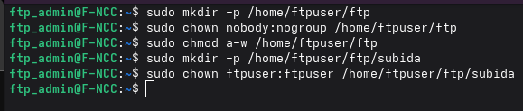
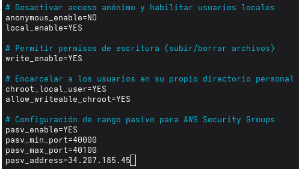

# Servidor web y FTP: Sprint 2

Se separaron los servicios web y de transferencia en W-NCC y F-NCC. Los comandos siguientes documentan la operación de los servicios; los secretos y direcciones públicas reales no se incluyen.

## Preparación de W-NCC

Tras crear la nueva instancia se definió su hostname y se crearon cuentas de administración. El equipo instaló Apache, PHP, el módulo de Apache para PHP y el conector MySQL; también instaló un cliente MySQL para las pruebas desde la máquina web.

```bash
sudo apt update
sudo apt install apache2 php libapache2-mod-php php-mysql mysql-client -y
sudo systemctl enable --now apache2
sudo systemctl status apache2
php -v
```





## Prueba de comunicación con B-NCC

Se probó el puerto TCP de MySQL desde W-NCC antes de comprobar la sesión SQL. Es importante separar la conectividad de red de la autorización de datos.

```bash
nc -vz HOST_B_NCC 3306
mysql -h HOST_B_NCC -u USUARIO_LECTURA -p
```

Los valores `HOST_B_NCC` y `USUARIO_LECTURA` son marcadores que deben reemplazarse por los configurados sin escribir contraseñas en el propio comando.


## Configuración de conexión fuera del código

En el documento se explica que los datos de conexión fueron separados del código PHP y colocados bajo `/etc/educabcn.conf`, con propietario `root`, grupo `www-data` y modo `640`. De esta forma el repositorio no necesita incluir las credenciales. Debe comprobarse que el archivo no sea servible por HTTP y que el proceso PHP pueda leerlo.

```bash
sudo chown root:www-data /etc/educabcn.conf
sudo chmod 640 /etc/educabcn.conf
sudo stat -c "%U:%G %a %n" /etc/educabcn.conf
```



## Creación y configuración de F-NCC

Se aprovisionó la instancia F-NCC y se instaló el demonio vsftpd. El documento muestra la preparación de una cuenta de transferencia `ftpuser` y directorios restringidos mediante `chroot`. También aparecen cuentas administrativas del sistema, que cumplen una función distinta. Configurar `chroot` limita la navegación por directorios, pero no cifra las conexiones ni sustituye los permisos del sistema de archivos.

```bash
sudo apt update
sudo apt install vsftpd -y
sudo cp /etc/vsftpd.conf /etc/vsftpd.conf.bak
sudo systemctl enable --now vsftpd
sudo systemctl status vsftpd
```

La cuenta FTP no debe poseer permisos de administración del sistema por el mero hecho de necesitar transferencias.





## Parámetros de vsftpd y reinicio

Se editó `/etc/vsftpd.conf` para limitar el acceso a usuarios locales y habilitar escritura y directorios restringidos. Los parámetros mostrados constituyen un ejemplo resumido de los aspectos que se documentaron.

```ini
anonymous_enable=NO
local_enable=YES
write_enable=YES
chroot_local_user=YES
```

```bash
sudo systemctl restart vsftpd
sudo systemctl status vsftpd
```

La instalación de vsftpd y las pruebas de conexión no acreditan el uso de FTPS ni de SFTP. No se describe el servicio como transferencia cifrada ya implementada. El FTP en claro puede exponer credenciales y archivos; antes de usar documentación sensible debe verificarse FTPS con TLS o utilizarse SFTP, además de restringir la exposición de puertos.



## Adaptación de F-NCC tras la migración de subredes

F-NCC utilizó inicialmente `172.31.16.170` y figura después como `172.31.102.20` en la Intranet. En W-NCC se comprobó la accesibilidad TCP de `172.31.102.20:21` y la resolución DNS en el mismo servidor. Esto acredita el acceso al puerto de control FTP y las respuestas del servicio DNS, **no** una transferencia de archivos completa ni cifrado FTPS/SFTP. El documento inicial con las instrucciones de vsftpd, `chroot` y cuentas se conserva como registro de la primera etapa.

El conjunto de pruebas se encuentra en [aislamiento y conectividad](../../tests/pruebas-sprint-02-segmentacion.md). Si se decide mover F-NCC a DMZ, debe tratarse como un cambio adicional de arquitectura con nuevas pruebas; no se presenta como ejecutado en estas capturas.
