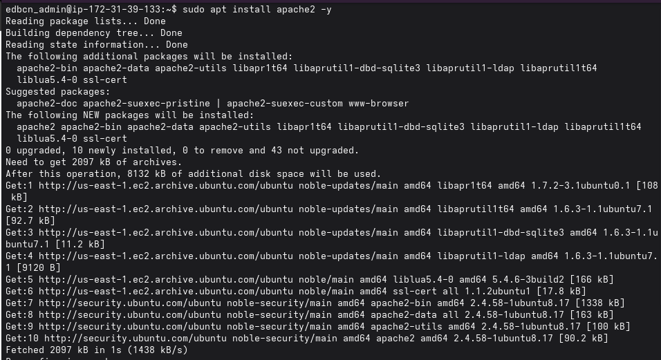
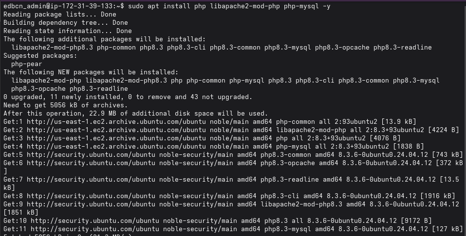
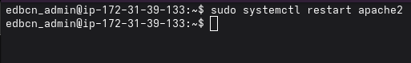
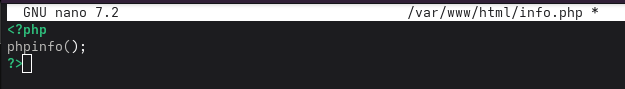
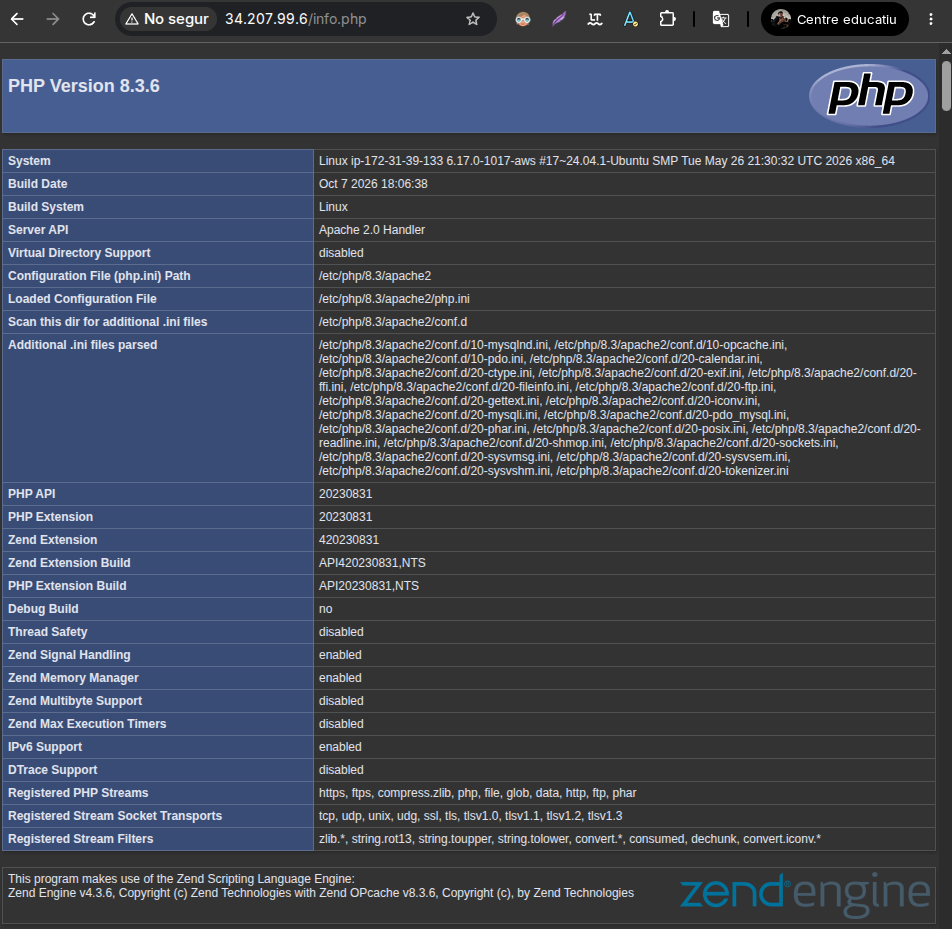

# Instalación inicial de Apache y PHP: Sprint 1

## Índice

- [Objetivo](#objetivo)
- [Instalación de Apache](#instalacion-de-apache)
- [Instalación de PHP](#instalacion-de-php)
- [Comprobación de PHP](#comprobacion-de-php)
- [Resultado](#resultado)


## Objetivo

Configurar la primera instancia Ubuntu para publicar una página PHP y comprobar la integración con MySQL.

## Instalación de Apache

Se actualizaron los repositorios y se instaló el servidor HTTP Apache:

```bash
sudo apt update
sudo apt install apache2 -y
```



*Instalación del paquete apache2 en Ubuntu Server.*

Para verificar un servicio en funcionamiento se puede utilizar `sudo systemctl status apache2`. La configuración predeterminada sirve los archivos del directorio `/var/www/html/`.

## Instalación de PHP

Se instaló el intérprete PHP y el módulo que permite a PHP conectarse a MySQL:

```bash
sudo apt install php libapache2-mod-php php-mysql -y
sudo systemctl restart apache2
```



*Instalación de PHP y sus componentes en el primer servidor.*



*Reinicio del servidor web tras instalar los módulos.*

## Comprobación de PHP

Para confirmar que Apache procesa un archivo PHP se creó temporalmente `/var/www/html/info.php` con `phpinfo()`, y se abrió desde el navegador.

```php
<?php
phpinfo();
```



*Código del archivo temporal de prueba PHP.*



*Página phpinfo mostrando el intérprete en funcionamiento.*

`phpinfo()` muestra detalles internos del servidor, por lo que debe eliminarse del entorno público una vez comprobada la instalación:

```bash
sudo rm -f /var/www/html/info.php
```

## Resultado

Apache y PHP quedaron preparados para ejecutar la aplicación del primer sprint, que consultaba MySQL localmente.
