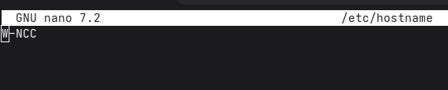
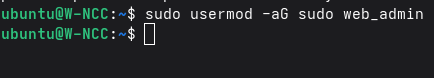
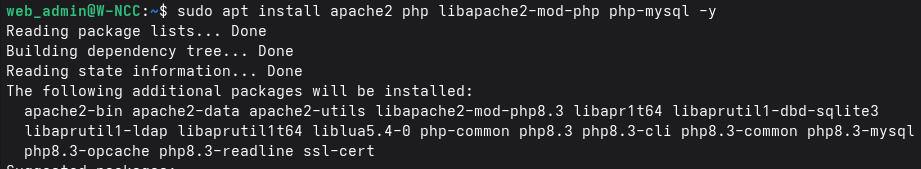
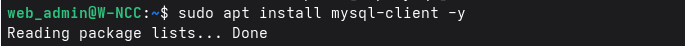
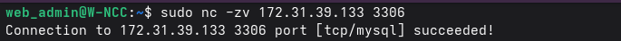
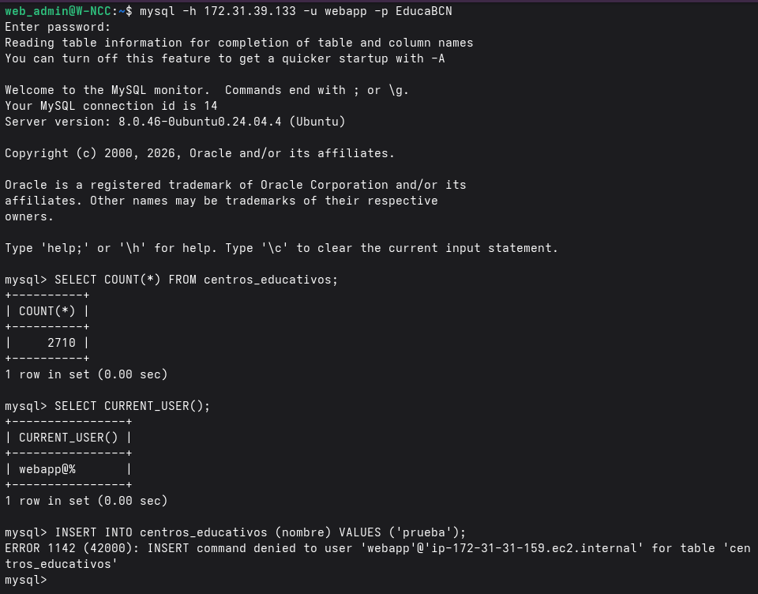
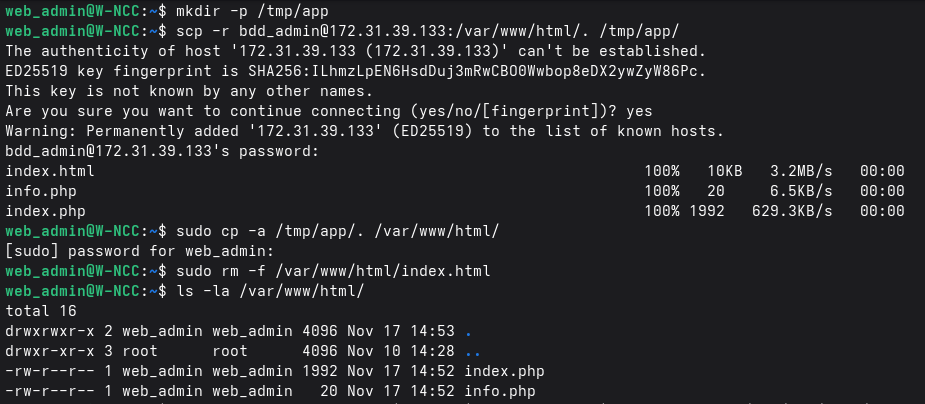
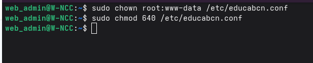
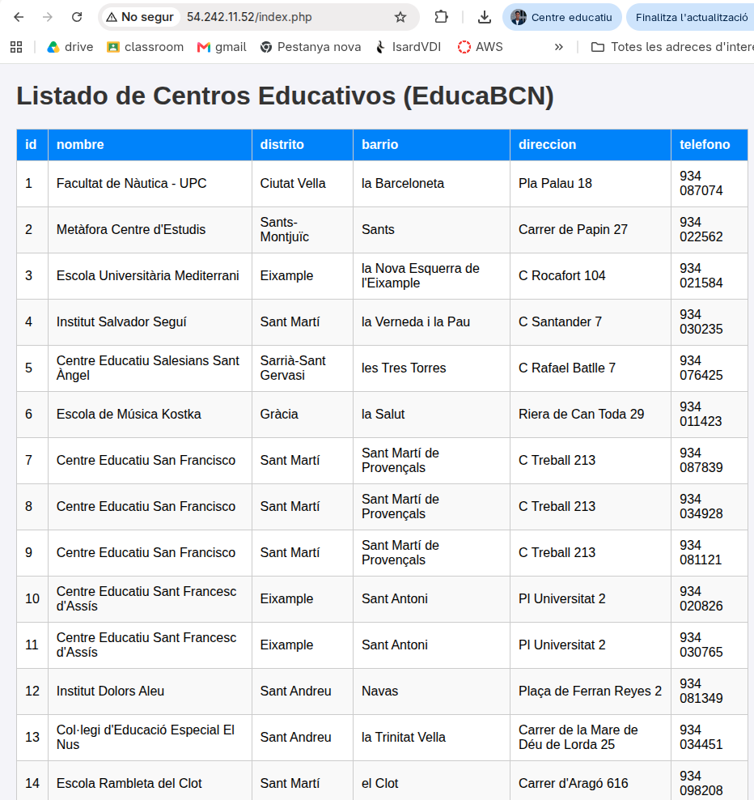

# Instalación y migración del servidor web W-NCC: Sprint 2

## Índice

- [1. Objetivo y punto de partida](#1-objetivo-y-punto-de-partida)
- [2. Nombre del equipo y usuarios](#2-nombre-del-equipo-y-usuarios)
- [3. Apache, PHP y cliente de MySQL](#3-apache-php-y-cliente-de-mysql)
- [4. Comprobar la red hacia B-NCC](#4-comprobar-la-red-hacia-b-ncc)
- [5. Transferir el portal desde la máquina anterior](#5-transferir-el-portal-desde-la-maquina-anterior)
- [6. Configurar la conexión PHP con MySQL](#6-configurar-la-conexion-php-con-mysql)
- [7. Resultado de la migración](#7-resultado-de-la-migracion)
- [8. Comprobaciones de administración](#8-comprobaciones-de-administracion)


## 1. Objetivo y punto de partida

En el primer sprint la aplicación PHP y MySQL residían en una misma instancia. Para dividir las responsabilidades, el equipo creó W-NCC con Apache y PHP y mantuvo MySQL en B-NCC. La transferencia de archivos se hizo directamente entre instancias, utilizando la red privada de AWS y SSH.

## 2. Nombre del equipo y usuarios

En W-NCC se configuró el nombre de host y se creó la cuenta administradora `web_admin`. Las capturas también muestran la creación del usuario Linux `bchecker`, distinta de su homónimo de MySQL.

```bash
sudo hostnamectl set-hostname W-NCC
sudo adduser web_admin
sudo usermod -aG sudo web_admin
hostnamectl
```

El comando `hostnamectl` es una forma reproducible de consultar o cambiar el nombre; la captura del equipo muestra la edición del archivo `/etc/hostname`.



*Nombre W-NCC configurado en el servidor web.*



*Asignación de privilegios sudo a la cuenta web_admin.*

## 3. Apache, PHP y cliente de MySQL

Se instalaron los paquetes necesarios para ejecutar PHP y conectarlo a una base de datos remota. En W-NCC no se necesitó instalar un servidor MySQL, únicamente el cliente para pruebas y la extensión PHP de conexión.

```bash
sudo apt update
sudo apt install apache2 php libapache2-mod-php php-mysql -y
sudo apt install mysql-client -y
```



*Instalación de Apache, PHP y la extensión de MySQL en W-NCC.*



*Instalación del cliente MySQL en W-NCC.*

## 4. Comprobar la red hacia B-NCC

Antes de transferir la aplicación se comprobó el puerto 3306 de B-NCC con `nc` y se accedió a MySQL desde W-NCC. Se verificó la existencia de la base de datos y que el usuario de aplicación podía realizar consultas. En la captura también aparece una operación de escritura rechazada, coherente con un usuario de lectura.

```bash
nc -zv 172.31.39.133 3306
mysql -h 172.31.39.133 -u webapp -p EducaBCN
```



*Comprobación de conectividad TCP/3306 hacia B-NCC.*



*Consulta a la base de datos remota desde W-NCC y comprobación de permisos.*

## 5. Transferir el portal desde la máquina anterior

Para conservar los archivos del primer prototipo se usó `scp` desde W-NCC, copiando el contenido de `/var/www/html/` del antiguo servidor B-NCC a un directorio temporal. Este procedimiento se ejecutó con una cuenta Linux autorizada en el servidor origen.

```bash
mkdir -p /tmp/app
scp -r bdd_admin@172.31.39.133:/var/www/html/. /tmp/app/
```

Después se copiaron los archivos al directorio público de Apache y se eliminó el archivo `index.html` que podría imponerse al `index.php`:

```bash
sudo cp -a /tmp/app/. /var/www/html/
sudo rm -f /var/www/html/index.html
ls -la /var/www/html/
```



*Transferencia SCP y copia del portal en /var/www/html/ de W-NCC.*

## 6. Configurar la conexión PHP con MySQL

La aplicación del primer sprint utilizaba el host `localhost` porque MySQL estaba en esa misma instancia. En el segundo sprint debe utilizar la IP privada de B-NCC o un nombre interno correctamente resuelto. El usuario de aplicación documentado para el acceso remoto es `webapp`.

La documentación original muestra un archivo `/etc/educabcn.conf` pensado para separar las credenciales del código y restringir su lectura al servicio Apache. No se reproduce la captura que contiene una contraseña. El contenido debe permanecer fuera de la raíz web.

```bash
sudo chown root:www-data /etc/educabcn.conf
sudo chmod 640 /etc/educabcn.conf
sudo grep -nE 'localhost|new PDO|mysqli_connect|educabcn.conf' /var/www/html/index.php
php -l /var/www/html/index.php
```



*Permisos restrictivos establecidos para el archivo de configuración de EducaBCN.*

**Atención:** cambiar la contraseña de MySQL o el archivo de configuración sin actualizar PHP rompe la conexión. No deben almacenarse contraseñas dentro del repositorio ni en comentarios del código.

## 7. Resultado de la migración

Al abrir la aplicación desde W-NCC, el navegador mostró el listado con centros educativos, distritos, barrios, direcciones y teléfonos. La captura acompaña la comprobación funcional de la migración. El éxito del renderizado debe interpretarse junto con la prueba remota de MySQL, no aisladamente.



*Página de EducaBCN funcionando en el nuevo servidor web W-NCC.*

## 8. Comprobaciones de administración

```bash
sudo systemctl status apache2
php -l /var/www/html/index.php
ls -la /var/www/html/
curl -I http://127.0.0.1/index.php
```

Un error de conexión PDO debe investigarse en el usuario MySQL, contraseña vigente, host privado, privilegios y Security Group correspondiente al puerto 3306.
