# Capturas del Sprint 01

Capturas seleccionadas de la documentación original. Se indica la página de procedencia. Las imágenes se muestran como evidencia histórica, sin atribuirles resultados adicionales.

## Estructura inicial del repositorio
Fuente: documento original, página 9.
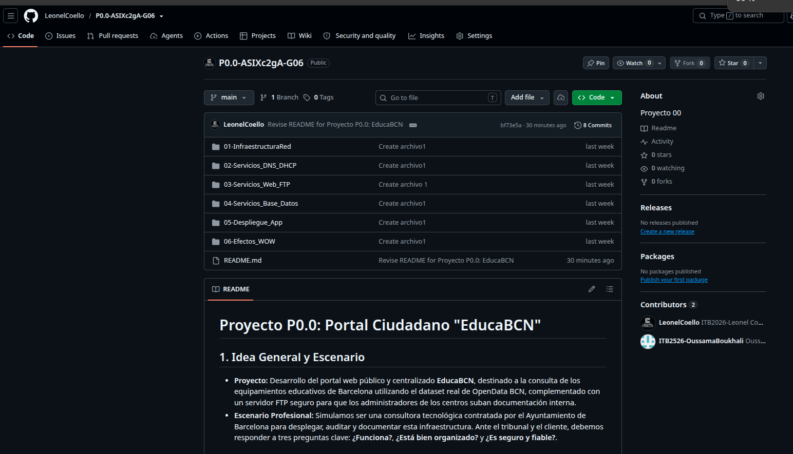

## Tablero de planificación
Fuente: documento original, página 10.
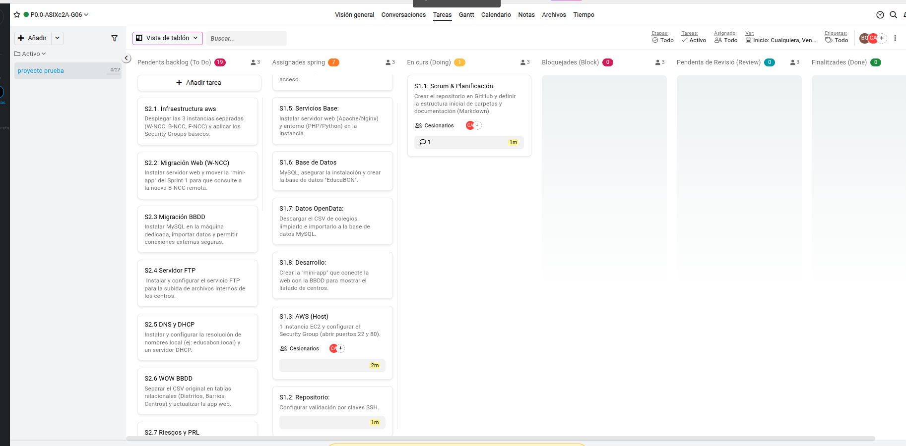

## Creación de instancia EC2
Fuente: documento original, página 11.
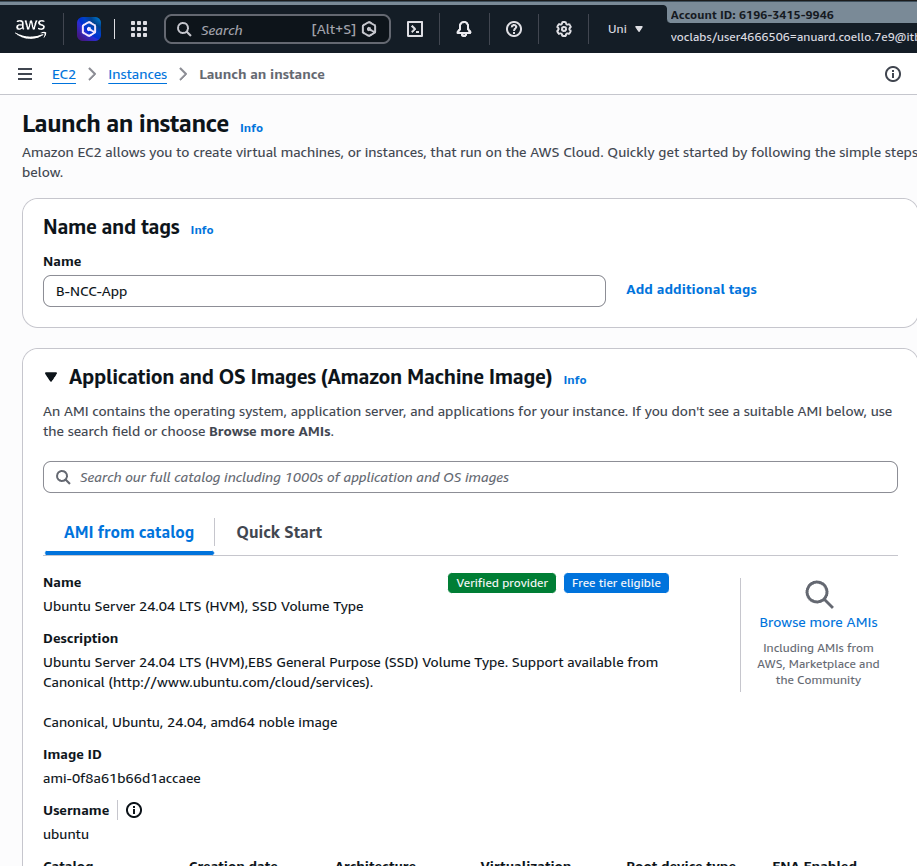

## Comprobación del control de versiones
Fuente: documento original, página 15.
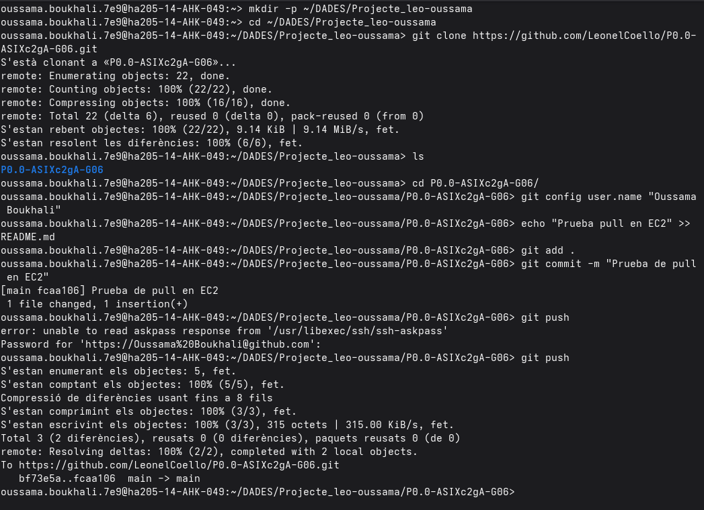

## Instalación de Apache
Fuente: documento original, página 19.
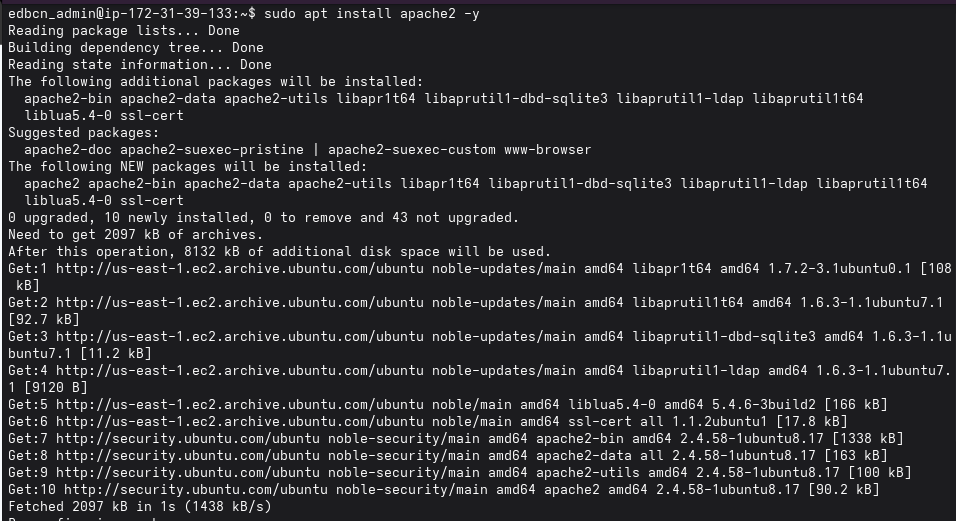

## Instalación de PHP
Fuente: documento original, página 20.
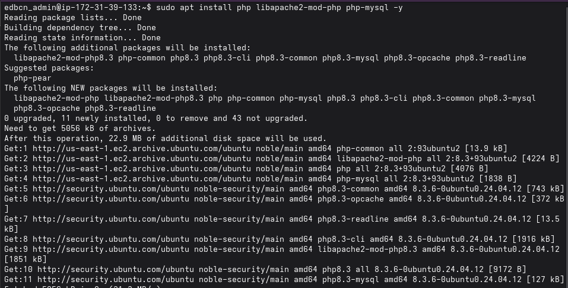

## Archivo de prueba de PHP
Fuente: documento original, página 21.
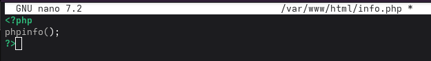

## Página de información de PHP
Fuente: documento original, página 22.
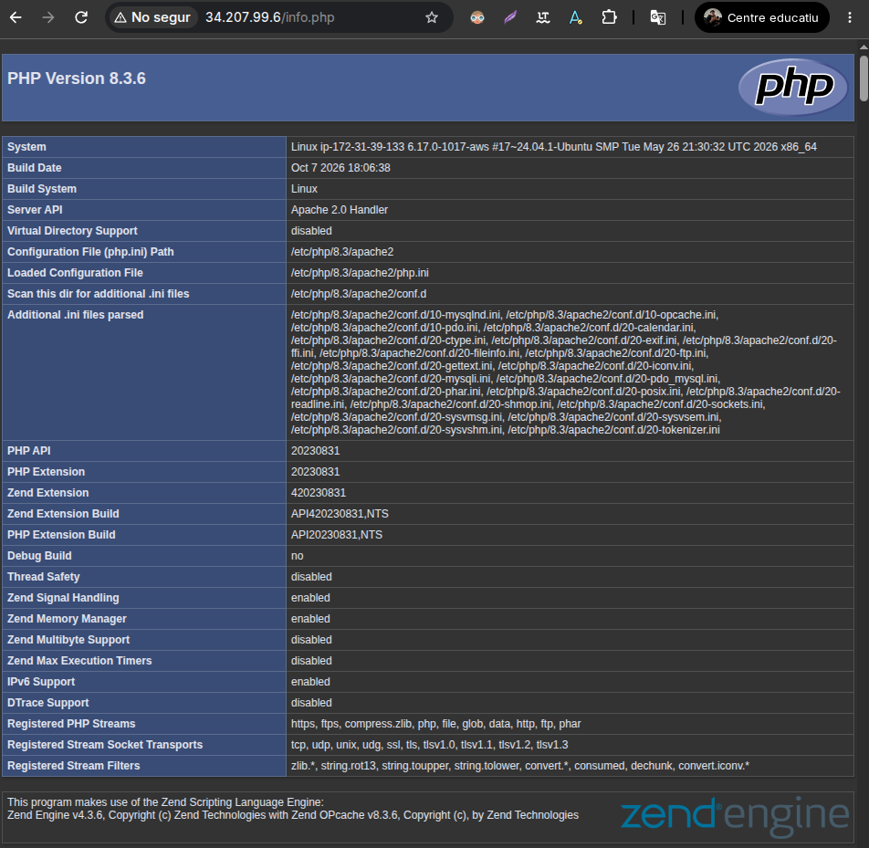

## Estado del servicio MySQL
Fuente: documento original, página 23.
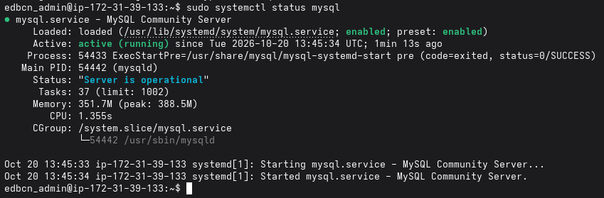

## Transferencia del CSV
Fuente: documento original, página 26.
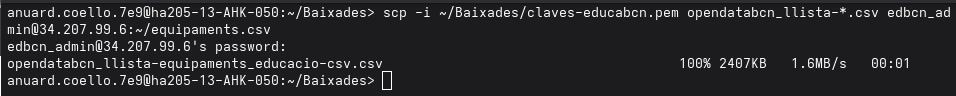

## Consultas de comprobación de datos
Fuente: documento original, página 27.
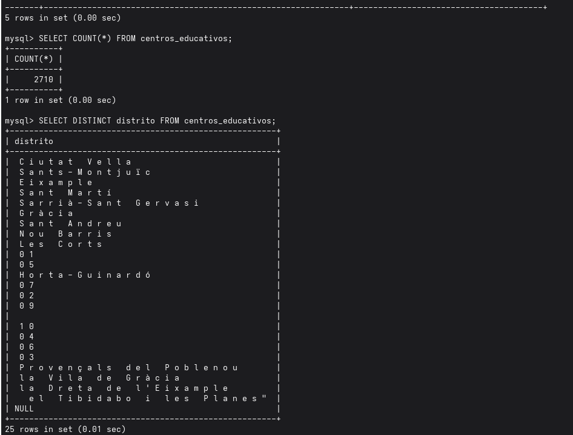

## Consulta de distritos
Fuente: documento original, página 28.
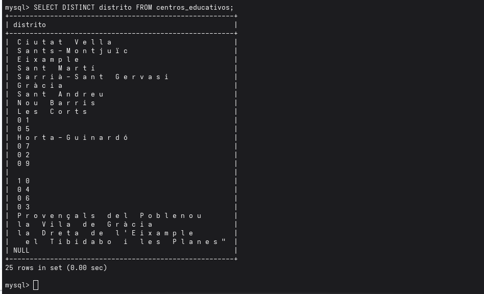

## Vista inicial de EducaBCN
Fuente: documento original, página 31.
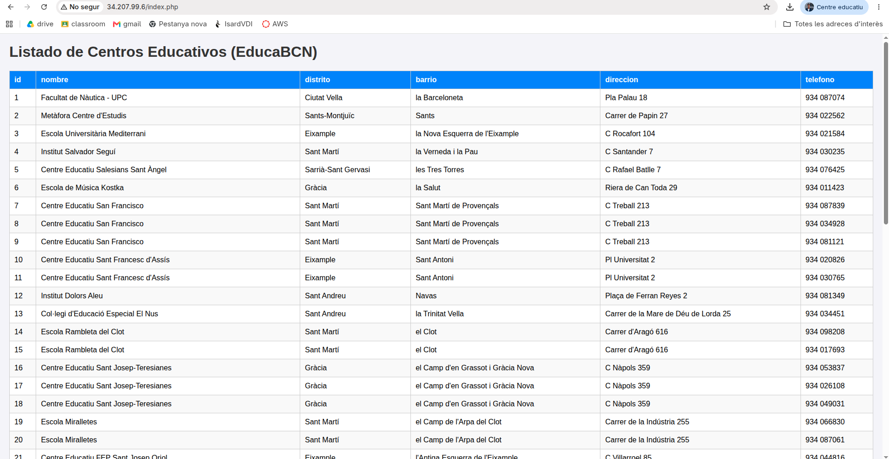

