# Capturas del Sprint 02

Capturas seleccionadas de la documentación original. Se indica la página de procedencia. Las imágenes se muestran como evidencia histórica, sin atribuirles resultados adicionales.

## Creación del servidor web
Fuente: documento original, página 32.
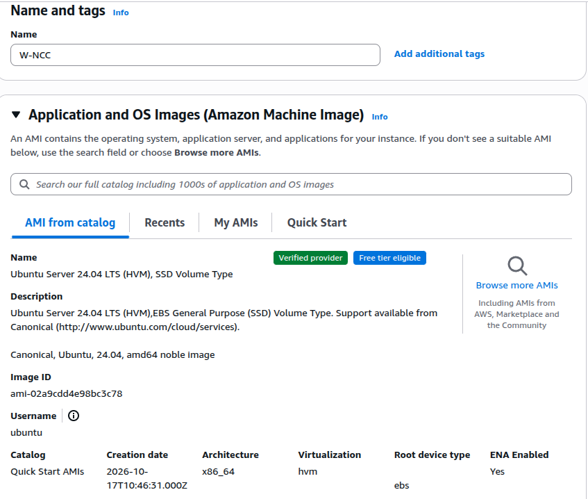

## Configuración de instancia web
Fuente: documento original, página 33.
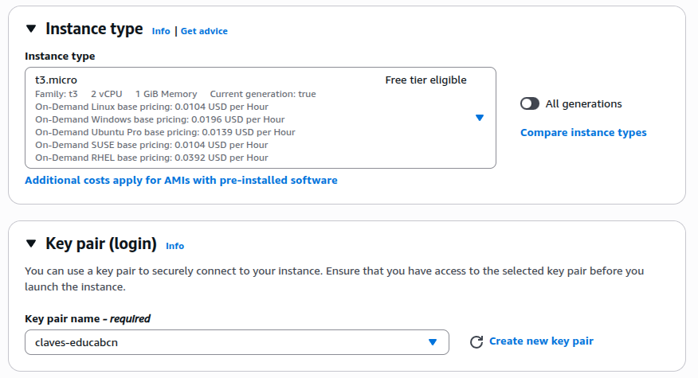

## Reglas de acceso a la web
Fuente: documento original, página 34.
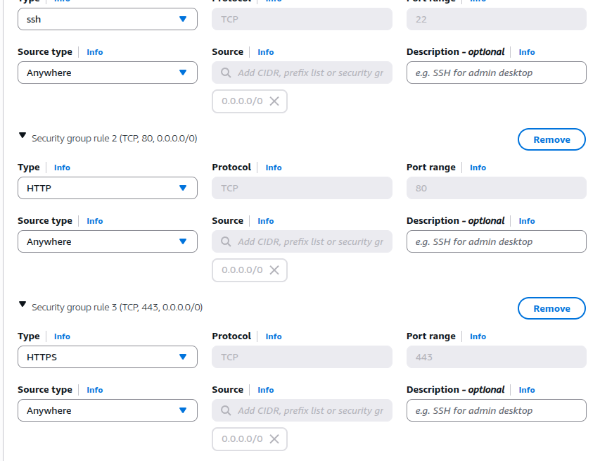

## Creación del servidor FTP
Fuente: documento original, página 35.
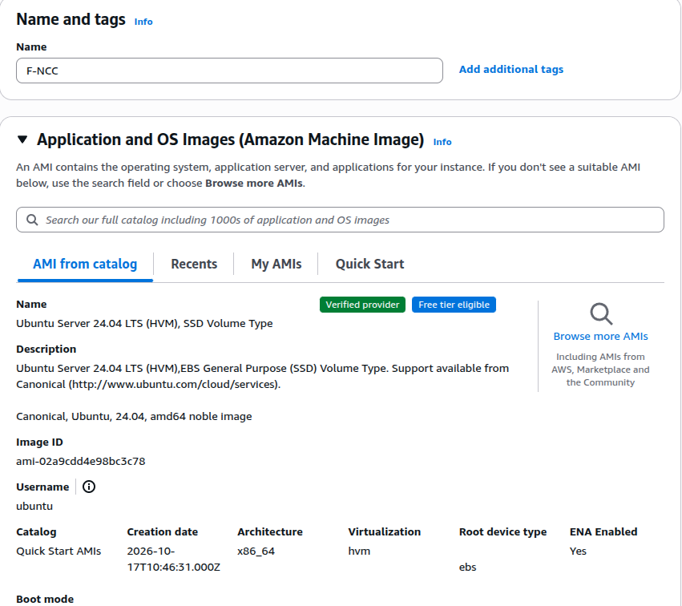

## Vista de grupos de seguridad
Fuente: documento original, página 36.
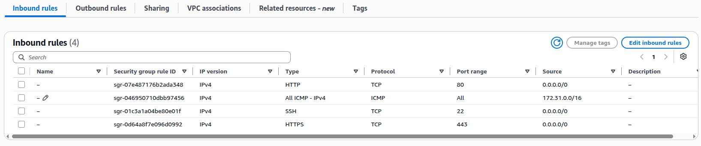

## Hostname del servidor web
Fuente: documento original, página 37.
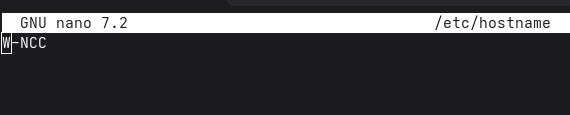

## Instalación de Apache y PHP en W-NCC
Fuente: documento original, página 38.
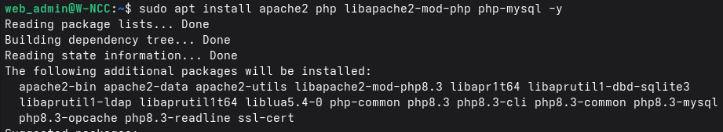

## Permisos de archivo de configuración
Fuente: documento original, página 39.
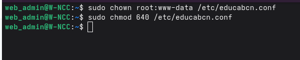

## Desactivación del Apache anterior
Fuente: documento original, página 40.
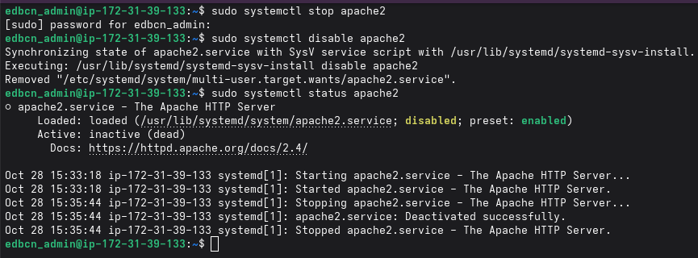

## Estado de vsftpd
Fuente: documento original, página 42.
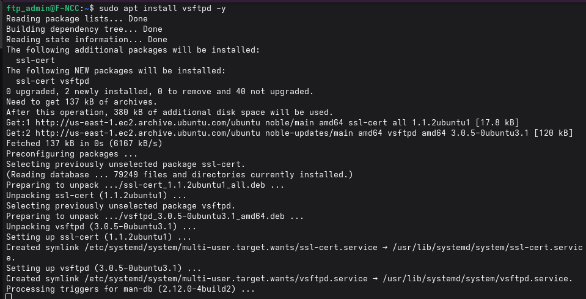

## Estructura de directorios FTP
Fuente: documento original, página 43.
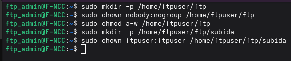

## Reinicio servicio FTP
Fuente: documento original, página 44.
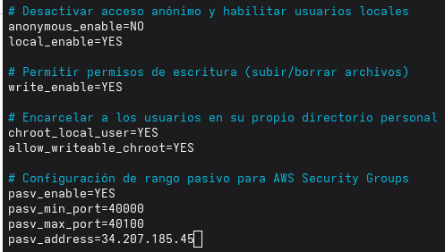

## Instalación de BIND9
Fuente: documento original, página 45.
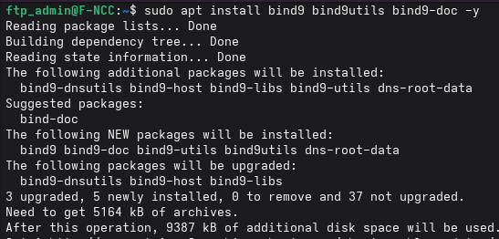

## Configuración de zona DNS
Fuente: documento original, página 45.
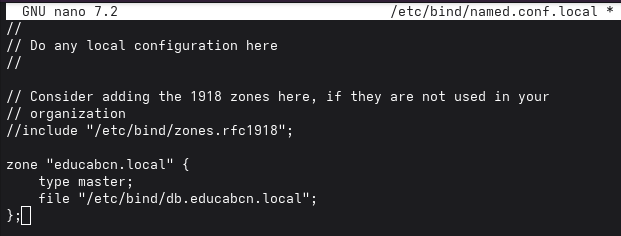

## Zona DNS interna
Fuente: documento original, página 46.
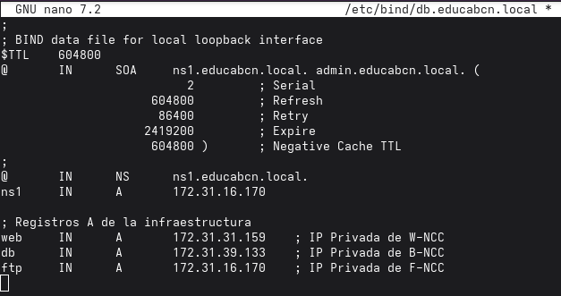

## Estado BIND9
Fuente: documento original, página 46.
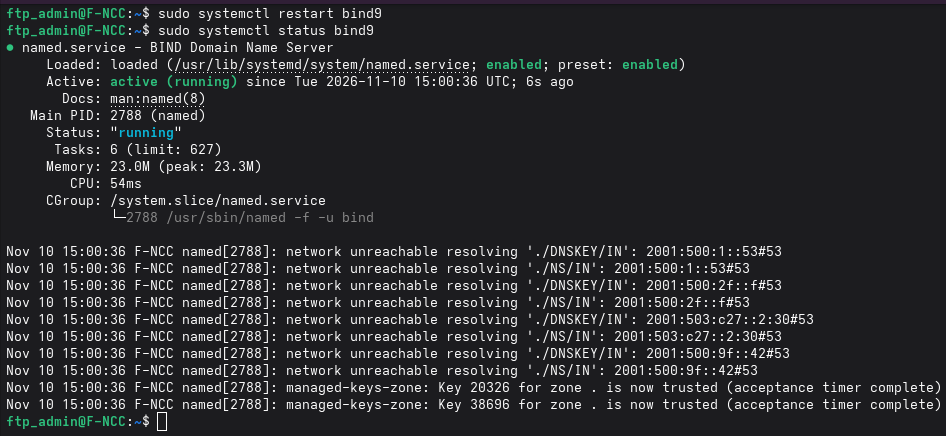

## Instalación de servidor DHCP
Fuente: documento original, página 47.
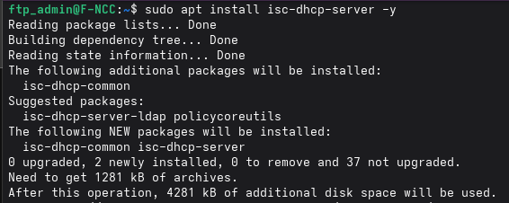

## Estado del servicio DHCP
Fuente: documento original, página 48.
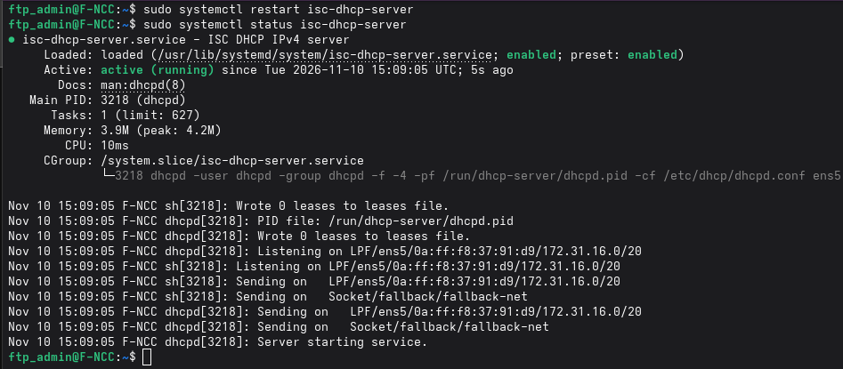

## Consulta DNS local
Fuente: documento original, página 49.
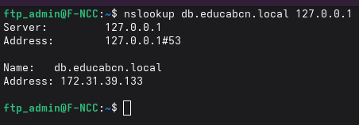

## Comprobación DNS desde servidor web
Fuente: documento original, página 49.
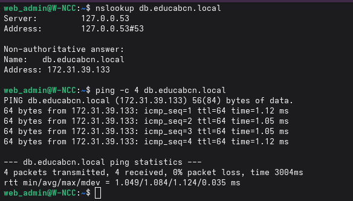

## Comprobación DNS desde servidor BD
Fuente: documento original, página 49.
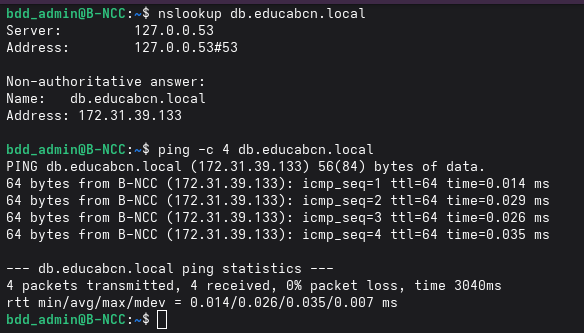

## Capturas de segmentación y seguridad

Se han añadido imágenes originales de creación de subredes/ENI extraídas del documento técnico y capturas de terminal y AWS aportadas por el equipo. Las relativas a router y NAT aparecen **dentro del procedimiento** de [red del Sprint 2](../../infrastructure/red/sprint-02.md). Las cuatro capturas de creación de Security Groups figuran en [firewall](../../security/configuracion-accesos.md), y las dos pruebas de servicio y bloqueo están en [pruebas de segmentación](../../tests/pruebas-sprint-02-segmentacion.md). No se han dibujado flechas ni anotaciones sobre las imágenes.
