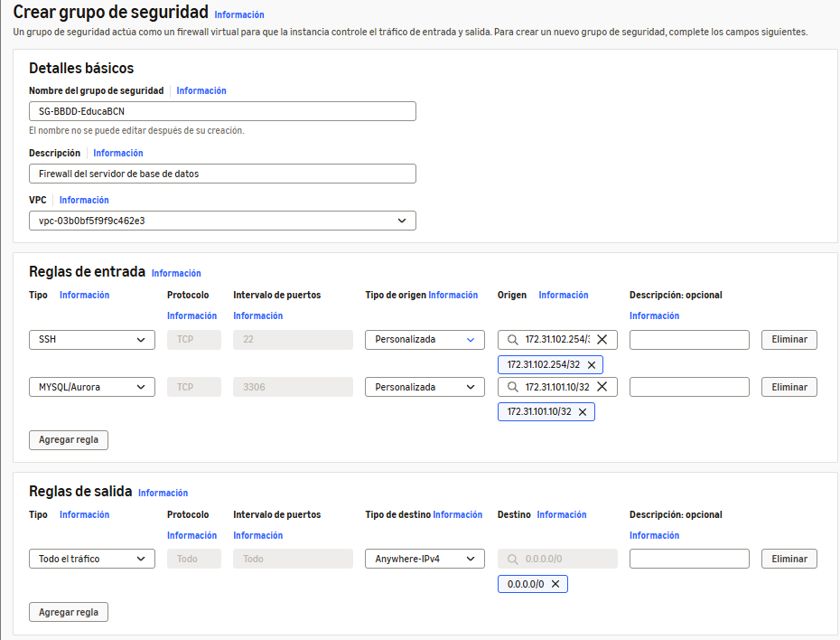
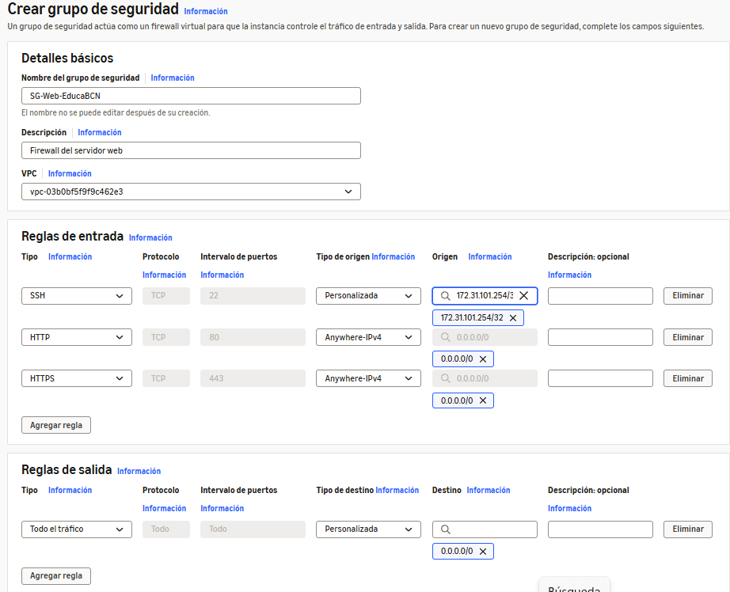
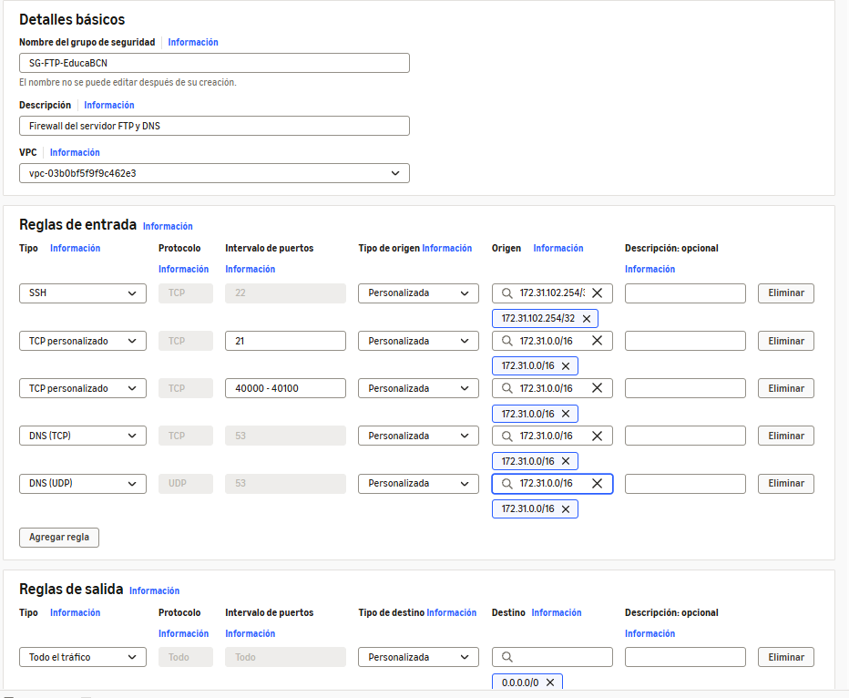
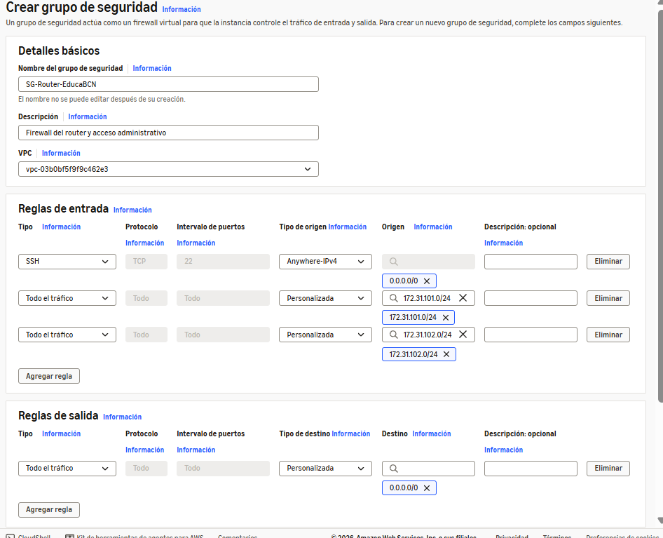

# Firewall y control de accesos: ampliación del Sprint 2 (S2.7)

## Objetivo y alcance

Para terminar la infraestructura distribuida se trasladó al Sprint 2 la tarea denominada antes S3.2: sustituir el Security Group compartido por políticas distintas para R-NCC, W-NCC, B-NCC y F-NCC, mantener la administración por SSH a través del router y comprobar las comunicaciones necesarias. El aislamiento aplicado mediante **AWS Security Groups** no equivale a un filtrado completo por `iptables` entre todas las subredes.

## Situación previa: grupo compartido

Las instancias utilizaban el grupo `sgrncceducabcn` con SSH desde `0.0.0.0/0` y «todo el tráfico» desde `172.31.0.0/16`. Era útil para pruebas iniciales, pero demasiado amplio para aislar servicios. El equipo creó grupos específicos y comunicó la retirada del grupo antiguo de las instancias/interfaces tras asociar los nuevos. Las capturas originales del estado previo permanecen en la documentación de la separación de servidores.

## 1. SG-BBDD-EducaBCN: MySQL

| Dirección | Protocolo / puerto | Origen o destino | Justificación |
|---|---|---|---|
| Entrada | TCP 22 | `172.31.102.254/32` (R-NCC, interfaz Intranet) | Administración SSH desde el punto de salto |
| Entrada | TCP 3306 | `172.31.101.10/32` (W-NCC) | Consultas MySQL de la aplicación PHP |
| Salida | Todos | `0.0.0.0/0` | Se mantuvo la salida general en esta fase |

La captura muestra los permisos definidos al crear el grupo, no un registro de paquetes real. La prueba desde W-NCC confirma el acceso al puerto 3306 y el bloqueo observado de ICMP y SSH directo.

## 2. SG-Web-EducaBCN: Apache/PHP

| Dirección | Protocolo / puerto | Origen o destino | Justificación |
|---|---|---|---|
| Entrada | TCP 22 | `172.31.101.254/32` (R-NCC, interfaz DMZ) | Administración por el router |
| Entrada | TCP 80 | `0.0.0.0/0` | Servicio HTTP del portal |
| Entrada | TCP 443 | `0.0.0.0/0` | Puerto reservado para HTTPS cuando se configure |
| Salida | Todos | `0.0.0.0/0` | Acceso a MySQL, DNS y servicios necesarios |

Permitir 80/443 en un Security Group **no asigna una IP pública ni publica automáticamente el portal**. HTTPS/443 permitido tampoco demuestra que se haya instalado un certificado TLS.

## 3. SG-FTP-EducaBCN: FTP, DNS

| Dirección | Protocolo / puerto | Origen o destino | Justificación |
|---|---|---|---|
| Entrada | TCP 22 | `172.31.102.254/32` (R-NCC, interfaz Intranet) | Administración SSH |
| Entrada | TCP 21 | `172.31.0.0/16` | Canal de control FTP de la VPC |
| Entrada | TCP 40000–40100 | `172.31.0.0/16` | Rango pasivo configurado para FTP |
| Entrada | TCP 53 | `172.31.0.0/16` | Consultas DNS sobre TCP |
| Entrada | UDP 53 | `172.31.0.0/16` | Consultas DNS habituales |
| Salida | Todos | `0.0.0.0/0` | Se mantuvo la salida general |

Esta política se diseñó con F-NCC en `172.31.102.20` (Intranet). El alcance `172.31.0.0/16` permite más orígenes de los estrictamente imprescindibles y se podrá restringir más adelante. No se añadió una regla DHCP específica para asignar IP a instancias AWS, función que gestiona AWS.

## 4. SG-Router-EducaBCN: WAN, DMZ e Intranet

| Dirección | Protocolo / puerto | Origen o destino | Justificación |
|---|---|---|---|
| Entrada | TCP 22 | `0.0.0.0/0` | Acceso SSH desde distintas ubicaciones; exige autenticación fuerte |
| Entrada | Todos | `172.31.101.0/24` (DMZ) | Tráfico de la DMZ hacia R-NCC |
| Entrada | Todos | `172.31.102.0/24` (Intranet) | Tráfico de la Intranet hacia R-NCC |
| Salida | Todos | `0.0.0.0/0` | Tráfico de salida y respuesta |

R-NCC tiene **tres interfaces ENI**, una por zona; los Security Groups se administran por interfaz y no exclusivamente por el nombre de instancia. El equipo revisó las interfaces y sustituyó el grupo antiguo por el nuevo. La protección SSH observada en R-NCC está documentada en [SSH](ssh.md).

**Riesgo residual:** abrir SSH a `0.0.0.0/0` permite intentos de conexión desde Internet, aunque se exija una clave. Es preferible restringir los orígenes administrativos, usar una VPN o un método equivalente. Mantener una política `FORWARD ACCEPT` sin reglas específicas tampoco constituye aislamiento de todos los protocolos entre DMZ e Intranet.

## 5. Comportamiento verificado

La captura con las pruebas de firewall se encuentra en [verificación del Sprint 2](../tests/pruebas-sprint-02-segmentacion.md). Desde W-NCC se obtuvo `succeeded` al abrir TCP/3306 de B-NCC y TCP/21 de F-NCC; BIND9 devolvió la IP correcta de B-NCC; el ping y la conexión TCP/22 directos de W-NCC a B-NCC no respondieron. B-NCC obtuvo `HTTP/2 200` al salir a Internet.

Los Security Groups son **stateful**: permiten las respuestas del tráfico iniciado y permitido sin añadir reglas entrantes de respuesta. Un `timeout` en una prueba concreta acredita que dicha conexión no se completó, pero no sustituye a una revisión de todas las rutas y puertos posibles.

## 6. Límites del aislamiento

Las pruebas documentadas muestran una separación funcional de permisos entrantes por servidor, no una auditoría total de seguridad. En R-NCC se observó `iptables -L FORWARD -n -v` con política `ACCEPT` y sin reglas particulares, por lo que no se debe afirmar un firewall interzona completo a nivel del router. Además, F-NCC permanece en la Intranet pese a que una tarjeta anterior del backlog sugería situarlo en DMZ. Si ese requisito se mantiene, faltará implementarlo y volver a probar la conectividad.
