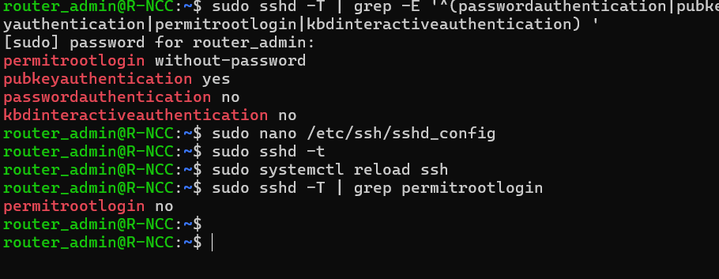

# Acceso SSH y cuentas


## Configuración documentada

El Sprint 1 comenzó con una clave PEM para acceder a EC2 y después se habilitó la autenticación SSH mediante contraseña en el laboratorio. Se creó `bchecker` como usuario Linux con permisos administrativos; este usuario no equivale automáticamente a la cuenta de MySQL del mismo nombre. No se afirma que el acceso por contraseña esté desactivado.

## Criterios de administración segura

Para la administración continuada se recomiendan claves individuales Ed25519, almacenamiento protegido y SSH limitado por Security Groups. Tras confirmar un acceso alternativo con clave y un procedimiento de recuperación, puede deshabilitarse `PasswordAuthentication` mediante una modificación controlada de `sshd_config`. Esta última medida se describe como recomendación y no como cambio ejecutado. Las cuentas de servicio web, SQL y FTP deberían quedar separadas de los usuarios con privilegios `sudo`. Registrar las altas, bajas y revocaciones de claves.

## Refuerzo SSH comprobado en R-NCC durante la segunda etapa del Sprint 2

La descripción histórica anterior corresponde al Sprint 1 y no debe extrapolarse al estado actual de todos los nodos. En R-NCC se comprobó la configuración efectiva con:

```bash
sudo sshd -T | grep -E '^(passwordauthentication|pubkeyauthentication|permitrootlogin|kbdinteractiveauthentication) '
```

La captura mostró `pubkeyauthentication yes`, `passwordauthentication no` y `kbdinteractiveauthentication no`. Inicialmente `PermitRootLogin` figuraba como `without-password`, por lo que se cambió a `no` en `/etc/ssh/sshd_config`, se validó la sintaxis con `sudo sshd -t` y se recargó el servicio mediante `sudo systemctl reload ssh`.



La consulta posterior mostró `permitrootlogin no` y el equipo confirmó que una nueva conexión administrativa seguía funcionando. Esta medida está **comprobada en R-NCC**, sin afirmar que se haya aplicado en cada servidor de la VPC.

Para administrar los nodos privados se utiliza `ProxyJump` desde el equipo local, conservando la clave PEM privada en ese equipo:

```bash
ssh -J ubuntu@IP_PUBLICA_R_NCC ubuntu@172.31.101.10
```

El ejemplo ilustra el salto a W-NCC; si se necesita una identidad determinada para cada servidor, debe indicarse en la configuración SSH local, no copiar la clave privada al router. No se publica la IP pública del equipo administrativo ni la ruta concreta de sus credenciales.
