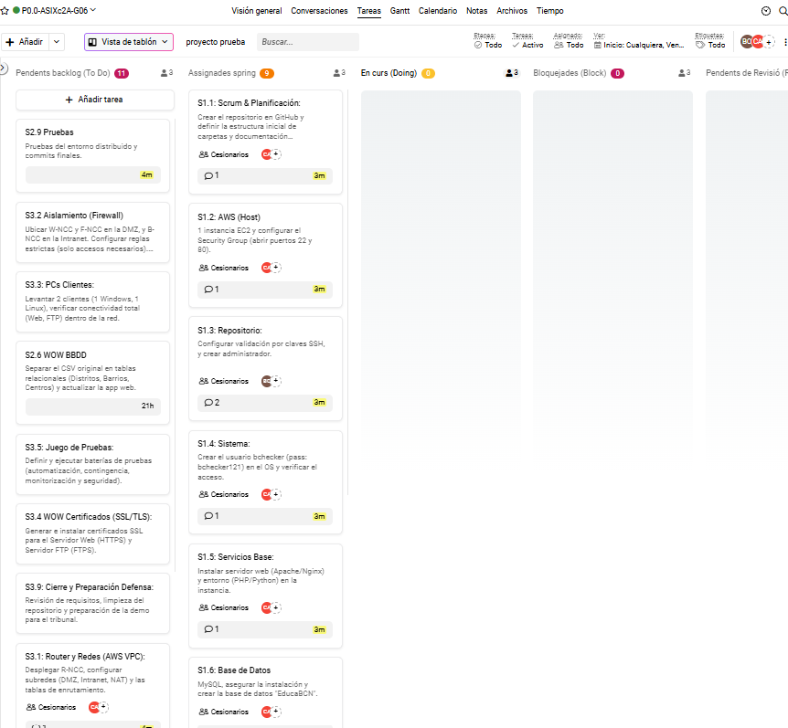
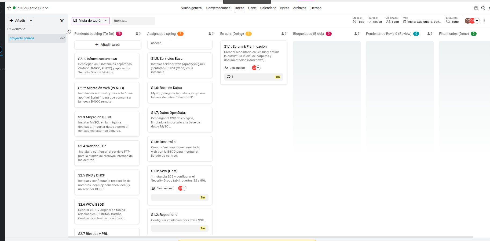

# Sprint 1: planificación

## Índice

- [Entregables definidos](#entregables-definidos)
- [Evidencia de tareas asignadas en ProofHub](#evidencia-de-tareas-asignadas-en-proofhub)
- [Backlog inicial documentado](#backlog-inicial-documentado)

**Objetivo:** conseguir un primer MVP que permita consultar registros educativos desde una web PHP conectada a MySQL en una instancia EC2.

Según las actas de 7, 13 y 20 de octubre de 2026, el equipo inició el repositorio y el backlog en ProofHub, distribuyó las tareas y organizó el despliegue de AWS, Apache, PHP y MySQL, la importación del dataset y la prueba final de la web.

**Participantes registrados:** Leonel Coello y Oussama Boukhali.

## Entregables definidos

1. Instancia Ubuntu Server con acceso administrativo.
2. Repositorio Git con estructura inicial de servicios.
3. Apache y PHP instalados.
4. Base de datos creada, datos importados y consultas verificadas.
5. Página de consulta del dataset desde el navegador.

## Evidencia de tareas asignadas en ProofHub

La siguiente imagen es una captura original aportada por el equipo. Muestra las tarjetas situadas en la columna **«Asignadas spring»**, los participantes asignados mediante los iconos de usuario, el backlog pendiente y las columnas de seguimiento. Acredita la planificación y el reparto, **no** que las tareas de esa columna estén terminadas.

Para verificar fechas exactas, comentarios y finalización se debe consultar el historial de la tarea dentro de ProofHub; estos datos no se deducen de esta vista general.

## Backlog inicial documentado

El backlog inicial se conserva también como captura original de ProofHub. Esta vista corresponde a una etapa temprana y muestra tareas en diferentes columnas, incluyendo tareas de sprints posteriores aún pendientes. Se aporta como evidencia histórica del registro del trabajo.

