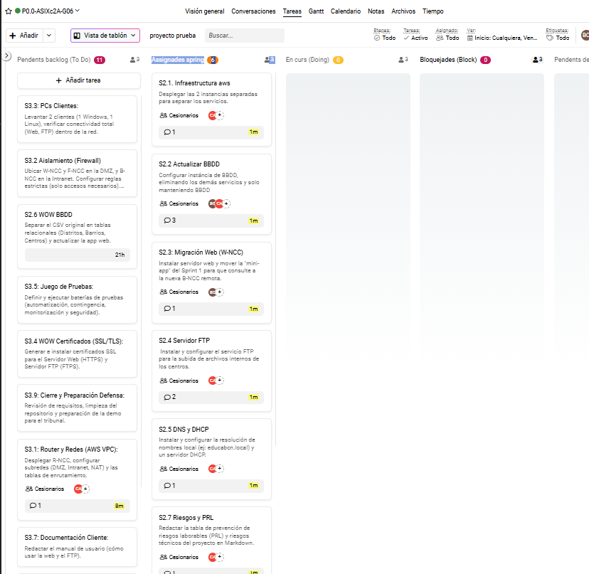

# Sprint 2: planificación

## Índice

- [Línea de trabajo](#linea-de-trabajo)
- [Evidencia de tareas asignadas en ProofHub](#evidencia-de-tareas-asignadas-en-proofhub)

**Objetivo:** separar Apache/PHP, MySQL y FTP en instancias independientes y añadir DNS/DHCP básicos, sin perder la consulta de los centros desde la aplicación.

En la reunión inicial del 28 de octubre de 2026 se justificó el nuevo MVP. La reunión del 2 de noviembre incluye como objetivos la configuración de la base de datos, FTP, DNS y DHCP. La reunión del 10 de noviembre registra B-NCC adaptada y W-NCC/F-NCC todavía en configuración, con la decisión de completar las máquinas y los servicios de nombres.

## Línea de trabajo

1. Crear instancias W-NCC y F-NCC y mantener B-NCC a partir del prototipo.
2. Preparar cuentas y comunicaciones privadas.
3. Migrar Apache/PHP y los archivos de la aplicación a W-NCC.
4. Habilitar conexión remota de lectura a MySQL en B-NCC.
5. Instalar vsftpd, BIND9 e ISC DHCP en F-NCC.
6. Verificar el funcionamiento de la web y los servicios auxiliares.

## Evidencia de tareas asignadas en ProofHub

La siguiente imagen es una captura original aportada por el equipo. Muestra las tarjetas situadas en la columna **«Asignadas spring»**, los participantes asignados mediante los iconos de usuario, el backlog pendiente y las columnas de seguimiento. Acredita la planificación y el reparto, **no** que las tareas de esa columna estén terminadas.

Para verificar fechas exactas, comentarios y finalización se debe consultar el historial de la tarea dentro de ProofHub; estos datos no se deducen de esta vista general.
