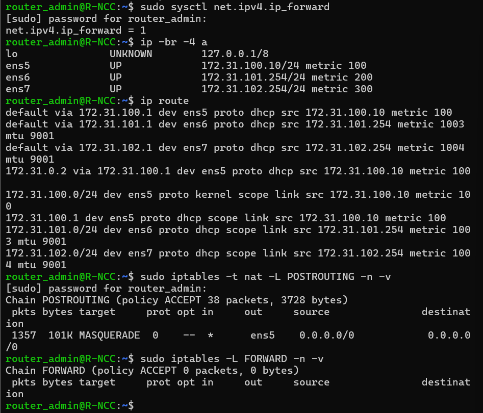
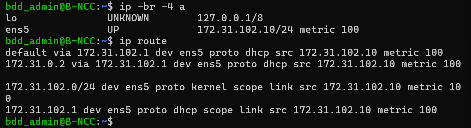
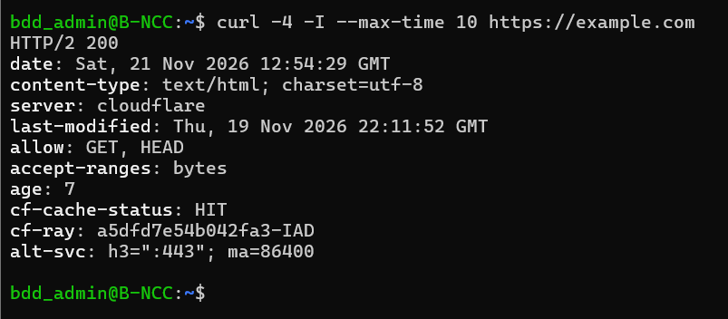
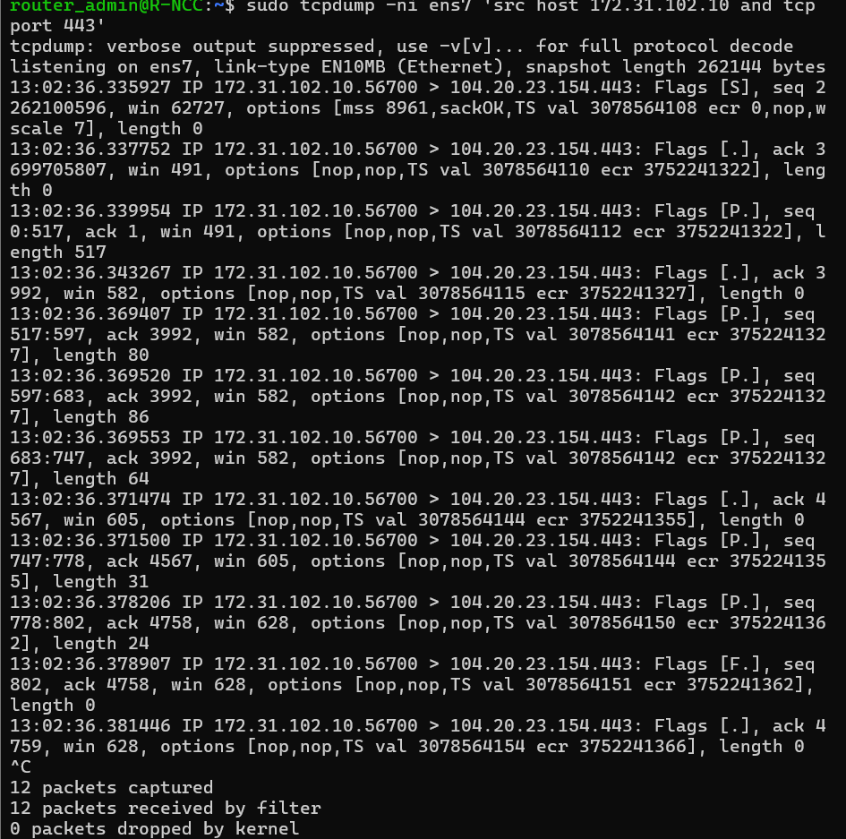
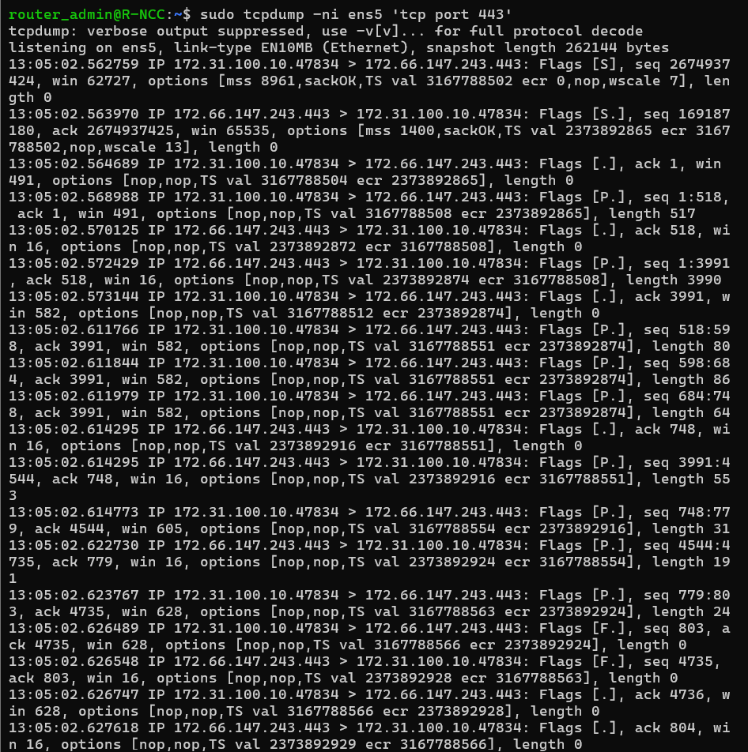
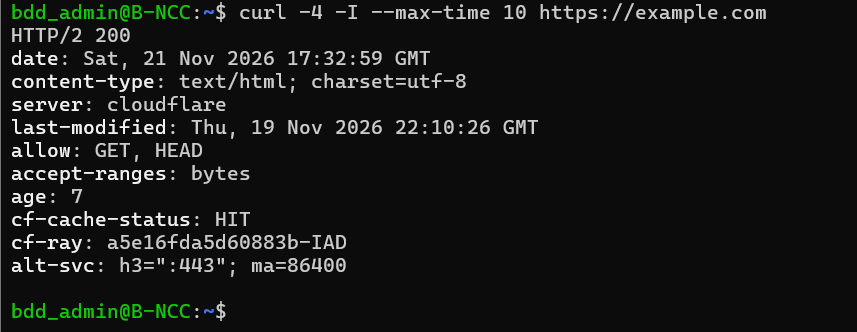
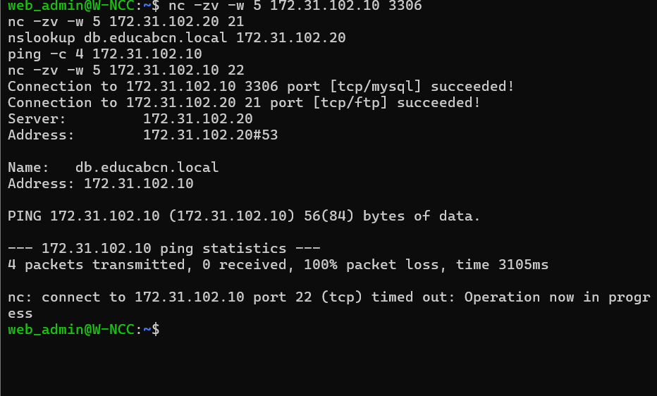

# Pruebas de segmentación y firewall: segunda etapa del Sprint 2

## Contexto y criterio de evidencia

Se documentan las pruebas de Router y Redes (S2.6) y Aislamiento/Firewall (S2.7), tareas que inicialmente figuraban en el backlog como S3.1 y S3.2. Cada resultado se relaciona con una captura original. Se distinguen **servicio disponible**, **conexión permitida**, **conexión bloqueada** y **encaminamiento a través de R-NCC**; una observación no demuestra automáticamente las demás.

## Resumen de resultados

| ID | Origen | Prueba | Resultado observado | Interpretación |
|---|---|---|---|---|
| SEG-01 | R-NCC | `ip -br -4 a` | `ens5`, `ens6` y `ens7` UP, con IP de cada red | Interfaces activas |
| SEG-02 | R-NCC | `sysctl net.ipv4.ip_forward` | `1` | Reenvío IPv4 habilitado |
| SEG-03 | R-NCC | `iptables -t nat ... POSTROUTING` | `MASQUERADE` por `ens5` | NAT configurado; contadores visibles |
| SEG-04 | AWS | Tablas RT-WAN / RT-INTRANET | WAN a IGW, Intranet a ENI de R-NCC | Ruta de salida configurada |
| SEG-05 | B-NCC | `ip -br -4 a`, `ip route` | `172.31.102.10`, gateway AWS `172.31.102.1` | Instancia en la Intranet |
| SEG-06 | B-NCC | `curl -4 -I ... example.com` | `HTTP/2 200` | Salida HTTPS funcional |
| SEG-07 | R-NCC | `tcpdump` en `ens7` | Paquetes de B-NCC hacia TCP/443 | La Intranet entrega tráfico a R-NCC |
| SEG-08 | R-NCC | `tcpdump` en `ens5` | Paquetes HTTPS con origen `172.31.100.10` | Tráfico WAN de R-NCC observado |
| FW-01 | W-NCC | `nc` a B-NCC:3306 | `succeeded` | MySQL accesible desde W-NCC |
| FW-02 | W-NCC | `nc` a F-NCC:21 | `succeeded` | Control FTP accesible |
| FW-03 | W-NCC | `nslookup db...` a F-NCC | `172.31.102.10` | Nombre de B-NCC resuelve a IP actual |
| FW-04 | W-NCC | `ping` a B-NCC | 100 % de pérdida | No se recibieron respuestas ICMP |
| FW-05 | W-NCC | `nc` a B-NCC:22 | `timed out` | El SSH directo desde W-NCC no se completó |
| FW-06 | B-NCC | `curl -4 -I ... example.com` | `HTTP/2 200` | La salida a Internet continuó funcionando tras aplicar los grupos |

### Evidencias de Router y Redes

La captura reúne interfaces, rutas, IP Forwarding y configuración NAT; `FORWARD` aparece sin reglas específicas y con política `ACCEPT`.

B-NCC utiliza la dirección `172.31.102.10` en la subred Intranet.

La respuesta `HTTP/2 200` confirma conectividad HTTPS con el exterior.

La captura registra tráfico HTTPS hacia Internet procedente de B-NCC.

La captura registra tráfico HTTPS desde la IP WAN de R-NCC. Los destinos mostrados en ambas capturas son distintos, así que estas imágenes no prueban por sí solas la traducción de un mismo flujo. Se conserva esta precisión para no sobreinterpretar la prueba.

### Evidencias de aislamiento con Security Groups

Los cuatro grupos y sus reglas de entrada y salida se documentan con las capturas de su creación en [firewall y acceso](../security/configuracion-accesos.md).

B-NCC continuó llegando al servicio externo (`HTTP/2 200`).

MySQL (3306), FTP (21) y resolución DNS funcionaron; no hubo respuestas ICMP ni se completó la conexión directa SSH a B-NCC (22).

## Comprobaciones a diferenciar de los resultados ya obtenidos

- Que TCP/21 sea accesible no certifica una transferencia de archivos FTP completa ni cifrada.
- Que TCP/3306 acepte conexiones no certifica una consulta SQL ejecutada desde la aplicación PHP tras cambiar la IP de B-NCC.
- Que DNS resuelva correctamente `db.educabcn.local` no certifica por sí solo que todos los clientes hayan actualizado sus cachés DNS ni que el nombre web se haya comprobado después de la recarga.
- Que SSH por `ProxyJump` funcione no implica que esté restringido el acceso SSH a R-NCC por origen: su regla de entrada conservó `0.0.0.0/0`.
- La política `FORWARD ACCEPT` sin reglas granulares no acredita un bloqueo global de tráfico entre la DMZ y la Intranet.
- La ausencia de respuesta a `ping` puede deberse al filtrado ICMP; no demuestra que otros puertos estén cerrados.

## Cierre de evidencias

Las capturas registradas son suficientes para explicar lo que se configuró y se comprobó de forma puntual. Las pruebas de disponibilidad prolongada, rendimiento con métricas, restauración, cifrado FTP y una matriz exhaustiva de aislamiento entre zonas no aparecen en estas evidencias y no se declaran realizadas.
